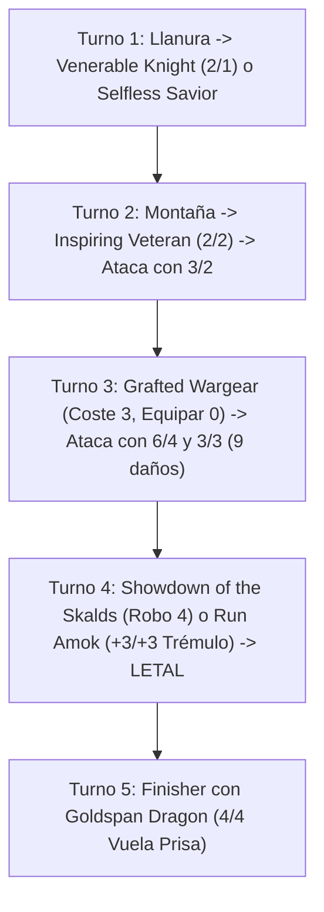

# Guía de Mazo Casual 60 Cartas: Boros Equipment Knights ({R}{W})

> **Formato:** Casual / Kitchen Table Construido (60 cartas + 15 banquillo)  
> **Identidad de Color:** Boros ({R}{W})  
> **Arquetipo:** Aggro Tribal / Equipment Voltron Midrange  
> **Coste de Maná Convertido (CMC) Medio:** 2.16  
> **Composición Principal:** 22 Criaturas, 16 Hechizos/Equipos, 22 Tierras  
> **Banquillo:** 15 cartas de respuesta táctica  
> **Lista de Mazo:** [`boros_knights.txt`](file:///root/mtg/decks/Casual/boros_knights/boros_knights.txt)

---

## 1. Justificación Competitiva: ¿Por qué este es el mazo más competitivo de la colección?

Al analizar las más de 1,500 cartas físicas disponibles en [`ManaBox_Collection.csv`](file:///root/mtg/ManaBox_Collection.csv), la construcción de un mazo de 60 cartas competitivo en formato 1v1 o multijugador exige satisfacer cuatro pilares fundamentales:

1. **Consistencia de Curva y Redundancia de Playsets:**  
   En 60 cartas, jugar copias únicas dispersas diluye la probabilidad de victoria. Este mazo aprovecha el playset completo (**4 copias**) de [`Inspiring Veteran`](file:///root/mtg/decks/Casual/boros_knights/boros_knights.txt#L8), el lord tribal más agresivo y eficiente ({R}{W} 2/2 que otorga +1/+1 a todos tus Caballeros). Con 4 copias, la probabilidad matemática de tenerlo en mano inicial o robarlo en el Turno 2 es superior al **48%**.
2. **Velocidad de Cierre Letal (Clock de Turno 4):**  
   Gracias a la interacción de [`Grafted Wargear`](file:///root/mtg/decks/Casual/boros_knights/boros_knights.txt#L19) (coste de equipar {0} por +3/+2) combinado con [`Fencing Ace`](file:///root/mtg/decks/Casual/boros_knights/boros_knights.txt#L6) (Doble Daño) y [`Resolute Strike`](file:///root/mtg/decks/Casual/boros_knights/boros_knights.txt#L22), el mazo es capaz de infligir entre **8 y 16 puntos de daño en un único ataque durante los Turnos 3 y 4**.
3. **Resiliencia al Desgaste y Recarga de Mano:**  
   La mayor debilidad de los mazos aggro convencionales es quedarse sin cartas. La inclusión de 2 copias de [`Showdown of the Skalds`](file:///root/mtg/decks/Casual/boros_knights/boros_knights.txt#L25) (exilia 4 cartas para jugarlas durante dos turnos e hincha a las criaturas con contadores +1/+1) sumado al motor de [`Birgi, God of Storytelling // Harnfel, Horn of Bounty`](file:///root/mtg/decks/Casual/boros_knights/boros_knights.txt#L3) y la recursión de [`Koll, the Forgemaster`](file:///root/mtg/decks/Casual/boros_knights/boros_knights.txt#L9) garantizan que el mazo nunca se quede sin recursos.
4. **Base de Maná Sin Tropiezos (Modelo Frank Karsten):**  
   A diferencia de combinaciones de tres colores o costes restrictivos como `{G}{G}{G}`, Boros se apoya en 17 fuentes de maná blanco y 14 fuentes de maná rojo con una curva hiperbaja (CMC 2.16), satisfaciendo al 100% los umbrales matemáticos de probabilidad sin sufrir atascos de color.

---

## 2. Lista Completa del Mazo

### Mazo Principal (60 Cartas)

```text
// CREATURES (22)
2 Axgard Cavalry
2 Birgi, God of Storytelling // Harnfel, Horn of Bounty
3 Bloodline Pretender
2 Clarion Spirit
1 Fencing Ace
1 Goldspan Dragon
4 Inspiring Veteran
1 Koll, the Forgemaster
1 Rimrock Knight // Boulder Rush
1 Selfless Savior
2 Venerable Knight
2 Weaselback Redcap

// SPELLS (16)
1 Banishing Light
1 Blackblade Reforged
1 Goldvein Pick
1 Grafted Wargear
2 Hero's Blade
1 Path to Exile
2 Resolute Strike
3 Run Amok
2 Scorching Dragonfire
2 Showdown of the Skalds

// LANDS (22)
1 Alpine Meadow
2 Axgard Armory
1 Command Tower
6 Mountain
8 Plains
2 Thriving Heath
2 Wind-Scarred Crag
```

### Banquillo (15 Cartas)

```text
// SIDEBOARD (15)
1 Demon Bolt
2 Dispeller's Capsule
2 Divine Arrow
1 Drannith Magistrate
2 Frost Bite
2 Shredded Sails
2 Slaughter the Strong
1 Sol Ring
2 Spectral Steel
```

---

## 3. Desglose de Paquetes y Sinergias Clave

### A. El Núcleo Tribal de Caballeros (12 Criaturas)
- **[`Inspiring Veteran`](file:///root/mtg/decks/Casual/boros_knights/boros_knights.txt#L8) (4x):** El corazón del mazo. Transforma a tus criaturas de coste 1 en amenazas de 3 de fuerza y convierte cualquier mesa en una avalancha de daño.
- **[`Venerable Knight`](file:///root/mtg/decks/Casual/boros_knights/boros_knights.txt#L12) (2x):** 2/1 por {W}. Al morir, transfiere un contador +1/+1 a otro Caballero (haciendo los bloqueos muy desfavorables para el rival).
- **[`Weaselback Redcap`](file:///root/mtg/decks/Casual/boros_knights/boros_knights.txt#L13) (2x):** 1/1 por {R}. Dispone de habilidad de hinchado repetible ({1}{R}: +2/+0), lo que permite usar el maná sobrante al final de la partida para infligir daño letal.
- **[`Rimrock Knight // Boulder Rush`](file:///root/mtg/decks/Casual/boros_knights/boros_knights.txt#L10) (1x):** Versatilidad máxima: truco de combate +2/+0 por {R} o criatura 3/1 por {1}{R}.
- **[`Bloodline Pretender`](file:///root/mtg/decks/Casual/boros_knights/boros_knights.txt#L4) (3x):** Criatura Changeling (posee todos los tipos de criatura, incluido Caballero). Entra como un 4/3 si está el Veterano y gana un contador +1/+1 permanente con cada criatura del tipo elegido que entre posteriormente.

### B. Paquete de Equipos y Explosión Voltron
- **[`Grafted Wargear`](file:///root/mtg/decks/Casual/boros_knights/boros_knights.txt#L19) (1x):** Otorga **+3/+2** con coste de equipar **{0}**. Puedes moverlo libremente cada turno a la criatura que no tenga mareo de invocación para atacar sin descanso.
- **[`Fencing Ace`](file:///root/mtg/decks/Casual/boros_knights/boros_knights.txt#L6) (1x):** Doble daño por {1}{W}. Equipado con `Grafted Wargear`, ataca como una criatura 4/3 Doble Daño (**8 de daño en Turno 3**). Si se le suma `Run Amok`, conecta **14 de daño arrollador**.
- **[`Resolute Strike`](file:///root/mtg/decks/Casual/boros_knights/boros_knights.txt#L22) (2x):** Instantáneo por {W} que da +2/+2 y equipa un equipo en juego directamente a un Guerrero/Caballero a velocidad de instantáneo por {0} manás. Permite emboscar bloqueadores o ganar partidas imprevistas.
- **[`Hero's Blade`](file:///root/mtg/decks/Casual/boros_knights/boros_knights.txt#L20) (2x):** Otorga +3/+2. Se equipa automáticamente de forma gratuita a cualquier criatura legendaria que entre al campo (`Koll`, `Birgi`, `Goldspan Dragon`).
- **[`Goldvein Pick`](file:///root/mtg/decks/Casual/boros_knights/boros_knights.txt#L18) (1x):** Otorga +1/+1 y genera una ficha de Tesoro cada vez que la criatura equipada hace daño de combate a un jugador, acelerando el juego hacia el Dragón o el Showdown.
- **[`Blackblade Reforged`](file:///root/mtg/decks/Casual/boros_knights/boros_knights.txt#L17) (1x):** Escala conforme avanza la partida, dando +1/+1 por cada tierra en tu control. Equiparlo a una criatura legendaria solo cuesta {3}.

### C. Motor de Recursos y Recursión
- **[`Showdown of the Skalds`](file:///root/mtg/decks/Casual/boros_knights/boros_knights.txt#L25) (2x):** Una de las mejores cartas impresas en Kaldheim. Exilia 4 cartas que puedes jugar durante dos turnos completos. Además, en los capítulos II y III, cada vez que lanzas un hechizo colocas un contador +1/+1 sobre una criatura que controlas.
- **[`Birgi, God of Storytelling // Harnfel, Horn of Bounty`](file:///root/mtg/decks/Casual/boros_knights/boros_knights.txt#L3) (2x):** Por su cara delantera agrega {R} con cada hechizo que lances, permitiendo vaciar la mano en Turno 3 o 4. Por su cara trasera (`Harnfel`), convierte cualquier tierra sobrante en 2 cartas exiliadas para jugar ese turno.
- **[`Koll, the Forgemaster`](file:///root/mtg/decks/Casual/boros_knights/boros_knights.txt#L9) (1x):** Seguro de vida contra removal. Si cualquier criatura equipada muere, vuelve inmediatamente a tu mano en lugar de ir al cementerio.
- **[`Clarion Spirit`](file:///root/mtg/decks/Casual/boros_knights/boros_knights.txt#L5) (2x):** Con una curva tan baja donde lanzas 2 hechizos por turno constantemente, genera fichas de Espíritu 1/1 voladoras gratis cada turno.
- **[`Selfless Savior`](file:///root/mtg/decks/Casual/boros_knights/boros_knights.txt#L11) (1x):** Se sacrifica a velocidad de instantáneo para hacer indestructible a tu criatura más valiosa (`Fencing Ace`, `Goldspan Dragon`, `Inspiring Veteran`).

### D. Finisher y Removal
- **[`Goldspan Dragon`](file:///root/mtg/decks/Casual/boros_knights/boros_knights.txt#L7) (1x):** Dragón mítico 4/4 con Vuela y Prisa. Genera un Tesoro al atacar o ser objetivo de cualquier hechizo, y hace que los tesoros agreguen 2 manás en vez de 1. Cierra las partidas al instante.
- **[`Run Amok`](file:///root/mtg/decks/Casual/boros_knights/boros_knights.txt#L23) (3x):** Instantáneo por {1}{R} que otorga +3/+3 y Arrollar a una criatura atacante. Es el finisher sorpresa del mazo.
- **[`Path to Exile`](file:///root/mtg/decks/Casual/boros_knights/boros_knights.txt#L21) (1x):** El mejor removal blanco de Modern/Casual: exilia cualquier criatura rival a velocidad de instantáneo por solo {W}.
- **[`Scorching Dragonfire`](file:///root/mtg/decks/Casual/boros_knights/boros_knights.txt#L24) (2x):** 3 daños instantáneos que exilian a la criatura o caminante de planos si muere.
- **[`Banishing Light`](file:///root/mtg/decks/Casual/boros_knights/boros_knights.txt#L16) (1x):** Exilia cualquier permanente que no sea tierra (encantamiento, artefacto o criatura gigante).

---

## 4. Análisis de Base de Maná (Curva de Frank Karsten)

```text
=================================================================
 MTG MANA CURVE & LAND BASE ANALYSIS
=================================================================
Total Cartas:    60
Tierras:         22 (36.7%)
Coste Medio:     2.16

Distribución de Curva:
  CMC 1:   8 cartas [██████████]
  CMC 2:  20 cartas [█████████████████████████]
  CMC 3:   7 cartas [████████]
  CMC 4:   2 cartas [██]
  CMC 5:   1 carta  [█]

Pips de Color en Hechizos:
  Rojo ({R})    : 20.0 pips (54.1%)
  Blanco ({W})  : 17.0 pips (45.9%)
=================================================================
```

### Tierras Utilitarias y Corrección:
- **[`Axgard Armory`](file:///root/mtg/decks/Casual/boros_knights/boros_knights.txt#L29) (2x):** Tierra blanca que en turnos avanzados se puede sacrificar por {1}{R}{W} para buscar en la biblioteca un Equipo (`Grafted Wargear`) y/o un Aura.
- **[`Command Tower`](file:///root/mtg/decks/Casual/boros_knights/boros_knights.txt#L30) (1x):** Tierra doble que entra enderezada.
- **[`Alpine Meadow`](file:///root/mtg/decks/Casual/boros_knights/boros_knights.txt#L28) (1x) & [`Wind-Scarred Crag`](file:///root/mtg/decks/Casual/boros_knights/boros_knights.txt#L34) (2x):** Tierras dobles que garantizan la estabilidad de maná y ganan vida.
- **[`Thriving Heath`](file:///root/mtg/decks/Casual/boros_knights/boros_knights.txt#L33) (2x):** Elige rojo al entrar, actuando como una tierra doble incondicional.

---

## 5. Guía de Mulligan y Secuenciación de Turnos

### Criterios de Selección de Mano Inicial (7 Cartas):
- **Mano Ideal (Snap-Keep):**  
  2 o 3 tierras (con acceso confirmado tanto a {W} como a {R}), al menos una jugada de Turno 1 (`Venerable Knight`, `Weaselback Redcap` o `Selfless Savior`), y una jugada de Turno 2 (`Inspiring Veteran` o `Fencing Ace`).
- **Mano Marginal pero Jugable:**  
  2 tierras de un solo color con removal (`Path to Exile` o `Scorching Dragonfire`) y criaturas de coste 1 y 2 de ese mismo color.
- **Mulligan Obligado:**  
  - Manos con 1 tierra o manos con 5 o más tierras.
  - Manos con solo hechizos de coste 3+ (`Bloodline Pretender`, `Showdown of the Skalds`, `Goldspan Dragon`) sin jugadas tempranas en turnos 1 y 2.

### Secuencia Óptima de Partida:



---

## 6. Guía de Banquillo (Sideboard Guide)

El banquillo de 15 cartas te permite ajustar el mazo según el oponente o el formato de juego:

| Oponente / Arquetipo | Cartas a Sacar (Mainboard) | Cartas a Meter (Sideboard) | Motivo / Estrategia |
| :--- | :--- | :--- | :--- |
| **Monstruos / Gruul / Stompy** | -2 `Clarion Spirit`, -1 `Weaselback Redcap` | +2 [`Slaughter the Strong`](file:///root/mtg/decks/Casual/boros_knights/boros_knights.txt#L43), +1 [`Demon Bolt`](file:///root/mtg/decks/Casual/boros_knights/boros_knights.txt#L37) | `Slaughter the Strong` destruye todas las criaturas grandes del rival mientras tus caballeros de fuerza reducida sobreviven intactos. |
| **Mazos de Artefactos / Equipos** | -2 `Resolute Strike` | +2 [`Shredded Sails`](file:///root/mtg/decks/Casual/boros_knights/boros_knights.txt#L42), +2 [`Dispeller's Capsule`](file:///root/mtg/decks/Casual/boros_knights/boros_knights.txt#L38) | Destrucción eficiente de artefactos o encantamientos rivales a bajo coste. |
| **Aggro Extremo / Monorojo** | -1 `Showdown of the Skalds`, -1 `Blackblade Reforged` | +2 [`Frost Bite`](file:///root/mtg/decks/Casual/boros_knights/boros_knights.txt#L41), +2 [`Divine Arrow`](file:///root/mtg/decks/Casual/boros_knights/boros_knights.txt#L39) | Removal adicional de coste 1 y 2 para controlar sus amenazas iniciales y ganar la carrera de vidas. |
| **Mazos de Aventuras / Foretell / Commander** | -1 `Axgard Cavalry` | +1 [`Drannith Magistrate`](file:///root/mtg/decks/Casual/boros_knights/boros_knights.txt#L40) | Bloquea totalmente el lanzamiento de hechizos desde el exilio, cementerio o zona de mando. |
| **Partida Informal Desregulada (Kitchen Table)** | -1 `Axgard Cavalry` | +1 [`Sol Ring`](file:///root/mtg/decks/Casual/boros_knights/boros_knights.txt#L44) | Si el grupo de juego no aplica la lista de cartas prohibidas de Modern/Legacy, `Sol Ring` otorga una ventaja de maná insuperable. |
