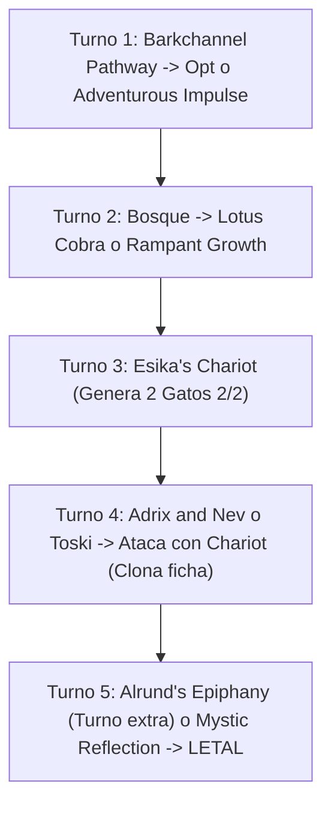

# Guía de Mazo Casual 60 Cartas: Simic Chariot Tokens & Ramp ({G}{U})

> **Formato:** Casual / Kitchen Table Construido (60 cartas + 15 banquillo)  
> **Identidad de Color:** Simic ({G}{U})  
> **Arquetipo:** Midrange Ramp / Token Multiplier Tempo  
> **Coste de Maná Convertido (CMC) Medio:** 2.54  
> **Composición Principal:** 20 Criaturas, 17 Hechizos/Vehículos/Sagas, 23 Tierras  
> **Banquillo:** 15 cartas de adaptación táctica  
> **Lista de Mazo:** [`simic_chariot.txt`](file:///root/mtg/decks/Casual/simic/simic_chariot.txt)

---

## 1. Justificación y Potencial del Mazo con el Pool Restante

Tras construir el mazo [`boros_knights.txt`](file:///root/mtg/decks/Casual/boros/boros_knights.txt), el inventario restante contiene **1,451 cartas físicas** completamente intactas en los colores Verde ({G}), Azul ({U}) y Negro ({B}). 

Este mazo reúne las cartas de mayor potencia individual y sinergia disponibles en la colección:
1. **Multiplicación Exponencial de Fichas:**  
   La interacción entre el comandante mítico [`Adrix and Nev, Twincasters`](file:///root/mtg/decks/Casual/simic/simic_chariot.txt#L2) (duplica cada ficha creada) y el vehículo estelar [`Esika's Chariot`](file:///root/mtg/decks/Casual/simic/simic_chariot.txt#L18) permite inundar la mesa: cuando el Carro entra, crea **CUATRO gatos 2/2**, y cada vez que ataca, duplica cualquier ficha creando **dos copias adicionales**.
2. **Motor de Robo Incontestable e Indestructible:**  
   [`Toski, Bearer of Secrets`](file:///root/mtg/decks/Casual/simic/simic_chariot.txt#L12) no puede ser contrarrestado ni destruido. Al atacar junto a la horda de gatos generada por el Carro, roba entre 3 y 5 cartas por turno, imposibilitando que el oponente gane por desgaste.
3. **Rampa Acelerada y Filtrado Temprano:**  
   Con 8 fuentes de rampa y aceleración ([`Lotus Cobra`](file:///root/mtg/decks/Casual/simic/simic_chariot.txt#L10), [`Rampant Growth`](file:///root/mtg/decks/Casual/simic/simic_chariot.txt#L22), [`Deranged Assistant`](file:///root/mtg/decks/Casual/simic/simic_chariot.txt#L5) y [`Farhaven Elf`](file:///root/mtg/decks/Casual/simic/simic_chariot.txt#L7)), el mazo salta de 2 a 4 manás en el Turno 3, jugando amenazas dominantes dos turnos antes de lo previsto.
4. **El Combo Letal de [`Mystic Reflection`](file:///root/mtg/decks/Casual/simic/simic_chariot.txt#L20):**  
   Al lanzar `Mystic Reflection` en respuesta a la entrada de [`Esika's Chariot`](file:///root/mtg/decks/Casual/simic/simic_chariot.txt#L18) haciendo objetivo a [`Old-Growth Troll`](file:///root/mtg/decks/Casual/simic/simic_chariot.txt#L11) o [`Battle Mammoth`](file:///root/mtg/decks/Casual/simic/simic_chariot.txt#L4), las fichas que entran no son simples gatos 2/2, sino **copias exactas de 4/4 o 6/5 con Arrollar** (¡y con Adrix & Nev en mesa entran cuatro copias simultáneamente!).
5. **Cierre Incondicional con Turno Extra:**  
   [`Alrund's Epiphany`](file:///root/mtg/decks/Casual/simic/simic_chariot.txt#L16) otorga un turno adicional y genera dos fichas de ave 1/1 voladoras, permitiendo rematar partidas sin que el oponente tenga derecho a responder.

---

## 2. Lista Completa del Mazo

### Mazo Principal (60 Cartas)

```text
// CREATURES (20)
2 Adrix and Nev, Twincasters
2 Almighty Brushwagg
1 Battle Mammoth
3 Deranged Assistant
2 Faerie Vandal
2 Farhaven Elf
2 Fynn, the Fangbearer
1 Garruk, Primal Hunter
1 Lotus Cobra
2 Old-Growth Troll
2 Toski, Bearer of Secrets

// SPELLS (17)
2 Adventurous Impulse
1 Alrund's Epiphany
2 Blizzard Brawl
2 Esika's Chariot
2 Into the Roil
1 Mystic Reflection
1 Opt
2 Rampant Growth
1 Rapid Hybridization
1 Snakeskin Veil
2 The Bears of Littjara

// LANDS (23)
2 Barkchannel Pathway // Tidechannel Pathway
1 Command Tower
8 Forest
5 Island
1 Lumbering Falls
2 Rimewood Falls
1 Simic Growth Chamber
1 Temple of Mystery
2 Thornwood Falls
```

### Banquillo (15 Cartas)

```text
// SIDEBOARD (15)
1 Annul
1 Blizzard Brawl
1 Broken Wings
1 Champion of Wits
2 Chilling Trap
1 Curse of the Swine
2 Elven Bow
1 Perplexing Test
1 Return of the Wildspeaker
1 Sol Ring
1 Whirlwind Denial
2 Wilt
```

---

## 3. Desglose de Paquetes y Sinergias Clave

### A. El Núcleo de Fichas y Multiplicación
- **[`Adrix and Nev, Twincasters`](file:///root/mtg/decks/Casual/simic/simic_chariot.txt#L2) (2x):** Criatura legendaria mítica que duplica automáticamente el número de fichas que creas.
- **[`Esika's Chariot`](file:///root/mtg/decks/Casual/simic/simic_chariot.txt#L18) (2x):** Vehículo legendario dominante en Pioneer/Estándar. Crea dos fichas de Gato 2/2 al entrar (o cuatro con Adrix). Al atacar, clona cualquier ficha que controles (gatos, osos 4/4 o fichas de Troll).
- **[`The Bears of Littjara`](file:///root/mtg/decks/Casual/simic/simic_chariot.txt#L25) (2x):** Saga rara de Kaldheim. Capítulo I crea una ficha 2/2 con todos los tipos; Capítulo II convierte fichas en 4/4s base; Capítulo III hace que una criatura luche contra una amenaza rival.
- **[`Mystic Reflection`](file:///root/mtg/decks/Casual/simic/simic_chariot.txt#L20) (1x):** Instantáneo flexible por {1}{U} con Profetizar {U}. Se puede usar a la ofensiva para transformar tus próximas fichas en copias de tu mejor criatura, o a la defensiva para transformar la mejor criatura del oponente en un inocuo 1/1 al entrar.

### B. El Motor de Rampa y Ventaja de Cartas
- **[`Toski, Bearer of Secrets`](file:///root/mtg/decks/Casual/simic/simic_chariot.txt#L12) (2x):** Criatura 1/1 indestructible que no puede ser contrarrestada. Cada vez que una de tus criaturas conecta daño a un jugador, robas una carta. Con la multitud de fichas del mazo, garantiza manos llenas de forma perpetua.
- **[`Lotus Cobra`](file:///root/mtg/decks/Casual/simic/simic_chariot.txt#L10) (1x):** Genera 1 maná de cualquier color en cada Aterrizaje (*Landfall*), acelerando salidas explosivas.
- **[`Deranged Assistant`](file:///root/mtg/decks/Casual/simic/simic_chariot.txt#L5) (3x):** Criatura 1/1 por {1}{U} que gira para agregar {1} al precio de moler 1 carta.
- **[`Rampant Growth`](file:///root/mtg/decks/Casual/simic/simic_chariot.txt#L22) (2x) & [`Farhaven Elf`](file:///root/mtg/decks/Casual/simic/simic_chariot.txt#L7) (2x):** Buscan tierras básicas de la biblioteca directamente al campo para acelerar y estabilizar colores.
- **[`Garruk, Primal Hunter`](file:///root/mtg/decks/Casual/simic/simic_chariot.txt#L9) (1x):** Caminante de planos mítico: su +1 crea fichas de Bestia 3/3 (que se duplican con Adrix), y su -3 roba cartas igual a la mayor fuerza entre tus criaturas.

### C. Presión Temprana y Amenazas de Curva
- **[`Old-Growth Troll`](file:///root/mtg/decks/Casual/simic/simic_chariot.txt#L11) (2x):** 4/4 con Arrollar por `{G}{G}{G}`. Al morir rampa una tierra, y desde la tierra se puede sacrificar para crear otra ficha 4/4 con Arrollar (lista para ser clonada por `Esika's Chariot`).
- **[`Fynn, the Fangbearer`](file:///root/mtg/decks/Casual/simic/simic_chariot.txt#L8) (2x):** 1/3 con Toque Mortal que coloca 2 contadores de veneno cada vez que una criatura con toque mortal conecta daño a un jugador. Actúa como bloqueador disuasorio supremo o condición alternativa de victoria con 10 contadores.
- **[`Faerie Vandal`](file:///root/mtg/decks/Casual/simic/simic_chariot.txt#L6) (2x):** Vuela y Destello por {1}{U}. Gana un contador +1/+1 cada vez que robas tu segunda carta del turno (altamente sinérgico con `Toski` y cantrips).
- **[`Battle Mammoth`](file:///root/mtg/decks/Casual/simic/simic_chariot.txt#L4) (1x):** 6/5 con Arrollar y Profetizar {3}{G}. Cada vez que un permanente tuyo es objetivo de un hechizo rival, robas una carta.

### D. Interacción y Trucos Tácticos
- **[`Rapid Hybridization`](file:///root/mtg/decks/Casual/simic/simic_chariot.txt#L23) (1x):** Removal incondicional por {U} a velocidad de instantáneo: destruye cualquier monstruo rival a cambio de dejarle un 3/3 sin habilidades.
- **[`Blizzard Brawl`](file:///root/mtg/decks/Casual/simic/simic_chariot.txt#L17) (2x):** Hechizo de lucha por {G} que con permanentes nevados otorga +1/+0 e indestructible a tu criatura.
- **[`Into the Roil`](file:///root/mtg/decks/Casual/simic/simic_chariot.txt#L19) (2x):** Rebote instantáneo versátil para frenar jugadas rivales, con Estímulo opcional para robar carta.
- **[`Snakeskin Veil`](file:///root/mtg/decks/Casual/simic/simic_chariot.txt#L24) (1x):** Protección instantánea por {G} que otorga Antimaleficio (*Hexproof*) y un contador +1/+1 para frustrar el removal dirigido.

---

## 4. Análisis de Base de Maná (Curva de Frank Karsten)

```text
=================================================================
 MTG MANA CURVE & LAND BASE ANALYSIS
=================================================================
Total Cartas:    60
Tierras:         23 (38.3%)
Aceleradores:    8 fuentes de rampa / maná
Coste Medio:     2.54

Distribución de Curva:
  CMC 1:   9 cartas [█████████████████]
  CMC 2:  13 cartas [█████████████████████████]
  CMC 3:   6 cartas [███████████]
  CMC 4:   6 cartas [███████████]
  CMC 5:   2 cartas [███]
  CMC 7+:  1 carta  [█]

Pips de Color en Hechizos:
  Verde ({G})   : 33.0 pips (67.3%)
  Azul ({U})    : 16.0 pips (32.7%)
=================================================================
```

### Fuentes de Color y Tierras Especiales:
- **Fuentes Verdes (18 totales):** 8 [`Forest`](file:///root/mtg/decks/Casual/simic/simic_chariot.txt#L30) + 2 [`Barkchannel Pathway // Tidechannel Pathway`](file:///root/mtg/decks/Casual/simic/simic_chariot.txt#L28) + 1 [`Command Tower`](file:///root/mtg/decks/Casual/simic/simic_chariot.txt#L29) + 1 [`Lumbering Falls`](file:///root/mtg/decks/Casual/simic/simic_chariot.txt#L32) + 2 [`Rimewood Falls`](file:///root/mtg/decks/Casual/simic/simic_chariot.txt#L33) + 1 [`Simic Growth Chamber`](file:///root/mtg/decks/Casual/simic/simic_chariot.txt#L34) + 1 [`Temple of Mystery`](file:///root/mtg/decks/Casual/simic/simic_chariot.txt#L35) + 2 [`Thornwood Falls`](file:///root/mtg/decks/Casual/simic/simic_chariot.txt#L36).  
  *Cumple exactamente el umbral de Frank Karsten (18 fuentes) para lanzar [`Old-Growth Troll`](file:///root/mtg/decks/Casual/simic/simic_chariot.txt#L11) en Turno 3.*
- **Fuentes Azules (15 totales):** 5 [`Island`](file:///root/mtg/decks/Casual/simic/simic_chariot.txt#L31) + todas las tierras dobles compartidas.  
  *Garantiza maná azul disponible en Turno 1 o 2 con más del 92% de probabilidad matemática.*

---

## 5. Guía de Mulligan y Secuenciación de Partida

### Criterios de Mano Inicial (7 Cartas):
- **Mano Ideal (Snap-Keep):**  
  2 o 3 tierras (con acceso a {G} y {U}), 1 acelerador de Turno 2 (`Lotus Cobra`, `Rampant Growth` o `Deranged Assistant`), y 1 amenaza de coste 3 o 4 (`Esika's Chariot`, `The Bears of Littjara` o `Old-Growth Troll`).
- **Mano de Control / Interacción:**  
  3 tierras, cantrip (`Opt` o `Adventurous Impulse`), removal temprano (`Rapid Hybridization` o `Blizzard Brawl`) y `Toski`.
- **Mulligan Obligado:**  
  - Manos sin fuentes verdes (impiden desarrollar el 67% del mazo).
  - Manos con 5 o más tierras sin motores de robo activos.

### Secuencia Óptima de Juego:



---

## 6. Guía de Banquillo (Sideboard Guide)

El banquillo de 15 cartas permite reconfigurar el mazo contra los emparejamientos más habituales:

| Oponente / Arquetipo | Cartas a Sacar (Mainboard) | Cartas a Meter (Sideboard) | Motivo / Estrategia |
| :--- | :--- | :--- | :--- |
| **Control / Counters Masivos** | -1 `Rapid Hybridization`, -2 `Adventurous Impulse` | +1 [`Whirlwind Denial`](file:///root/mtg/decks/Casual/simic/simic_chariot.txt#L49), +1 [`Champion of Wits`](file:///root/mtg/decks/Casual/simic/simic_chariot.txt#L42), +1 [`Return of the Wildspeaker`](file:///root/mtg/decks/Casual/simic/simic_chariot.txt#L47) | Protege tus hechizos clave, contraataca habilidades de planeswalkers y recarga la mano tras un limpiamesas. |
| **Aggro Rápido / Quemadura (Burn)** | -1 `Alrund's Epiphany`, -1 `Garruk, Primal Hunter` | +2 [`Chilling Trap`](file:///root/mtg/decks/Casual/simic/simic_chariot.txt#L43), +2 [`Elven Bow`](file:///root/mtg/decks/Casual/simic/simic_chariot.txt#L45) | `Chilling Trap` frena un atacante clave y cicla carta; `Elven Bow` entra con destello creando un bloqueador con alcance. |
| **Artefactos y Encantamientos** | -2 `Into the Roil` | +2 [`Wilt`](file:///root/mtg/decks/Casual/simic/simic_chariot.txt#L50), +1 [`Annul`](file:///root/mtg/decks/Casual/simic/simic_chariot.txt#L39) | Destrucción instantánea por {1}{G} (con ciclo si no hay objetivos) y contrahechizo por {U}. |
| **Mazos de Criaturas Grandes / Voladores** | -2 `Almighty Brushwagg` | +1 [`Curse of the Swine`](file:///root/mtg/decks/Casual/simic/simic_chariot.txt#L44), +1 [`Broken Wings`](file:///root/mtg/decks/Casual/simic/simic_chariot.txt#L41) | Exilio masivo selectivo y respuesta directa contra dragones, ángeles o artefactos pesados. |
| **Limpiamesas Asimétrico contra Mazos Normales** | -1 `Fynn, the Fangbearer` | +1 [`Perplexing Test`](file:///root/mtg/decks/Casual/simic/simic_chariot.txt#L46) | Devuelve a la mano todas las criaturas que NO sean fichas, despejando el campo rival mientras todo tu ejército de gatos y bestias ataca a placer. |
| **Partida Informal Desregulada (Kitchen Table)** | -1 `Farhaven Elf` | +1 [`Sol Ring`](file:///root/mtg/decks/Casual/simic/simic_chariot.txt#L48) | Si el grupo de juego permite `Sol Ring`, la salida de Turno 1 con `Sol Ring` permite jugar `Esika's Chariot` o `Adrix and Nev` en el Turno 2. |
