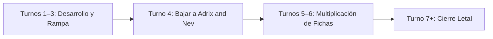

# Guía Estratégica: Adrix and Nev, Twincasters
### Duplicación Exponencial de Fichas (Simic Token Swarm)

> **Formato:** Commander / EDH (CR 903)  
> **Comandante:** [Adrix and Nev, Twincasters](file:///root/mtg/decks/Commander/adrix/adrix.txt#L2)  
> **Identidad de Color:** Simic (`{G, U}`)  
> **Total Cartas:** 100 cartas exactas (Conforme a la normativa oficial CR 903.5)  
> **Lista del mazo:** [`decks/Commander/adrix/adrix.txt`](file:///root/mtg/decks/Commander/adrix/adrix.txt)

---

## 1. El Comandante: Análisis de Mecánicas

| Característica | Detalle |
| :--- | :--- |
| **Coste de Maná** | `{2}{G}{U}` (CMC: 4) |
| **Tipo de Carta** | Criatura Legendaria — Hechicero Tritón (2/4) |
| **Protección Innata** | **Ward {2}** (Cualquier hechizo o habilidad que le haga objetivo es contrarrestado a menos que su controlador pague `{2}`) |
| **Habilidad Estática** | *"Si una o más fichas fueran a crearse bajo tu control, se crea el doble de esas fichas en su lugar."* |

### Reglas Oficiales y Funcionamiento de la Duplicación
1. **Efecto de Reemplazo (CR 614.1a):** La habilidad de Adrix and Nev **no usa la pila ni se puede responder**. Se aplica instantáneamente en el momento en que se genera cualquier ficha.
2. **Duplica TODO tipo de fichas:** No solo criaturas; también duplica fichas de **Tesoro** (*Treasure*), **Comida** (*Food*), fichas de **Copia** (clones de criaturas) y fichas de **Fractal**.
3. **Múltiples fuentes:** Si un hechizo dice *"Crea tres fichas de Oso 2/2"*, con Adrix en mesa entran **seis fichas de Oso 2/2**.

---

## 2. Curva de Maná y Estadísticas del Mazo

El mazo ha sido optimizado aplicando el modelo matemático de **Frank Karsten** para garantizar una cadencia de juego ágil y evitar el atasco de maná:

```text
=================================================================
 MTG MANA CURVE & LAND BASE ANALYSIS
=================================================================
Total Cartas:           100
Coste Medio (CMC):      3.28
Tierras Totales:        37 tierras efectivas (35 tradicionales + 2 MDFC)
Piezas de Rampa:        13 fuentes
Distribución de Pips:   Verde (G): 50.7%  |  Azul (U): 49.3%
=================================================================
```

### Gráfico de Distribución de Curva

```text
  CMC  1:  8 cartas | ████████
  CMC  2: 13 cartas | ██████████████
  CMC  3: 23 cartas | █████████████████████████ (PICO DE LA CURVA)
  CMC  4: 10 cartas | ██████████
  CMC  5:  4 cartas | ████
  CMC  6:  2 cartas | ██
  CMC 7+:  5 cartas | █████
```

* **Pico en Turno 2–3 (36 cartas de coste 1–3):** Permite desarrollar la mesa, acelerar maná y colocar motores antes de que el comandante toque el campo.
* **Curvatura Perfecta para Turno 4:** Con 13 piezas de rampa de coste 1–3 (*Moss Diamond*, *Humble Naturalist*, *Fertile Footsteps*, etc.), Adrix and Nev puede entrar consistentemente en el turno 3 o en el turno 4 manteniendo maná abierto para su protección.

---

## 3. Desglose Estratégico por Roles

### A. Motores de Duplicación y Generación de Fichas (20 Cartas)
El motor principal del mazo. Al tener a Adrix en juego, cada una de estas cartas genera una ventaja desmedida:

* **Clones y Copias Masivas:**
  * [`Stolen Identity`](file:///root/mtg/decks/Commander/adrix/adrix.txt#L75): Crea **dos copias** de la mejor criatura del campo de batalla. Al cifrarse (*Cipher*) sobre una criatura evasiva, genera **dos copias más cada turno** en el que golpees.
  * [`Champion of Wits`](file:///root/mtg/decks/Commander/adrix/adrix.txt#L8): Filtra la mano al inicio; su coste de *Eternalizar* crea **dos copias 4/4** y te hace robar 8 cartas.
  * [`Reflections of Littjara`](file:///root/mtg/decks/Commander/adrix/adrix.txt#L45): Elige Hechicero (*Wizard*) o la tribu dominante para copiar cada hechizo que lances.
* **Enjambre de Criaturas:**
  * [`Desolation Twin`](file:///root/mtg/decks/Commander/adrix/adrix.txt#L12): Pone **dos fichas Eldrazi 10/10** de golpe en mesa (20 de fuerza).
  * [`Flaxen Intruder // Welcome Home`](file:///root/mtg/decks/Commander/adrix/adrix.txt#L15): Su aventura genera **seis Osos 2/2** por 7 manás.
  * [`The Bears of Littjara`](file:///root/mtg/decks/Commander/adrix/adrix.txt#L47): Pone dos cambiaformas 4/4 y convierte a todas tus fichas en 4/4.
  * [`Mantle of the Wolf`](file:///root/mtg/decks/Commander/adrix/adrix.txt#L43): Da +4/+4 y al morir genera **cuatro Lobos 2/2**.
  * [`Kazandu Tuskcaller`](file:///root/mtg/decks/Commander/adrix/adrix.txt#L18): Sube de nivel para girarse y generar **dos o cuatro Elefantes 3/3** por turno.
  * [`Biomathematician`](file:///root/mtg/decks/Commander/adrix/adrix.txt#L6) y [`Fractal Harness`](file:///root/mtg/decks/Commander/adrix/adrix.txt#L32): Generan pares de Fractales que escalan con contadores +1/+1.
  * [`Old-Growth Troll`](file:///root/mtg/decks/Commander/adrix/adrix.txt#L22): Amenaza 4/4 que rampa al morir y luego se sacrifica para crear **dos Trolls 4/4**.
* **Tesoros y Economía:**
  * [`Goldvein Pick`](file:///root/mtg/decks/Commander/adrix/adrix.txt#L33): Crea 2 Tesoros por impacto.
  * [`Malcolm, Keen-Eyed Navigator`](file:///root/mtg/decks/Commander/adrix/adrix.txt#L19): Genera 2 Tesoros con cualquier daño de piratas.
  * [`Prosperous Pirates`](file:///root/mtg/decks/Commander/adrix/adrix.txt#L23): Genera **cuatro Tesoros** al entrar.
  * [`Replicating Ring`](file:///root/mtg/decks/Commander/adrix/adrix.txt#L38): Al llegar a 8 contadores se convierte en **16 artefactos** productores de maná.

---

### B. Rematadores y Condiciones de Victoria (5 Cartas)
El mazo no necesita esperar para desgastar a los rivales; cuenta con formas contundentes de cerrar la partida:

1. **[`Ruxa, Patient Professor`](file:///root/mtg/decks/Commander/adrix/adrix.txt#L25):** 
   * La mayoría de tus fichas (Fractales, Osos, Elefantes, Eldrazis) no tienen habilidades de texto.
   * Ruxa les otorga +1/+1 y hace que **asignen su daño de combate como si no hubiesen sido bloqueadas**, cerrando la partida directamente contra los puntos de vida de los oponentes.
2. **[`Biomass Mutation`](file:///root/mtg/decks/Commander/adrix/adrix.txt#L54):**
   * Instantáneo sorpresa. Antes del cálculo de daño, convierte a todas tus criaturas en X/X (por ejemplo, diez fichas 6/6) para una victoria en un solo ataque.
3. **[`Storm the Citadel`](file:///root/mtg/decks/Commander/adrix/adrix.txt#L76):**
   * Da +2/+2 a todos tus atacantes y destruye todos los artefactos y encantamientos de los oponentes cuando tus criaturas conectan.
4. **[`Treeshaker Chimera`](file:///root/mtg/decks/Commander/adrix/adrix.txt#L28):**
   * Criatura 8/5 que obliga a **todas** las criaturas oponentes a bloquearla a ella, dejando vía libre al resto de tu ejército de fichas para noquear a la mesa.
5. **[`Kaseto, Orochi Archmage`](file:///root/mtg/decks/Commander/adrix/adrix.txt#L17):**
   * Hace imbloqueables a tus mayores amenazas (o a Adrix para ganar por 21 puntos de daño de comandante).

---

### C. Ventaja de Cartas y Recursos (12 Cartas)
Un mazo de Commander necesita robar de forma continuada para no quedarse sin fuelle tras un barrido de mesa:

* **[`Idol of Oblivion`](file:///root/mtg/decks/Commander/adrix/adrix.txt#L35):** En este mazo es un motor que roba 1 carta cada turno por solo girarlo (y a partida larga crea dos Eldrazis 10/10).
* **[`Eureka Moment`](file:///root/mtg/decks/Commander/adrix/adrix.txt#L57):** Roba 2 cartas a velocidad instantánea y pone una tierra en juego.
* **[`Behold the Multiverse`](file:///root/mtg/decks/Commander/adrix/adrix.txt#L53):** Adivina 2 y roba 2 (aprovechando la mecánica de *Foretell*).
* **[`Of One Mind`](file:///root/mtg/decks/Commander/adrix/adrix.txt#L73):** Como controlas criaturas Humanas (Adrix) y No-Humanas (fichas de Bestias/Osos), roba 2 cartas por solo `{U}`.
* **[`Commander's Insight`](file:///root/mtg/decks/Commander/adrix/adrix.txt#L55):** Robo instantáneo a partida avanzada según las veces que hayas lanzado a Adrix.
* **[`Thirst for Knowledge`](file:///root/mtg/decks/Commander/adrix/adrix.txt#L64) y [`Thirst for Meaning`](file:///root/mtg/decks/Commander/adrix/adrix.txt#L65):** Robo instantáneo de 3 cartas filtrando artefactos o encantamientos.

---

### D. Interacción, Control e Ira Asimétrica (11 Cartas)

* **[`Cyclone Summoner`](file:///root/mtg/decks/Commander/adrix/adrix.txt#L11) (Ira Selectiva / One-Sided Board Wipe):**
  * Criatura 7/7 que al entrar regresa a la mano de sus propietarios todos los permanentes que no sean Gigantes ni Hechiceros.
  * **Interacción Clave:** Como Adrix and Nev tiene el tipo **Hechicero (*Merfolk Wizard*)**, **tu comandante no se va a la mano**, limpiando la defensa enemiga para un ataque libre.
* **Eliminación y Respuestas Instantáneas:**
  * [`Rapid Hybridization`](file:///root/mtg/decks/Commander/adrix/adrix.txt#L62): Destruye cualquier amenaza criatura por 1 maná azul.
  * [`Ram Through`](file:///root/mtg/decks/Commander/adrix/adrix.txt#L61): Mordisco instantáneo a una criatura rival sin recibir daño (con arrollar excedente si se usa con criaturas grandes).
  * [`Reclamation Sage`](file:///root/mtg/decks/Commander/adrix/adrix.txt#L24) y [`Caustic Caterpillar`](file:///root/mtg/decks/Commander/adrix/adrix.txt#L7): Destrucción de artefactos y encantamientos prioritarios.
  * [`Ravenform`](file:///root/mtg/decks/Commander/adrix/adrix.txt#L74) e [`Introduction to Annihilation`](file:///root/mtg/decks/Commander/adrix/adrix.txt#L72): Exilio absoluto de cualquier permanente problemático.
* **Protección del Comandante:**
  * [`Snakeskin Veil`](file:///root/mtg/decks/Commander/adrix/adrix.txt#L63): Antimaleficio instantáneo + contador +1/+1.
  * [`Tyrite Sanctum`](file:///root/mtg/decks/Commander/adrix/adrix.txt#L87): Tierra capaz de otorgar un contador de **Indestructible** sobre Adrix and Nev.
  * [`Annul`](file:///root/mtg/decks/Commander/adrix/adrix.txt#L51), [`Essence Scatter`](file:///root/mtg/decks/Commander/adrix/adrix.txt#L56) y [`Lofty Denial`](file:///root/mtg/decks/Commander/adrix/adrix.txt#L59): Contrahechizos de bajo coste para proteger el estado de la mesa.

---

## 4. Plan de Partida: Fase por Fase



### Turnos 1 a 3: El Despliegue
* Busca manos con al menos 3 fuentes de maná (entre tierras y rampa de turno 2/3).
* Prioriza jugar [`Fertile Footsteps`](file:///root/mtg/decks/Commander/adrix/adrix.txt#L5), [`Moss Diamond`](file:///root/mtg/decks/Commander/adrix/adrix.txt#L37), [`Humble Naturalist`](file:///root/mtg/decks/Commander/adrix/adrix.txt#L16) o criaturas evasivas baratas como [`Curious Pair`](file:///root/mtg/decks/Commander/adrix/adrix.txt#L10) o [`Witching Well`](file:///root/mtg/decks/Commander/adrix/adrix.txt#L40).
* Si puedes, deja preparado un contrahechizo o truco de protección.

### Turno 4: Lanzamiento Seguro del Comandante
* Lanza a **Adrix and Nev, Twincasters**.
* Gracias a su habilidad de **Ward {2}**, si algún oponente quiere eliminarlo en turno 4, tendrá que pagar 2 manás extra, lo que casi siempre les deja sin maná para responder. Si tienes [`Snakeskin Veil`](file:///root/mtg/decks/Commander/adrix/adrix.txt#L63) en mano, tu comandante está prácticamente blindado.

### Turnos 5 a 6: Explosión de Fichas
* Ahora cualquier generador de fichas multiplica su valor por dos:
  * Lanza [`The Bears of Littjara`](file:///root/mtg/decks/Commander/adrix/adrix.txt#L47) o [`Stolen Identity`](file:///root/mtg/decks/Commander/adrix/adrix.txt#L75).
  * Activa [`Idol of Oblivion`](file:///root/mtg/decks/Commander/adrix/adrix.txt#L35) para robar sin coste.
  * Equipa [`Goldvein Pick`](file:///root/mtg/decks/Commander/adrix/adrix.txt#L33) para generar tesoros a pares.

### Turno 7 en adelante: El Golpe de Gracia
* Despliega [`Cyclone Summoner`](file:///root/mtg/decks/Commander/adrix/adrix.txt#L11) para limpiar la mesa oponente dejando a Adrix intacto.
* Conecta con [`Ruxa, Patient Professor`](file:///root/mtg/decks/Commander/adrix/adrix.txt#L25) o remata con [`Biomass Mutation`](file:///root/mtg/decks/Commander/adrix/adrix.txt#L54) / [`Storm the Citadel`](file:///root/mtg/decks/Commander/adrix/adrix.txt#L76).
* Si la partida se estanca, [`Treeshaker Chimera`](file:///root/mtg/decks/Commander/adrix/adrix.txt#L28) o [`Desolation Twin`](file:///root/mtg/decks/Commander/adrix/adrix.txt#L12) acabarán con las vidas de los contrincantes por fuerza bruta.

---

## 5. Tierras Modales (MDFC): Flexibilidad Máxima

El mazo incluye dos cartas de doble cara que cuentan como hechizos reactivos pero pueden jugarse como tierras si la mano lo requiere:

1. **[`Beyeen Veil // Beyeen Coast`](file:///root/mtg/decks/Commander/adrix/adrix.txt#L79):**
   * Como hechizo: Instantáneo por 2 manás que da -2/-0 a todas las criaturas atacantes del rival para sobrevivir a un ataque sorpresa.
   * Como tierra: Entra girada y da maná azul `{U}`.
2. **[`Silundi Vision // Silundi Isle`](file:///root/mtg/decks/Commander/adrix/adrix.txt#L82):**
   * Como hechizo: Mira las 6 primeras cartas de tu biblioteca y quédate con un instantáneo o conjuro para encontrar respuestas clave.
   * Como tierra: Entra girada y produce maná azul `{U}`.

---

## 6. Lista Oficial del Mazo (Formato ManaBox)

La lista íntegra, sin cartas de los otros dos mazos y verificada bajo las reglas oficiales de Magic: The Gathering, se encuentra en:

👉 **[`decks/Commander/adrix/adrix.txt`](file:///root/mtg/decks/Commander/adrix/adrix.txt)**
