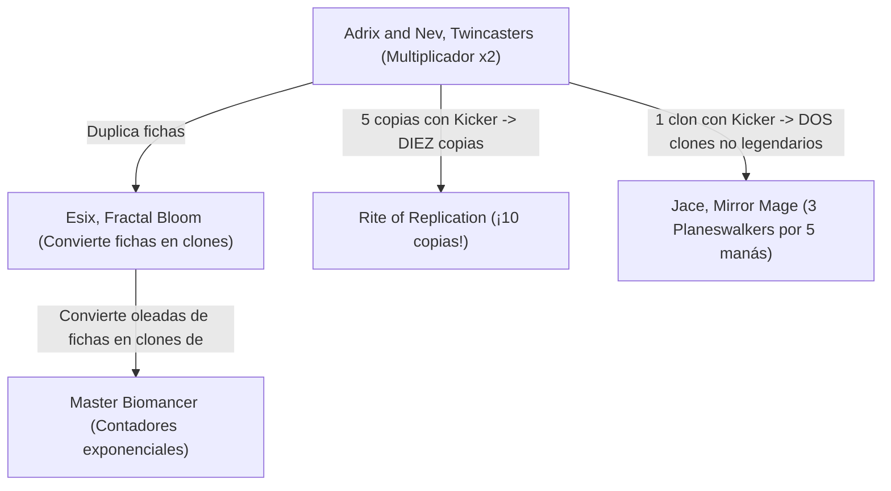
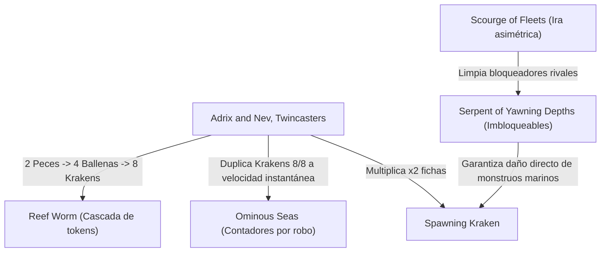

# Guía Estratégica: Adrix and Nev, Twincasters
### Duplicación Exponencial de Fichas, Combo de Krakens, Clones Masivos y Control Asimétrico

> **Formato:** Commander / EDH (CR 903)  
> **Comandante:** [Adrix and Nev, Twincasters](file:///root/mtg/decks/Commander/adrix/adrix.txt#L2)  
> **Identidad de Color:** Simic (`{G, U}`)  
> **Total Cartas:** 100 cartas exactas (Conforme a la normativa oficial CR 903.5)  
> **Lista del mazo:** [`decks/Commander/adrix/adrix.txt`](file:///root/mtg/decks/Commander/adrix/adrix.txt)

---

## 1. El Comandante: Análisis de Mecánicas

| Característica | Detalle |
| :--- | :--- |
| **Coste de Maná** | `{2}{G}{U}` (CMC: 4) |
| **Tipo de Carta** | Criatura Legendaria — Hechicero Tritón (2/4) |
| **Protección Innata** | **Ward {2}** (Cualquier hechizo o habilidad que le haga objetivo es contrarrestado a menos que su controlador pague `{2}`) |
| **Habilidad Estática** | *"Si una o más fichas fueran a crearse bajo tu control, se crea el doble de esas fichas en su lugar."* |

### Reglas Oficiales y Funcionamiento de la Duplicación
1. **Efecto de Reemplazo (CR 614.1a):** La habilidad de Adrix and Nev **no usa la pila ni se puede responder**. Se aplica instantáneamente en el momento en que se genera cualquier ficha.
2. **Duplica TODO tipo de fichas:** No solo criaturas; también duplica fichas de **Tesoro** (*Treasure*), **Comida** (*Food*), fichas de **Planeswalker no legendarias** ([Jace, Mirror Mage](file:///root/mtg/decks/Commander/adrix/adrix.txt#L31)), fichas de **Copia** ([Esix, Fractal Bloom](file:///root/mtg/decks/Commander/adrix/adrix.txt#L12) y [Rite of Replication](file:///root/mtg/decks/Commander/adrix/adrix.txt#L76)) y fichas masivas de **Kraken 9/9** y **Kraken 8/8**.
3. **Múltiples fuentes:** Si una habilidad dice *"Crea una ficha de Kraken 9/9"*, con Adrix en mesa entran **dos fichas de Kraken 9/9** de golpe.

---

## 2. Curva de Maná y Estadísticas del Mazo

El mazo ha sido optimizado aplicando el modelo matemático de **Frank Karsten** para garantizar una cadencia de juego ágil y evitar el atasco de maná:

```text
=================================================================
 MTG MANA CURVE & LAND BASE ANALYSIS
=================================================================
Total Cartas:           100
Coste Medio (CMC):      3.46
Tierras Totales:        37 tierras efectivas (35 tradicionales + 2 MDFC)
Piezas de Rampa:        14 fuentes (incluyendo Simic Signet y Arixmethes)
Distribución de Pips:   Verde (G): 49.3%  |  Azul (U): 50.7%
=================================================================
```

### Gráfico de Distribución de Curva

```text
  CMC  1:  7 cartas | ███████
  CMC  2: 14 cartas | ██████████████
  CMC  3: 20 cartas | ████████████████████ (PICO DE LA CURVA)
  CMC  4: 11 cartas | ███████████
  CMC  5:  5 cartas | █████
  CMC  6:  5 cartas | █████
  CMC 7+:  5 cartas | █████
```

* **Aceleración Temprana (Turnos 1–3):** Con [Simic Signet](file:///root/mtg/decks/Commander/adrix/adrix.txt#L41), [Moss Diamond](file:///root/mtg/decks/Commander/adrix/adrix.txt#L39) y [Humble Naturalist](file:///root/mtg/decks/Commander/adrix/adrix.txt#L15), Adrix and Nev puede entrar consistentemente en el **Turno 3** manteniendo el escudo de Ward {2}.
* **Defensa de Rondas Iniciales:** [Hornet Nest](file:///root/mtg/decks/Commander/adrix/adrix.txt#L14) detiene en seco a los rivales agresivos amenazando con duplicar avispas con toque mortal.

---

## 3. Desglose Estratégico por Roles

### A. Los Tres Motores de Clonación Masiva (El Núcleo Roto)



1. **[Rite of Replication](file:///root/mtg/decks/Commander/adrix/adrix.txt#L76):**
   * Por 4 manás (`{2}{U}{U}`), copia cualquier criatura en mesa (Adrix te da **dos copias**).
   * **El Golpe Definitivo con Estímulo (9 manás):** Crea 5 copias... ¡que Adrix convierte en **DIEZ COPIAS de cualquier criatura**! Si apuntas a [Desolation Twin](file:///root/mtg/decks/Commander/adrix/adrix.txt#L11), son diez 10/10 Eldrazis (100 de fuerza). Si apuntas a [Spawning Kraken](file:///root/mtg/decks/Commander/adrix/adrix.txt#L27), la partida termina instantáneamente.
2. **[Esix, Fractal Bloom](file:///root/mtg/decks/Commander/adrix/adrix.txt#L12):**
   * La primera vez en cada turno que fueras a crear una o más fichas, puedes elegir una criatura en mesa y hacer que todas esas fichas entren como copias de ella.
   * Con la aventura de [Flaxen Intruder](file:///root/mtg/decks/Commander/adrix/adrix.txt#L13), Adrix crea 6 fichas y Esix las transforma en **seis copias de la criatura más demoledora de la mesa**.
3. **[Master Biomancer](file:///root/mtg/decks/Commander/adrix/adrix.txt#L19):**
   * Cada criatura que entra bajo tu control lo hace con contadores +1/+1 iguales a la fuerza de Biomancer.
   * Al combinarse con Esix y Adrix, cada token nuevo dispara un efecto bola de nieve que infla todo tu ejército a tamaños superiores a 30/30.
4. **[Jace, Mirror Mage](file:///root/mtg/decks/Commander/adrix/adrix.txt#L31):**
   * Al jugarlo con estímulo por 5 manás, su copia ficha es duplicada por Adrix. Pasas a controlar **tres Planeswalkers Jace a la vez** (el original con 4 de lealtad y 2 copias ficha no legendarias), activando 3 habilidades de lealtad cada turno (+1 adivinar / 0 robar).

---

### B. El Combo Tribal de Monstruos Marinos y Krakens (Paquete de Impacto Letal)



1. **[Spawning Kraken](file:///root/mtg/decks/Commander/adrix/adrix.txt#L27):**
   * Cada vez que un Kraken, Leviatán, Pulpo o Serpiente inflige daño de combate a un jugador, crea una ficha de Kraken 9/9 azul.
   * **Sinergia con Adrix:** ¡Crea **DOS Krakens 9/9 por CADA criatura marina que conecte**! Si atacas con 3 monstruos y conectan, generas **6 Krakens 9/9 (54 de fuerza en mesa)** de golpe.
2. **[Serpent of Yawning Depths](file:///root/mtg/decks/Commander/adrix/adrix.txt#L26):**
   * Hace que **todos tus Krakens, Leviatanes, Pulpos y Serpientes no puedan ser bloqueados** excepto por criaturas que compartan esos tipos.
   * Garantiza que tus monstruos marinos golpeen a la cara del rival, disparando a [Spawning Kraken](file:///root/mtg/decks/Commander/adrix/adrix.txt#L27) turno tras turno.
3. **[Ominous Seas](file:///root/mtg/decks/Commander/adrix/adrix.txt#L47):**
   * Encantamiento de coste `{1}{U}` que acumula un contador de presagio cada vez que robas una carta (apoyado por [Eureka Moment](file:///root/mtg/decks/Commander/adrix/adrix.txt#L57), [Commander's Insight](file:///root/mtg/decks/Commander/adrix/adrix.txt#L55), [Thirst for Knowledge](file:///root/mtg/decks/Commander/adrix/adrix.txt#L64), [Jace, Mirror Mage](file:///root/mtg/decks/Commander/adrix/adrix.txt#L31), etc.).
   * Al retirar 8 contadores (a coste `{0}` y a velocidad instantánea), crea un Kraken 8/8... **¡que Adrix convierte en DOS Krakens 8/8 por 0 manás!**
4. **[Reef Worm](file:///root/mtg/decks/Commander/adrix/adrix.txt#L23):**
   * La pesadilla de las limpiezas de mesa rivales. Cuando muere, pone un Pez 3/3 (con Adrix: **2 Peces 3/3**). Cuando los peces mueren, ponen Ballenas 6/6 (con Adrix: **4 Ballenas 6/6**). Cuando las ballenas mueren, ponen Krakens 9/9 (con Adrix: **¡8 Krakens 9/9 = 72 de poder!**).
5. **[Scourge of Fleets](file:///root/mtg/decks/Commander/adrix/adrix.txt#L25):**
   * Ira asimétrica de mesa (*One-Sided Board Wipe*). Al entrar al campo, devuelve a la mano de sus propietarios cada criatura de los oponentes cuya resistencia sea menor o igual a tu número de Islas. Deja a la mesa rival sin defensas para el ataque letal.
6. **[Arixmethes, Slumbering Isle](file:///root/mtg/decks/Commander/adrix/adrix.txt#L5):**
   * Rampa masiva de turno 3–4 que se gira para dar `{G}{U}` y entra como tierra. Al lanzar 5 hechizos, se despierta como un **Kraken 12/12 legendario** que se vuelve imbloqueable con [Serpent of Yawning Depths](file:///root/mtg/decks/Commander/adrix/adrix.txt#L26) y dispara [Spawning Kraken](file:///root/mtg/decks/Commander/adrix/adrix.txt#L27).

---

### C. El Factor Sorpresa e Iras Asimétricas (11 Cartas)

* **[Perplexing Test](file:///root/mtg/decks/Commander/adrix/adrix.txt#L60) (La Jugada de la Partida):**
  * Instantáneo por 5 manás. Eliges *"Regresa todas las criaturas que no sean fichas a la mano de sus propietarios"*.
  * Como tu mesa está compuesta por Krakens, Clones, Elefantes y Fichas, **lo lanzas en el paso final del oponente previo**: vacías completamente las defensas de los tres contrincantes, tu ejército se queda intacto en el campo y atacas para ganar a mesa vacía en tu turno.
* **[Cyclone Summoner](file:///root/mtg/decks/Commander/adrix/adrix.txt#L10) & [Scourge of Fleets](file:///root/mtg/decks/Commander/adrix/adrix.txt#L25):**
  * `Cyclone Summoner`: Regresa a la mano todos los permanentes que no sean Gigantes ni Hechiceros (como Adrix es Hechicero, se queda en mesa).
  * `Scourge of Fleets`: Devuelve a la mano todas las criaturas enemigas basándose en tus Islas.
* **Escudo Defensivo Temprano:**
  * [Hornet Nest](file:///root/mtg/decks/Commander/adrix/adrix.txt#L14): Disuasión absoluta. Si un oponente te ataca o bloquea, genera el doble de avispas 1/1 con toque mortal y volar.
* **Eliminación y Protección Instantánea:**
  * [Rapid Hybridization](file:///root/mtg/decks/Commander/adrix/adrix.txt#L62): Destrucción incondicional por 1 maná azul.
  * [Ram Through](file:///root/mtg/decks/Commander/adrix/adrix.txt#L61): Mordisco sin recibir daño (con arrollar si usas criaturas gigantes).
  * [Curse of the Swine](file:///root/mtg/decks/Commander/adrix/adrix.txt#L70) y [Ravenform](file:///root/mtg/decks/Commander/adrix/adrix.txt#L75): Exilio selectivo masivo y puntual.
  * [Snakeskin Veil](file:///root/mtg/decks/Commander/adrix/adrix.txt#L63): Antimaleficio + contador.
  * [Tyrite Sanctum](file:///root/mtg/decks/Commander/adrix/adrix.txt#L89): Contador de **Indestructible** sobre Adrix.
  * [Annul](file:///root/mtg/decks/Commander/adrix/adrix.txt#L52), [Essence Scatter](file:///root/mtg/decks/Commander/adrix/adrix.txt#L56) y [Whirlwind Denial](file:///root/mtg/decks/Commander/adrix/adrix.txt#L65): Contrahechizos de protección total.

---

### D. Motores de Duplicación y Generación de Fichas (14 Cartas)

* **Clones y Copias Masivas:**
  * [Stolen Identity](file:///root/mtg/decks/Commander/adrix/adrix.txt#L77): Crea **dos copias** de la mejor criatura del campo de batalla. Al cifrarse (*Cipher*) sobre una criatura evasiva, genera **dos copias más cada turno** en el que golpees.
  * [Champion of Wits](file:///root/mtg/decks/Commander/adrix/adrix.txt#L8): Filtra la mano al inicio; su coste de *Eternalizar* crea **dos copias 4/4** y te hace robar 8 cartas.
  * [Reflections of Littjara](file:///root/mtg/decks/Commander/adrix/adrix.txt#L48): Copia cada hechizo de criatura del tipo elegido que lances.
* **Enjambre de Criaturas:**
  * [Desolation Twin](file:///root/mtg/decks/Commander/adrix/adrix.txt#L11): Pone **dos fichas Eldrazi 10/10** de golpe en mesa (20 de fuerza).
  * [Flaxen Intruder // Welcome Home](file:///root/mtg/decks/Commander/adrix/adrix.txt#L13): Su aventura genera **seis Osos 2/2** por 7 manás (o 6 copias de lo que quieras con [Esix, Fractal Bloom](file:///root/mtg/decks/Commander/adrix/adrix.txt#L12)).
  * [The Bears of Littjara](file:///root/mtg/decks/Commander/adrix/adrix.txt#L49): Pone dos cambiaformas 4/4 y convierte a todas tus fichas en 4/4.
  * [Mantle of the Wolf](file:///root/mtg/decks/Commander/adrix/adrix.txt#L45): Da +4/+4 y al morir genera **cuatro Lobos 2/2**.
  * [Kazandu Tuskcaller](file:///root/mtg/decks/Commander/adrix/adrix.txt#L17): Sube de nivel para girarse y generar **dos o cuatro Elefantes 3/3** por turno.
  * [Old-Growth Troll](file:///root/mtg/decks/Commander/adrix/adrix.txt#L21): Amenaza 4/4 que rampa al morir y luego se sacrifica para crear **dos Trolls 4/4**.
* **Tesoros y Economía:**
  * [Goldvein Pick](file:///root/mtg/decks/Commander/adrix/adrix.txt#L36): Crea 2 Tesoros por impacto.
  * [Malcolm, Keen-Eyed Navigator](file:///root/mtg/decks/Commander/adrix/adrix.txt#L18): Genera 2 Tesoros con cualquier daño de piratas.
  * [Replicating Ring](file:///root/mtg/decks/Commander/adrix/adrix.txt#L40): Al llegar a 8 contadores se convierte en **16 artefactos** productores de maná.

---

### E. Rematadores y Condiciones de Victoria (5 Cartas)

1. **[Ruxa, Patient Professor](file:///root/mtg/decks/Commander/adrix/adrix.txt#L24):** 
   * La mayoría de tus fichas (Krakens, Osos, Elefantes, Eldrazis) no tienen texto.
   * Ruxa les otorga +1/+1 y hace que **asignen su daño de combate como si no hubiesen sido bloqueadas**, cerrando la partida directamente contra las vidas oponentes.
2. **[Biomass Mutation](file:///root/mtg/decks/Commander/adrix/adrix.txt#L54):**
   * Instantáneo sorpresa. Antes del cálculo de daño, convierte a todas tus criaturas en X/X (por ejemplo, diez fichas 6/6) para una victoria en un solo ataque.
3. **[Storm the Citadel](file:///root/mtg/decks/Commander/adrix/adrix.txt#L78):**
   * Da +2/+2 a todos tus atacantes y destruye todos los artefactos y encantamientos de los oponentes cuando tus criaturas conectan.
4. **[Treeshaker Chimera](file:///root/mtg/decks/Commander/adrix/adrix.txt#L28):**
   * Criatura 8/5 que obliga a **todas** las criaturas oponentes a bloquearla a ella, dejando vía libre al resto de tu ejército de monstruos y fichas para noquear a la mesa.
5. **[Kaseto, Orochi Archmage](file:///root/mtg/decks/Commander/adrix/adrix.txt#L16):**
   * Hace imbloqueables a tus mayores amenazas (o a Adrix para ganar por 21 puntos de daño de comandante).

---

### F. Ventaja de Cartas y Recursos (11 Cartas)

* **[Idol of Oblivion](file:///root/mtg/decks/Commander/adrix/adrix.txt#L38):** En este mazo es un motor que roba 1 carta cada turno por solo girarlo (y a partida larga crea dos Eldrazis 10/10).
* **[Eureka Moment](file:///root/mtg/decks/Commander/adrix/adrix.txt#L57):** Roba 2 cartas a velocidad instantánea y pone una tierra en juego (pone 2 contadores en [Ominous Seas](file:///root/mtg/decks/Commander/adrix/adrix.txt#L47)).
* **[Behold the Multiverse](file:///root/mtg/decks/Commander/adrix/adrix.txt#L53):** Adivina 2 y roba 2 (aprovechando la mecánica de *Foretell*).
* **[Of One Mind](file:///root/mtg/decks/Commander/adrix/adrix.txt#L74):** Como controlas criaturas Humanas (Adrix) y No-Humanas (fichas de Bestias/Osos/Krakens), roba 2 cartas por solo `{U}`.
* **[Commander's Insight](file:///root/mtg/decks/Commander/adrix/adrix.txt#L55):** Robo instantáneo masivo a partida avanzada según las veces que hayas lanzado a Adrix.
* **[Thirst for Knowledge](file:///root/mtg/decks/Commander/adrix/adrix.txt#L64):** Robo instantáneo de 3 cartas filtrando artefactos.
* **[Kodama's Reach](file:///root/mtg/decks/Commander/adrix/adrix.txt#L73):** Aceleración esencial que adelanta una tierra básica al campo y otra a tu mano.

---

## 4. Plan de Partida: Fase por Fase


### Turnos 1 a 3: El Despliegue Rápido
* Busca manos con al menos 3 fuentes de maná o aceleradores de coste 2.
* Juega [Simic Signet](file:///root/mtg/decks/Commander/adrix/adrix.txt#L41) o [Moss Diamond](file:///root/mtg/decks/Commander/adrix/adrix.txt#L39) en Turno 2 para preparar a Adrix en **Turno 3**.
* Si un oponente empieza con agresividad, planta a [Hornet Nest](file:///root/mtg/decks/Commander/adrix/adrix.txt#L14) en Turno 3 para frenar en seco cualquier ataque contra ti.
* Prepara [Ominous Seas](file:///root/mtg/decks/Commander/adrix/adrix.txt#L47) o [Jace, Mirror Mage](file:///root/mtg/decks/Commander/adrix/adrix.txt#L31) para acumular ventaja temprana.

### Turno 3–4: Lanzamiento Seguro del Comandante
* Lanza a **Adrix and Nev, Twincasters**.
* Gracias a su habilidad de **Ward {2}**, si algún oponente quiere eliminarlo en turno temprano, tendrá que pagar 2 manás extra, lo que casi siempre les deja sin maná para responder. Si tienes [Snakeskin Veil](file:///root/mtg/decks/Commander/adrix/adrix.txt#L63) en mano, tu comandante está blindado.
* Como alternativa, baja a [Arixmethes, Slumbering Isle](file:///root/mtg/decks/Commander/adrix/adrix.txt#L5) para acelerar 2 manás adicionales el siguiente turno.

### Turnos 5 a 6: Despliegue de Esix, Master Biomancer y Planeswalkers
* Ahora cualquier generador de fichas multiplica su valor por dos:
  * Despliega a [Esix, Fractal Bloom](file:///root/mtg/decks/Commander/adrix/adrix.txt#L12) o [Master Biomancer](file:///root/mtg/decks/Commander/adrix/adrix.txt#L19) para convertir o inflar cada ficha creada.
  * Lanza a [Jace, Mirror Mage](file:///root/mtg/decks/Commander/adrix/adrix.txt#L31) con su coste de **Estímulo (5 manás)** para crear **dos copias ficha** y controlar a tres Planeswalkers a la vez.
  * Despliega a [Serpent of Yawning Depths](file:///root/mtg/decks/Commander/adrix/adrix.txt#L26) o [Spawning Kraken](file:///root/mtg/decks/Commander/adrix/adrix.txt#L27) en juego.
  * Dispara [Ominous Seas](file:///root/mtg/decks/Commander/adrix/adrix.txt#L47) al robar para poner dos Krakens 8/8 instantáneos.

### Turno 7 en adelante: El Golpe de Gracia
* **La Jugada Letal con [Perplexing Test](file:///root/mtg/decks/Commander/adrix/adrix.txt#L60):** En el paso final del oponente a tu derecha, lanza *Perplexing Test* regresando todas las criaturas no-fichas a la mano. Limpias la mesa enemiga entera, tus fichas se quedan intactas y atacas para ganar a mesa vacía.
* **La Bomba Definitiva con [Rite of Replication](file:///root/mtg/decks/Commander/adrix/adrix.txt#L76):** Lánzalo estimulado por 9 manás sobre [Desolation Twin](file:///root/mtg/decks/Commander/adrix/adrix.txt#L11), [Spawning Kraken](file:///root/mtg/decks/Commander/adrix/adrix.txt#L27) o cualquier titán para crear **DIEZ COPIAS** simultáneas.
* Remata con [Ruxa, Patient Professor](file:///root/mtg/decks/Commander/adrix/adrix.txt#L24) asignando daño sin bloquear, o con [Biomass Mutation](file:///root/mtg/decks/Commander/adrix/adrix.txt#L54) / [Storm the Citadel](file:///root/mtg/decks/Commander/adrix/adrix.txt#L78).

---

## 5. Tierras Modales (MDFC): Flexibilidad Máxima

El mazo incluye dos cartas de doble cara que cuentan como hechizos reactivos pero pueden jugarse como tierras si la mano lo requiere:

1. **[Beyeen Veil // Beyeen Coast](file:///root/mtg/decks/Commander/adrix/adrix.txt#L81):**
   * Como hechizo: Instantáneo por 2 manás que da -2/-0 a todas las criaturas atacantes del rival para sobrevivir a un ataque sorpresa.
   * Como tierra: Entra girada y da maná azul `{U}`.
2. **[Silundi Vision // Silundi Isle](file:///root/mtg/decks/Commander/adrix/adrix.txt#L84):**
   * Como hechizo: Mira las 6 primeras cartas de tu biblioteca y quédate con un instantáneo o conjuro para encontrar respuestas clave.
   * Como tierra: Entra girada y produce maná azul `{U}`.

---

## 6. Lista Oficial del Mazo (Formato ManaBox)

La lista íntegra, sin cartas de los otros dos mazos y verificada bajo las reglas oficiales de Magic: The Gathering, se encuentra en:

👉 **[`decks/Commander/adrix/adrix.txt`](file:///root/mtg/decks/Commander/adrix/adrix.txt)**
