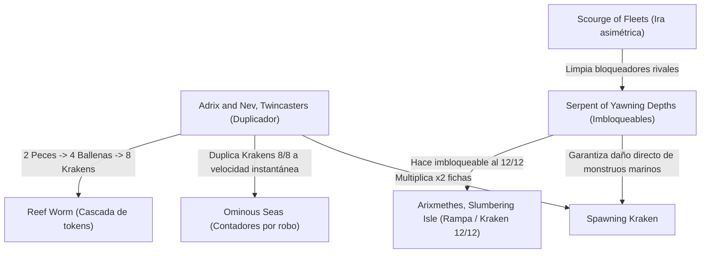
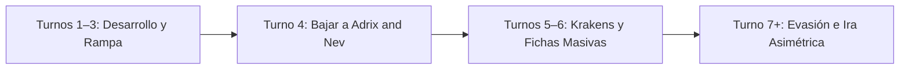

# Guía Estratégica: Adrix and Nev, Twincasters
### Duplicación Exponencial de Fichas & Combo de Monstruos Marinos (Simic Token & Kraken Swarm)

> **Formato:** Commander / EDH (CR 903)  
> **Comandante:** [Adrix and Nev, Twincasters](file:///root/mtg/decks/Commander/adrix/adrix.txt#L2)  
> **Identidad de Color:** Simic (`{G, U}`)  
> **Total Cartas:** 100 cartas exactas (Conforme a la normativa oficial CR 903.5)  
> **Lista del mazo:** [`decks/Commander/adrix/adrix.txt`](file:///root/mtg/decks/Commander/adrix/adrix.txt)

---

## 1. El Comandante: Análisis de Mecánicas

| Característica | Detalle |
| :--- | :--- |
| **Coste de Maná** | `{2}{G}{U}` (CMC: 4) |
| **Tipo de Carta** | Criatura Legendaria — Hechicero Tritón (2/4) |
| **Protección Innata** | **Ward {2}** (Cualquier hechizo o habilidad que le haga objetivo es contrarrestado a menos que su controlador pague `{2}`) |
| **Habilidad Estática** | *"Si una o más fichas fueran a crearse bajo tu control, se crea el doble de esas fichas en su lugar."* |

### Reglas Oficiales y Funcionamiento de la Duplicación
1. **Efecto de Reemplazo (CR 614.1a):** La habilidad de Adrix and Nev **no usa la pila ni se puede responder**. Se aplica instantáneamente en el momento en que se genera cualquier ficha.
2. **Duplica TODO tipo de fichas:** No solo criaturas; también duplica fichas de **Tesoro** (*Treasure*), **Comida** (*Food*), fichas de **Copia** (clones de criaturas), fichas de **Fractal** y fichas gigantescas de **Kraken 9/9** y **Kraken 8/8**.
3. **Múltiples fuentes:** Si una habilidad dice *"Crea una ficha de Kraken 9/9"*, con Adrix en mesa entran **dos fichas de Kraken 9/9** de golpe.

---

## 2. Curva de Maná y Estadísticas del Mazo

El mazo ha sido optimizado aplicando el modelo matemático de **Frank Karsten** para garantizar una cadencia de juego ágil y evitar el atasco de maná:

```text
=================================================================
 MTG MANA CURVE & LAND BASE ANALYSIS
=================================================================
Total Cartas:           100
Coste Medio (CMC):      3.37
Tierras Totales:        37 tierras efectivas (35 tradicionales + 2 MDFC)
Piezas de Rampa:        14 fuentes
Distribución de Pips:   Verde (G): 49.3%  |  Azul (U): 50.7%
=================================================================
```

### Gráfico de Distribución de Curva

```text
  CMC  1:  7 cartas | ███████
  CMC  2: 15 cartas | ███████████████
  CMC  3: 22 cartas | ██████████████████████ (PICO DE LA CURVA)
  CMC  4:  9 cartas | █████████
  CMC  5:  5 cartas | █████
  CMC  6:  4 cartas | ████
  CMC 7+:  5 cartas | █████
```

* **Pico en Turno 2–3 (44 cartas de coste 1–3):** Permite desarrollar la mesa, acelerar maná y colocar motores antes de que el comandante toque el campo.
* **Curvatura Perfecta para Turno 4:** Con 14 piezas de aceleración (*Arixmethes*, *Moss Diamond*, *Humble Naturalist*, *Fertile Footsteps*, etc.), Adrix and Nev entra consistentemente en el turno 3 o en el turno 4 manteniendo maná abierto para su protección.

---

## 3. Desglose Estratégico por Roles

### A. El Combo Tribal de Monstruos Marinos y Krakens (Paquete de Impacto Letal)
El paquete temático estrella de este mazo genera una bola de nieve incontrolable al combinarse con la habilidad duplicadora de Adrix:



1. **[Spawning Kraken](file:///root/mtg/decks/Commander/adrix/adrix.txt#L27):**
   * Cada vez que un Kraken, Leviatán, Pulpo o Serpiente inflige daño de combate a un jugador, crea una ficha de Kraken 9/9 azul.
   * **Sinergia con Adrix:** ¡Crea **DOS Krakens 9/9 por CADA criatura marina que conecte**! Si atacas con 3 monstruos y conectan, generas **6 Krakens 9/9 (54 de fuerza en mesa)** de golpe.
2. **[Serpent of Yawning Depths](file:///root/mtg/decks/Commander/adrix/adrix.txt#L26):**
   * Hace que **todos tus Krakens, Leviatanes, Pulpos y Serpientes no puedan ser bloqueados** excepto por criaturas que compartan esos tipos.
   * Garantiza que tus monstruos marinos golpeen a la cara del rival, disparando a [Spawning Kraken](file:///root/mtg/decks/Commander/adrix/adrix.txt#L27) turno tras turno.
3. **[Ominous Seas](file:///root/mtg/decks/Commander/adrix/adrix.txt#L45):**
   * Encantamiento de coste `{1}{U}` que acumula un contador de presagio cada vez que robas una carta (apoyado por [Eureka Moment](file:///root/mtg/decks/Commander/adrix/adrix.txt#L56), [Commander's Insight](file:///root/mtg/decks/Commander/adrix/adrix.txt#L54), [Thirst for Knowledge](file:///root/mtg/decks/Commander/adrix/adrix.txt#L62), etc.).
   * Al retirar 8 contadores (a coste `{0}` y a velocidad instantánea), crea un Kraken 8/8... **¡que Adrix convierte en DOS Krakens 8/8 por 0 manás!**
4. **[Reef Worm](file:///root/mtg/decks/Commander/adrix/adrix.txt#L23):**
   * La pesadilla de las limpiezas de mesa rivales. Cuando muere, pone un Pez 3/3 (con Adrix: **2 Peces 3/3**). Cuando los peces mueren, ponen Ballenas 6/6 (con Adrix: **4 Ballenas 6/6**). Cuando las ballenas mueren, ponen Krakens 9/9 (con Adrix: **¡8 Krakens 9/9 = 72 de poder!**).
5. **[Scourge of Fleets](file:///root/mtg/decks/Commander/adrix/adrix.txt#L25):**
   * Ira asimétrica de mesa (*One-Sided Board Wipe*). Al entrar al campo, devuelve a la mano de sus propietarios cada criatura de los oponentes cuya resistencia sea menor o igual a tu número de Islas. Deja a la mesa rival sin defensas para el ataque letal.
6. **[Arixmethes, Slumbering Isle](file:///root/mtg/decks/Commander/adrix/adrix.txt#L5):**
   * Rampa masiva de turno 3–4 que se gira para dar `{G}{U}` y entra como tierra. Al lanzar 5 hechizos, se despierta como un **Kraken 12/12 legendario** que se vuelve imbloqueable con [Serpent of Yawning Depths](file:///root/mtg/decks/Commander/adrix/adrix.txt#L26) y dispara [Spawning Kraken](file:///root/mtg/decks/Commander/adrix/adrix.txt#L27).
   * *(Nota: Mientras adquieres la copia física, puedes usar provisionalmente como proxy o sustituto a `Quandrix Cultivator` de tu carpeta `ultimas`).*

---

### B. Motores de Duplicación y Generación de Fichas (15 Cartas)
Al tener a Adrix en juego, cada generador produce una ventaja abrumadora:

* **Clones y Copias Masivas:**
  * [Stolen Identity](file:///root/mtg/decks/Commander/adrix/adrix.txt#L75): Crea **dos copias** de la mejor criatura del campo de batalla. Al cifrarse (*Cipher*) sobre una criatura evasiva, genera **dos copias más cada turno** en el que golpees.
  * [Champion of Wits](file:///root/mtg/decks/Commander/adrix/adrix.txt#L9): Filtra la mano al inicio; su coste de *Eternalizar* crea **dos copias 4/4** y te hace robar 8 cartas.
  * [Reflections of Littjara](file:///root/mtg/decks/Commander/adrix/adrix.txt#L46): Copia cada hechizo de criatura del tipo elegido que lances.
* **Enjambre de Criaturas:**
  * [Desolation Twin](file:///root/mtg/decks/Commander/adrix/adrix.txt#L13): Pone **dos fichas Eldrazi 10/10** de golpe en mesa (20 de fuerza).
  * [Flaxen Intruder // Welcome Home](file:///root/mtg/decks/Commander/adrix/adrix.txt#L14): Su aventura genera **seis Osos 2/2** por 7 manás.
  * [The Bears of Littjara](file:///root/mtg/decks/Commander/adrix/adrix.txt#L47): Pone dos cambiaformas 4/4 y convierte a todas tus fichas en 4/4.
  * [Mantle of the Wolf](file:///root/mtg/decks/Commander/adrix/adrix.txt#L43): Da +4/+4 y al morir genera **cuatro Lobos 2/2**.
  * [Kazandu Tuskcaller](file:///root/mtg/decks/Commander/adrix/adrix.txt#L17): Sube de nivel para girarse y generar **dos o cuatro Elefantes 3/3** por turno.
  * [Biomathematician](file:///root/mtg/decks/Commander/adrix/adrix.txt#L7) y [Fractal Harness](file:///root/mtg/decks/Commander/adrix/adrix.txt#L32): Generan pares de Fractales que escalan con contadores +1/+1.
  * [Old-Growth Troll](file:///root/mtg/decks/Commander/adrix/adrix.txt#L20): Amenaza 4/4 que rampa al morir y luego se sacrifica para crear **dos Trolls 4/4**.
* **Tesoros y Economía:**
  * [Goldvein Pick](file:///root/mtg/decks/Commander/adrix/adrix.txt#L33): Crea 2 Tesoros por impacto.
  * [Malcolm, Keen-Eyed Navigator](file:///root/mtg/decks/Commander/adrix/adrix.txt#L18): Genera 2 Tesoros con cualquier daño de piratas.
  * [Prosperous Pirates](file:///root/mtg/decks/Commander/adrix/adrix.txt#L21): Genera **cuatro Tesoros** al entrar.
  * [Replicating Ring](file:///root/mtg/decks/Commander/adrix/adrix.txt#L38): Al llegar a 8 contadores se convierte en **16 artefactos** productores de maná.

---

### C. Rematadores y Condiciones de Victoria (5 Cartas)
El mazo cuenta con múltiples formas contundentes de cerrar la partida:

1. **[Ruxa, Patient Professor](file:///root/mtg/decks/Commander/adrix/adrix.txt#L24):** 
   * La mayoría de tus fichas (Krakens, Fractales, Osos, Elefantes, Eldrazis) no tienen habilidades de texto.
   * Ruxa les otorga +1/+1 y hace que **asignen su daño de combate como si no hubiesen sido bloqueadas**, cerrando la partida directamente contra las vidas oponentes.
2. **[Biomass Mutation](file:///root/mtg/decks/Commander/adrix/adrix.txt#L53):**
   * Instantáneo sorpresa. Antes del cálculo de daño, convierte a todas tus criaturas en X/X (por ejemplo, diez fichas 6/6) para una victoria en un solo ataque.
3. **[Storm the Citadel](file:///root/mtg/decks/Commander/adrix/adrix.txt#L76):**
   * Da +2/+2 a todos tus atacantes y destruye todos los artefactos y encantamientos de los oponentes cuando tus criaturas conectan.
4. **[Treeshaker Chimera](file:///root/mtg/decks/Commander/adrix/adrix.txt#L28):**
   * Criatura 8/5 que obliga a **todas** las criaturas oponentes a bloquearla a ella, dejando vía libre al resto de tu ejército de monstruos y fichas para noquear a la mesa.
5. **[Kaseto, Orochi Archmage](file:///root/mtg/decks/Commander/adrix/adrix.txt#L16):**
   * Hace imbloqueables a tus mayores amenazas (o a Adrix para ganar por 21 puntos de daño de comandante).

---

### D. Ventaja de Cartas y Recursos (12 Cartas)
Un mazo de Commander necesita robar de forma continuada para alimentar la mesa y disparar contadores:

* **[Idol of Oblivion](file:///root/mtg/decks/Commander/adrix/adrix.txt#L35):** En este mazo es un motor que roba 1 carta cada turno por solo girarlo (y a partida larga crea dos Eldrazis 10/10).
* **[Eureka Moment](file:///root/mtg/decks/Commander/adrix/adrix.txt#L56):** Roba 2 cartas a velocidad instantánea y pone una tierra en juego (pone 2 contadores en [Ominous Seas](file:///root/mtg/decks/Commander/adrix/adrix.txt#L45)).
* **[Behold the Multiverse](file:///root/mtg/decks/Commander/adrix/adrix.txt#L52):** Adivina 2 y roba 2 (aprovechando la mecánica de *Foretell*).
* **[Of One Mind](file:///root/mtg/decks/Commander/adrix/adrix.txt#L73):** Como controlas criaturas Humanas (Adrix) y No-Humanas (fichas de Bestias/Osos/Krakens), roba 2 cartas por solo `{U}`.
* **[Commander's Insight](file:///root/mtg/decks/Commander/adrix/adrix.txt#L54):** Robo instantáneo masivo a partida avanzada según las veces que hayas lanzado a Adrix.
* **[Thirst for Knowledge](file:///root/mtg/decks/Commander/adrix/adrix.txt#L62) y [Thirst for Meaning](file:///root/mtg/decks/Commander/adrix/adrix.txt#L63):** Robo instantáneo de 3 cartas filtrando artefactos o encantamientos.
* **[Kodama's Reach](file:///root/mtg/decks/Commander/adrix/adrix.txt#L72):** Aceleración esencial que adelanta una tierra básica al campo y otra a tu mano.

---

### E. Interacción, Control e Ira Asimétrica (11 Cartas)

* **[Cyclone Summoner](file:///root/mtg/decks/Commander/adrix/adrix.txt#L12) & [Scourge of Fleets](file:///root/mtg/decks/Commander/adrix/adrix.txt#L25) (Iras Asimétricas):**
  * `Cyclone Summoner`: Criatura 7/7 que regresa a la mano de sus propietarios todos los permanentes que no sean Gigantes ni Hechiceros. Como Adrix and Nev tiene el tipo **Hechicero (*Merfolk Wizard*)**, **tu comandante no se va a la mano**, limpiando la defensa enemiga para un ataque libre.
  * `Scourge of Fleets`: Devuelve a la mano todas las criaturas oponentes con fuerza menor o igual a tus Islas, dejando tus gigantescos monstruos marinos listos para el golpe final.
* **Eliminación y Respuestas Instantáneas:**
  * [Rapid Hybridization](file:///root/mtg/decks/Commander/adrix/adrix.txt#L60): Destruye cualquier amenaza criatura por 1 maná azul.
  * [Ram Through](file:///root/mtg/decks/Commander/adrix/adrix.txt#L59): Mordisco instantáneo a una criatura rival sin recibir daño (con arrollar excedente si se usa con tus criaturas gigantes).
  * [Reclamation Sage](file:///root/mtg/decks/Commander/adrix/adrix.txt#L22) y [Caustic Caterpillar](file:///root/mtg/decks/Commander/adrix/adrix.txt#L8): Destrucción de artefactos y encantamientos prioritarios.
  * [Curse of the Swine](file:///root/mtg/decks/Commander/adrix/adrix.txt#L69) y [Ravenform](file:///root/mtg/decks/Commander/adrix/adrix.txt#L74): El mejor exilio de criaturas masivo y puntual de Simic.
* **Protección del Comandante:**
  * [Snakeskin Veil](file:///root/mtg/decks/Commander/adrix/adrix.txt#L61): Antimaleficio instantáneo + contador +1/+1.
  * [Tyrite Sanctum](file:///root/mtg/decks/Commander/adrix/adrix.txt#L87): Tierra capaz de otorgar un contador de **Indestructible** sobre Adrix and Nev.
  * [Annul](file:///root/mtg/decks/Commander/adrix/adrix.txt#L50), [Essence Scatter](file:///root/mtg/decks/Commander/adrix/adrix.txt#L55) y [Whirlwind Denial](file:///root/mtg/decks/Commander/adrix/adrix.txt#L64): Protección total contra limpiezas de mesa y turnos de combo rivales. Contrarresta todos los hechizos y habilidades en pila salvo que paguen `{4}` por cada uno.

---

## 4. Plan de Partida: Fase por Fase



### Turnos 1 a 3: El Despliegue
* Busca manos con al menos 3 fuentes de maná (entre tierras y rampa de turno 2/3).
* Prioriza jugar [Fertile Footsteps](file:///root/mtg/decks/Commander/adrix/adrix.txt#L6), [Moss Diamond](file:///root/mtg/decks/Commander/adrix/adrix.txt#L37), [Humble Naturalist](file:///root/mtg/decks/Commander/adrix/adrix.txt#L15), [Ominous Seas](file:///root/mtg/decks/Commander/adrix/adrix.txt#L45) o criaturas utilitarias como [Curious Pair](file:///root/mtg/decks/Commander/adrix/adrix.txt#L11) y [Witching Well](file:///root/mtg/decks/Commander/adrix/adrix.txt#L40).
* Si puedes, deja preparado un contrahechizo o truco de protección.

### Turno 4: Lanzamiento Seguro del Comandante
* Lanza a **Adrix and Nev, Twincasters**.
* Gracias a su habilidad de **Ward {2}**, si algún oponente quiere eliminarlo en turno 4, tendrá que pagar 2 manás extra, lo que casi siempre les deja sin maná para responder. Si tienes [Snakeskin Veil](file:///root/mtg/decks/Commander/adrix/adrix.txt#L61) en mano, tu comandante está prácticamente blindado.
* Como alternativa, baja a [Arixmethes, Slumbering Isle](file:///root/mtg/decks/Commander/adrix/adrix.txt#L5) para acelerar 2 manás adicionales el siguiente turno.

### Turnos 5 a 6: Explosión de Fichas y Despliegue de Monstruos Marinos
* Ahora cualquier generador de fichas multiplica su valor por dos:
  * Lanza [The Bears of Littjara](file:///root/mtg/decks/Commander/adrix/adrix.txt#L47), [Stolen Identity](file:///root/mtg/decks/Commander/adrix/adrix.txt#L75) o [Reef Worm](file:///root/mtg/decks/Commander/adrix/adrix.txt#L23).
  * Activa [Idol of Oblivion](file:///root/mtg/decks/Commander/adrix/adrix.txt#L35) para robar sin coste.
  * Coloca a [Serpent of Yawning Depths](file:///root/mtg/decks/Commander/adrix/adrix.txt#L26) o [Spawning Kraken](file:///root/mtg/decks/Commander/adrix/adrix.txt#L27) en juego.
  * Dispara [Ominous Seas](file:///root/mtg/decks/Commander/adrix/adrix.txt#L45) al robar para poner dos Krakens 8/8 instantáneos.

### Turno 7 en adelante: El Golpe de Gracia
* Despliega [Cyclone Summoner](file:///root/mtg/decks/Commander/adrix/adrix.txt#L12) o [Scourge of Fleets](file:///root/mtg/decks/Commander/adrix/adrix.txt#L25) para limpiar la mesa oponente dejando intactos a Adrix y tus monstruos marinos.
* Conecta libremente gracias a [Serpent of Yawning Depths](file:///root/mtg/decks/Commander/adrix/adrix.txt#L26) disparando [Spawning Kraken](file:///root/mtg/decks/Commander/adrix/adrix.txt#L27) para crear múltiples Krakens 9/9 por impacto.
* Remata con [Ruxa, Patient Professor](file:///root/mtg/decks/Commander/adrix/adrix.txt#L24) asignando daño sin bloquear, o con [Biomass Mutation](file:///root/mtg/decks/Commander/adrix/adrix.txt#L53) / [Storm the Citadel](file:///root/mtg/decks/Commander/adrix/adrix.txt#L76).
* Si la partida se estanca, [Treeshaker Chimera](file:///root/mtg/decks/Commander/adrix/adrix.txt#L28) o [Desolation Twin](file:///root/mtg/decks/Commander/adrix/adrix.txt#L13) acabarán con las vidas de los contrincantes por fuerza bruta.

---

## 5. Tierras Modales (MDFC): Flexibilidad Máxima

El mazo incluye dos cartas de doble cara que cuentan como hechizos reactivos pero pueden jugarse como tierras si la mano lo requiere:

1. **[Beyeen Veil // Beyeen Coast](file:///root/mtg/decks/Commander/adrix/adrix.txt#L79):**
   * Como hechizo: Instantáneo por 2 manás que da -2/-0 a todas las criaturas atacantes del rival para sobrevivir a un ataque sorpresa.
   * Como tierra: Entra girada y da maná azul `{U}`.
2. **[Silundi Vision // Silundi Isle](file:///root/mtg/decks/Commander/adrix/adrix.txt#L82):**
   * Como hechizo: Mira las 6 primeras cartas de tu biblioteca y quédate con un instantáneo o conjuro para encontrar respuestas clave.
   * Como tierra: Entra girada y produce maná azul `{U}`.

---

## 6. Lista Oficial del Mazo (Formato ManaBox)

La lista íntegra, sin cartas de los otros dos mazos y verificada bajo las reglas oficiales de Magic: The Gathering, se encuentra en:

👉 **[`decks/Commander/adrix/adrix.txt`](file:///root/mtg/decks/Commander/adrix/adrix.txt)**
