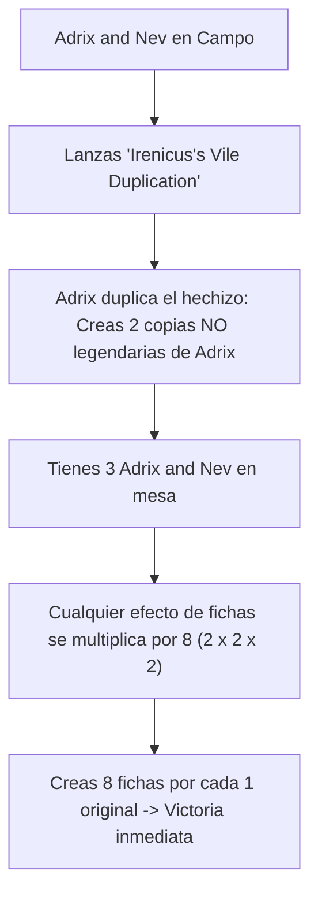

# Guía de Mejoras y Upgrades Futuros: Adrix and Nev, Twincasters
### De Fábrica de Fichas Simic a Multiplicación Exponencial Imparable (Power Level 8)

> **Mazo Base:** [`decks/Commander/adrix/adrix.txt`](file:///root/mtg/decks/Commander/adrix/adrix.txt)  
> **Guía Estratégica Base:** [`decks/Commander/adrix/adrix_guide.md`](file:///root/mtg/decks/Commander/adrix/adrix_guide.md)  
> **Comandante:** [Adrix and Nev, Twincasters](file:///root/mtg/decks/Commander/adrix/adrix.txt#L2)  
> **Identidad de Color:** Simic (`{G, U}`)  
> **Presupuesto Estimado:** Escalonado en 3 fases modulares (desde 12 €).

---

## 1. Visión General: Los Cuellos de Botella de Adrix and Nev

Adrix and Nev tiene el **techo de poder más alto en mesa despejada**: duplicar fichas es una de las habilidades matemáticas más rotas de Magic. Sin embargo, sufre de tres debilidades clave:

1. **Dependencia de la supervivencia del Comandante:** Si te barren la mesa con un *Wrath of God* o *Blasphemous Act*, la protección de Ward {2} no sirve de nada. Necesitas **protección incondicional** (*Heroic Intervention*) y **contramagia eficiente de 1 y 2 manás**.
2. **Generadores de fichas de bajo impacto:** Cartas de relleno como [Curious Pair](file:///root/mtg/decks/Commander/adrix/adrix.txt#L10) o [Biomathematician](file:///root/mtg/decks/Commander/adrix/adrix.txt#L6) generan fichas mediocres. Necesitan reemplazarse por bombas que produzcan ejércitos por sí solas (*Avenger of Zendikar*, *Koma, Cosmos Serpent*).
3. **Multiplicación de Adrix (El "Loop de Clonación"):** Si clonas a Adrix evitando la regla de leyendas (con cartas como *Irenicus's Vile Duplication* o *Helm of the Host*), las fichas no se duplican: **se cuadruplican o multiplican por ocho**.



---

## 2. Hoja de Ruta de Adquisición por Fases

---

### FASE 1: Mejoras "Budget" de Alto Impacto (~12 € - 15 € en total)
*Reemplazan cartas de relleno por generadores masivos de fichas y contramagia esencial por menos de 2 € cada una.*

| Carta a Incluir | Coste Maná | Tipo | Precio Aprox. | Rol Estratégico |
| :--- | :---: | :--- | :---: | :--- |
| **Avenger of Zendikar** | `{5}{G}{G}` | Criatura — Elemental | ~4.00 € | Al entrar crea 2 fichas de Planta por cada tierra que controles (¡si tienes 7 tierras, creas **14 Plantas**!). El *landfall* las hace gigantes. |
| **Biovisionary** | `{1}{G}{U}` | Criatura — Humano | ~0.80 € | **Condición de victoria alternativa:** Si al final de tu turno tienes 4 Biovisionary, ganas la partida. Con un solo clonador multiplicado por Adrix, ganas en el acto. |
| **Irenicus's Vile Duplication** | `{3}{U}` | Conjuro | ~1.50 € | Crea una ficha copia voladora NO legendaria de Adrix. ¡Adrix la duplica y pasas a tener **3 Adrix en mesa**, multiplicando tus fichas por 8! |
| **Cackling Counterpart** | `{1}{U}{U}` | Instantáneo | ~0.50 € | Crea una ficha copia a velocidad de instantáneo (con *Flashback* desde el cementerio). Adrix te da 2 copias. |
| **Quasiduplicate** | `{1}{U}{U}` | Conjuro | ~0.40 € | Crea una ficha de tu mejor criatura con *Jump-start* para reutilizarlo descartando una carta. |
| **Counterspell** | `{U}{U}` | Instantáneo | ~1.00 € | El contrahechizo por excelencia: frena cualquier limpieza de mesa por 2 manás. |
| **An Offer You Can't Refuse** | `{U}` | Instantáneo | ~1.50 € | Por un solo maná azul, contrarresta cualquier hechizo que no sea de criatura (salva a tu mesa). |
| **Yavimaya Coast** | Tierra | Tierra Doble | ~0.50 € | Tierra dual que entra enderezada siempre, dando incoloro gratis o `{G}`/`{U}` por 1 vida. |

> **Resultado de la Fase 1:** El mazo adquiere un potencial de clones ridículo, una condición de victoria alterna limpia (*Biovisionary*) e interacción a velocidad de instantáneo para no morir ante barridos.

---

### FASE 2: Motores Legendarios y Protección Total (~35 € - 45 € en total)
*Convierte a Adrix en una apisonadora difícil de detener.*

| Carta a Incluir | Coste Maná | Tipo | Precio Aprox. | Rol Estratégico |
| :--- | :---: | :--- | :---: | :--- |
| **Koma, Cosmos Serpent** | `{3}{G}{G}{U}{U}` | Criatura Legendaria | ~7.50 € | No puede ser contrarrestado. En **CADA mantenimiento** (incluyendo los de los 3 rivales), crea 2 Serpientes 3/3 (¡**8 Serpientes 3/3 por ronda** con Adrix!). Sacrifica serpientes para girar permanentes o hacer indestructible a Koma. |
| **Heroic Intervention** | `{1}{G}` | Instantáneo | ~7.00 € | Todas tus criaturas y permanentes ganan *Antimaleficio* e *Indestructible* por 2 manás. El antídoto definitivo a cualquier limpieza. |
| **Helm of the Host** | `{4}` | Artefacto — Equipo | ~7.00 € | Al inicio del combate, crea una copia no legendaria de la criatura equipada. Si se lo pones a Adrix, creas 2 copias el primer turno, y en el siguiente turno multiplicas por 16. |
| **Spark Double** | `{3}{U}` | Criatura | ~4.00 € | Entra como copia de Adrix que NO es legendaria con un contador +1/+1. Pasa a duplicar de nuevo todo. |
| **Tendershoot Thallid** | `{3}{G}{G}` | Criatura | ~4.00 € | En cada mantenimiento crea 2 Saprolines que pasan a ser 3/3 con la bendición de la ciudad. |
| **Rejuvenating Springs** | Tierra | Tierra Doble | ~6.00 € | *Bond land* Simic: entra enderezada incondicionalmente en partidas de Commander. |

> **Resultado de la Fase 2:** Con Koma y Helm of the Host, el mazo abruma a cualquier mesa en tan solo dos turnos.

---

### FASE 3: Upgrades de Lujo / Alta Gama (~50 €+)
*Para llevar a Adrix al máximo nivel de optimización:*

* **Parallel Lives** (~25 €): Duplica fichas de forma pasiva en encantamiento. Junto a Adrix, multiplicas por 4; con Koma o Scute Swarm, genera números exponenciales.
* **Doubling Season** (~35 €): Duplica fichas y además duplica contadores de planeswalkers y criaturas.
* **Cyclonic Rift** (~30 €): Sobrecargado por `{6}{U}`, devuelve todos los permanentes no tierra de tus rivales a sus manos de forma asimétrica. Gana la partida inmediatamente.
* **Fierce Guardianship** (~35 €): Contrahechizo que puedes lanzar **totalmente gratis** si controlas a Adrix.

---

## 3. Tabla de Sustituciones 1 a 1 (Qué entra y qué sale)

| Sale de la Lista Actual | Entra como Mejora | Motivo del Cambio |
| :--- | :--- | :--- |
| [Curious Pair](file:///root/mtg/decks/Commander/adrix/adrix.txt#L10) | **Avenger of Zendikar** | Pasas de crear una humilde ficha de comida a crear 14 plantas gigantes. |
| [Biomathematician](file:///root/mtg/decks/Commander/adrix/adrix.txt#L6) | **Biovisionary** | Sustituyes una ficha 0/0 débil por una condición de victoria alternativa directa. |
| [Flaxen Intruder](file:///root/mtg/decks/Commander/adrix/adrix.txt#L15) | **Irenicus's Vile Duplication** | Clonar a Adrix sin leyenda multiplica todo tu mazo por 8. |
| [Introduction to Annihilation](file:///root/mtg/decks/Commander/adrix/adrix.txt#L72) | **Koma, Cosmos Serpent** | Quitas un removal incoloro caro que da carta al rival para meter el mejor generador de fichas Simic. |
| [Lofty Denial](file:///root/mtg/decks/Commander/adrix/adrix.txt#L59) | **Counterspell** | Cancelación condicional reemplazada por contramagia dura y segura. |
| [Essence Scatter](file:///root/mtg/decks/Commander/adrix/adrix.txt#L56) | **An Offer You Can't Refuse** | Proteger a Adrix de conjuros y removals por solo `{U}` es vital. |
| [Mana Geode](file:///root/mtg/decks/Commander/adrix/adrix.txt#L36) | **Cackling Counterpart** | Quitas una roca lenta de coste 3 para meter un clonador a velocidad de instantáneo. |
| [Moss Diamond](file:///root/mtg/decks/Commander/adrix/adrix.txt#L37) | **Heroic Intervention** | Añades el seguro de vida definitivo contra limpiezas de mesa por 2 manás. |
| [Treeshaker Chimera](file:///root/mtg/decks/Commander/adrix/adrix.txt#L28) | **Helm of the Host** | Cambias un monstruo de 7 manás por un motor que genera infinitos Adrix. |
| [Unknown Shores](file:///root/mtg/decks/Commander/adrix/adrix.txt#L88) | **Yavimaya Coast** | Tierra ineficiente que cobra maná por filtrar cambiada por dual enderezada. |
| [Study Hall](file:///root/mtg/decks/Commander/adrix/adrix.txt#L83) | **Rejuvenating Springs** | Tierra incolora cambiada por la tierra dual perfecta de Commander. |

---

## 4. El Combo de Victoria Instantánea: Biovisionary + Clones

```text
Condición: [Adrix and Nev] en campo + [Biovisionary] en campo.

1. Lanzas [Irenicus's Vile Duplication] o [Cackling Counterpart] haciendo objetivo a Biovisionary.
2. El hechizo crea una ficha copia de Biovisionary.
3. El disparador de Adrix and Nev se activa: en lugar de crear 1 ficha, ¡creas 2 fichas!
4. Ahora controlas:
   - El Biovisionary original.
   - 2 fichas de Biovisionary.
   - (Total: 3).
5. Con la habilidad de Flashback o Jump-start de [Quasiduplicate] o [Cackling Counterpart], creas otras 2 copias (Total: 5).
6. Al llegar a tu fase final (*End Step*), el disparo de Biovisionary comprueba que controlas 4 o más criaturas llamadas Biovisionary:
   ¡Ganas el juego de forma instantánea!
```
