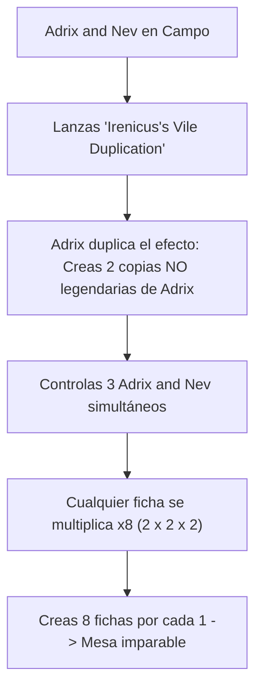

# Guía de Mejoras y Upgrades Futuros: Adrix and Nev, Twincasters
### De Fábrica de Fichas y Krakens a Multiplicación Exponencial Imparable (Power Level 8+)

> **Mazo Base:** [`decks/Commander/adrix/adrix.txt`](file:///root/mtg/decks/Commander/adrix/adrix.txt)  
> **Guía Estratégica Base:** [`decks/Commander/adrix/adrix_guide.md`](file:///root/mtg/decks/Commander/adrix/adrix_guide.md)  
> **Comandante:** [Adrix and Nev, Twincasters](file:///root/mtg/decks/Commander/adrix/adrix.txt#L2)  
> **Identidad de Color:** Simic (`{G, U}`)  
> **Presupuesto Estimado:** Escalonado en 3 fases modulares (desde ~12 €).

---

## 1. Visión General: Estado Actual y Siguientes Pasos

El mazo de Adrix and Nev cuenta ya con su núcleo más poderoso: el **Combo de Krakens** ([Spawning Kraken](file:///root/mtg/decks/Commander/adrix/adrix.txt#L27), [Serpent of Yawning Depths](file:///root/mtg/decks/Commander/adrix/adrix.txt#L26), [Scourge of Fleets](file:///root/mtg/decks/Commander/adrix/adrix.txt#L25)), el motor de clonación [Esix, Fractal Bloom](file:///root/mtg/decks/Commander/adrix/adrix.txt#L12), [Master Biomancer](file:///root/mtg/decks/Commander/adrix/adrix.txt#L19), [Perplexing Test](file:///root/mtg/decks/Commander/adrix/adrix.txt#L60), [Jace, Mirror Mage](file:///root/mtg/decks/Commander/adrix/adrix.txt#L31) y [Rite of Replication](file:///root/mtg/decks/Commander/adrix/adrix.txt#L76).

Para elevar el mazo al **nivel competitivo óptimo (Power Level 8 - High Power)**, las áreas clave de mejora son:

1. **El "Loop de Clonación de Adrix":** Al clonar a Adrix esquivando la regla de leyendas (con cartas como *Irenicus's Vile Duplication*, *Spark Double* o *Helm of the Host*), las fichas no se duplican: **se cuadruplican o multiplican por 8, 16 o 32**.
2. **Protección Incondicional contra Barridos Masivos:** Sustituir trucos puntuales por salvaguardas globales como *Heroic Intervention*.
3. **Contramagia Universal Eficiente:** Reemplazar contrahechizos condicionales de 2 manás por contramagia dura de 1 y 2 manás (*Counterspell*, *An Offer You Can't Refuse*).
4. **Optimización de la Base de Maná:** Eliminar tierras incoloras lentas (*Unknown Shores*, *Study Hall*) por tierras duales enderezadas (*Yavimaya Coast*, *Rejuvenating Springs*).



---

## 2. Hoja de Ruta de Adquisición por Fases de Precio

---

### FASE 1: Mejoras "Budget" de Alto Rendimiento (~12 € - 15 € en total)
*Reemplazos de menos de 2 € cada uno que disparan la consistencia y añaden combos letales.*

| Carta a Incluir | Coste Maná | Tipo | Precio Aprox. | Rol Estratégico |
| :--- | :---: | :--- | :---: | :--- |
| **Irenicus's Vile Duplication** | `{3}{U}` | Conjuro | ~1.50 € | Crea una ficha copia voladora NO legendaria de Adrix. Con Adrix en mesa, ¡creas **DOS copias** y pasas a tener **3 Adrix simultáneos (multiplicador x8)**! |
| **Biovisionary** | `{1}{G}{U}` | Criatura — Humano | ~0.80 € | **Condición de victoria alternativa instantánea:** Si tienes 4 Biovisionary al final del turno, ganas la partida. Con cualquier hechizo de clonación duplicado ganas en el acto. |
| **Counterspell** | `{U}{U}` | Instantáneo | ~1.00 € | Contramagia incondicional universal para proteger tus krakens o anular el turno del rival. |
| **An Offer You Can't Refuse** | `{U}` | Instantáneo | ~1.50 € | Por solo `{U}`, anula cualquier ira de mesa, planeswalker o artefacto que amenace tu posición. |
| **Cackling Counterpart** | `{1}{U}{U}` | Instantáneo | ~0.50 € | Crea copias a velocidad de instantáneo con *Flashback* desde el cementerio (¡Adrix te da 2 copias!). |
| **Quasiduplicate** | `{1}{U}{U}` | Conjuro | ~0.40 € | Clonador con *Jump-start* para reutilizarlo descartando una carta inservible de tu mano. |
| **Yavimaya Coast** | Tierra | Tierra Doble | ~0.50 € | Dual land que entra enderezada siempre, dando incoloro gratis o maná verde/azul por 1 vida. |
| **Avenger of Zendikar** | `{5}{G}{G}` | Criatura — Elemental | ~4.00 € | Al entrar crea 2 fichas de Planta por cada tierra que controles (con 7 tierras creas **14 Plantas**). El *Landfall* las infla rápidamente. |

> [!TIP]
> **Impacto de la Fase 1:** El mazo adquiere una condición de victoria alternativa limpia (*Biovisionary*), multiplicador x8 de Adrix y un escudo de contramagia universal de 1 y 2 manás por apenas 15 €.

---

### FASE 2: Motores Legendarios y Blindaje (~35 € - 45 € en total)
*Convierte a Adrix en una apisonadora imbatible en mesas competitivas.*

| Carta a Incluir | Coste Maná | Tipo | Precio Aprox. | Rol Estratégico |
| :--- | :---: | :--- | :---: | :--- |
| **Koma, Cosmos Serpent** | `{3}{G}{G}{U}{U}` | Criatura Legendaria — Serpiente | ~7.50 € | No puede ser contrarrestado. Se beneficia de [Serpent of Yawning Depths](file:///root/mtg/decks/Commander/adrix/adrix.txt#L26) siendo **imbloqueable**. En **CADA mantenimiento** (tuyo y de los 3 rivales) crea 2 Serpientes 3/3 (¡**8 Serpientes 3/3 por ronda** con Adrix!). Sacrifica serpientes para girar permanentes o hacerse indestructible. |
| **Heroic Intervention** | `{1}{G}` | Instantáneo | ~7.00 € | Todas tus criaturas y permanentes ganan *Antimaleficio* e *Indestructible* por 2 manás. La respuesta absoluta contra cualquier barrido masivo. |
| **Helm of the Host** | `{4}` | Artefacto — Equipo | ~7.00 € | En cada combate crea una copia no legendaria de la criatura equipada. Si equipas a Adrix, el multiplicador pasa a x4, luego x16, luego x256. |
| **Spark Double** | `{3}{U}` | Criatura | ~4.00 € | Entra como copia de Adrix (o de [Jace, Mirror Mage](file:///root/mtg/decks/Commander/adrix/adrix.txt#L31)) sin ser legendaria, duplicando de nuevo todo permanentemente. |
| **Rejuvenating Springs** | Tierra | Tierra Doble | ~6.00 € | *Bond land* Simic: entra enderezada incondicionalmente en partidas de Commander. |
| **Barkchannel Pathway** | Tierra | MDFC / Doble cara | ~4.50 € | Entra enderezada dando verde o azul según tu necesidad en ese momento. |

> [!NOTE]
> **Impacto de la Fase 2:** Con Koma, Heroic Intervention y Helm of the Host, el mazo alcanza un nivel de resistencia absurdo contra mesas con mucho removal.

---

### FASE 3: Upgrades de Lujo y Techo Máximo (~60 €+)
*El techo absoluto de optimización para Adrix and Nev:*

| Carta a Incluir | Coste Maná | Tipo | Precio Aprox. | Rol Estratégico |
| :--- | :---: | :--- | :---: | :--- |
| **Parallel Lives** | `{3}{G}` | Encantamiento | ~25.00 € | Duplica fichas de forma pasiva. Con Adrix en mesa, cada creación de fichas se multiplica por 4. |
| **Doubling Season** | `{4}{G}` | Encantamiento | ~35.00 € | Duplica fichas y además **duplica contadores**. [Jace, Mirror Mage](file:///root/mtg/decks/Commander/adrix/adrix.txt#L31) entra con 8 de lealtad y los krakens de [Ominous Seas](file:///root/mtg/decks/Commander/adrix/adrix.txt#L47) se cargan el doble de rápido. |
| **Cyclonic Rift** | `{1}{U}` | Instantáneo | ~30.00 € | Con Sobrecarga por `{6}{U}`, regresa **todos los permanentes que no sean tierra de tus rivales a sus manos**. Victoria instantánea a velocidad de instantáneo. |
| **Fierce Guardianship** | `{2}{U}` | Instantáneo | ~35.00 € | Contrahechizo que puedes lanzar **totalmente gratis (0 manás)** mientras controles a Adrix. |

---

## 3. Tabla de Sustituciones 1 a 1 (Qué entra y qué sale de la lista actual)

Cuando vayas adquiriendo cartas de cualquiera de las fases, estos son los reemplazos exactos sobre la lista oficial de [`adrix.txt`](file:///root/mtg/decks/Commander/adrix/adrix.txt):

| ❌ Sale de la Lista Actual | ⭐ Entra como Mejora | Fase | Motivo del Cambio |
| :--- | :--- | :---: | :--- |
| [Boon of the Wish-Giver](file:///root/mtg/decks/Commander/adrix/adrix.txt#L69) | **Koma, Cosmos Serpent** | Fase 2 | Conjuro de robo pesado de 6 manás cambiado por el rey de los monstruos marinos Simic. |
| [Wilt](file:///root/mtg/decks/Commander/adrix/adrix.txt#L66) | **Heroic Intervention** | Fase 2 | Removal menor cambiado por el mejor seguro de vida contra limpiezas de mesa de Magic. |
| [Essence Scatter](file:///root/mtg/decks/Commander/adrix/adrix.txt#L56) | **Counterspell** | Fase 1 | Contrahechizo condicional de solo criaturas cambiado por contramagia dura universal. |
| [Annul](file:///root/mtg/decks/Commander/adrix/adrix.txt#L52) | **An Offer You Can't Refuse** | Fase 1 | Amplía el rango para frenar cualquier conjuro, instantáneo o planeswalker por solo `{U}`. |
| [Deep Analysis](file:///root/mtg/decks/Commander/adrix/adrix.txt#L71) | **Irenicus's Vile Duplication** | Fase 1 | Robo de velocidad conjuro cambiado por el multiplicador x8 de Adrix. |
| [Flaxen Intruder](file:///root/mtg/decks/Commander/adrix/adrix.txt#L13) | **Biovisionary** | Fase 1 | Añade una condición de victoria alternativa instantánea con clones. |
| [Moss Diamond](file:///root/mtg/decks/Commander/adrix/adrix.txt#L39) | **Helm of the Host** | Fase 2 | Cambias una piedra de maná que entra girada por la máquina de clones infinitos de Adrix. |
| [Treeshaker Chimera](file:///root/mtg/decks/Commander/adrix/adrix.txt#L28) | **Avenger of Zendikar** | Fase 1 | Criatura de 7 manás cambiada por el mayor generador masivo de fichas verdes de Commander. |
| [Unknown Shores](file:///root/mtg/decks/Commander/adrix/adrix.txt#L90) | **Yavimaya Coast** | Fase 1 | Tierra ineficiente cambiada por dual land que entra enderezada siempre. |
| [Study Hall](file:///root/mtg/decks/Commander/adrix/adrix.txt#L85) | **Rejuvenating Springs** | Fase 2 | Tierra incolora cambiada por la tierra dual perfecta de Commander. |
| [Theorist's Sanctum](file:///root/mtg/decks/Commander/adrix/adrix.txt#L88) | **Barkchannel Pathway** | Fase 2 | Tierra incolora cambiada por tierra dual modal enderezada. |

---

## 4. El Combo de Victoria Instantánea: Biovisionary + Clones

```text
Condición en mesa: [Adrix and Nev, Twincasters] + [Biovisionary].

Paso 1: Lanzas [Irenicus's Vile Duplication], [Cackling Counterpart] o [Quasiduplicate] haciendo objetivo a Biovisionary.
Paso 2: El hechizo crea una ficha copia de Biovisionary.
Paso 3: El disparador de Adrix and Nev duplica la ficha: ¡creas DOS fichas en su lugar!
Paso 4: Ahora controlas:
        - El Biovisionary original.
        - 2 fichas de Biovisionary.
        - (Total: 3 criaturas Biovisionary).
Paso 5: Activas el Flashback o Jump-start del hechizo de copia desde el cementerio para crear otras 2 copias (Total: 5).
Paso 6: Al llegar a tu paso final (End Step), la habilidad de Biovisionary comprueba que controlas 4 o más criaturas con su nombre:
        ¡Ganas la partida inmediatamente!
```
