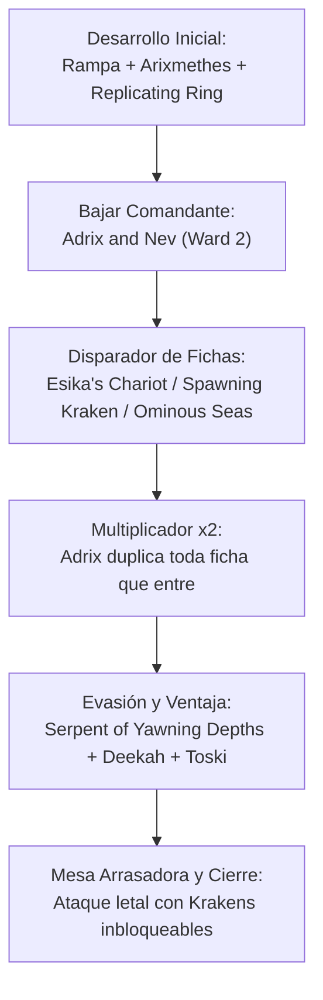

# Guía Estratégica: Adrix & Nev — Versión Optimizada Colección (`adrix_optimized`)

**Comandante**: [`Adrix and Nev, Twincasters`](file:///root/mtg/decks/Commander/adrix_optimized/adrix_optimized.txt#L2)  
**Formato**: Commander / EDH (Legal según Magic Comprehensive Rules CR 903)  
**Identidad de Color**: Simic (`{G}{U}`)  
**Enfoque**: Duplicación Masiva de Fichas, Monstruos Marinos y Clones Exponenciales  
**Nivel de Liga**: **Bracket 3 Oficial WotC / Nivel 7.0 High-Power Casual**  
**Origen de Cartas**: **100% de tu colección física ([`ManaBox_Collection.csv`](file:///root/mtg/ManaBox_Collection.csv))**, con **0 cartas en conflicto** con tus otros mazos activos ([Anowon](file:///root/mtg/decks/Commander/anowon/anowon.txt), [Kardur](file:///root/mtg/decks/Commander/kardur/kardur.txt), [Svella](file:///root/mtg/decks/Commander/svella/svella.txt), [Krenko](file:///root/mtg/decks/Commander/krenko/krenko.txt) y [Liesa](file:///root/mtg/decks/Commander/liesa/liesa.txt)).

---

## 1. El Salto de Calidad Frente a la Versión Anterior

El mazo original de Adrix sufría por incluir cartas pesadas de relleno de coste 8 y 10 que rara vez llegabas a lanzar con comodidad. En esta versión optimizada:

1. **El Motor Esika's Chariot + Adrix**:
   * [`Esika's Chariot`](file:///root/mtg/decks/Commander/adrix_optimized/adrix_optimized.txt#L30) entra al campo y crea **4 gatos 2/2** con Adrix.
   * Pero su mayor virtud es que **en cada ataque clona cualquier ficha de criatura que tengas**. Si eliges una ficha de Kraken 9/9, Adrix duplica el disparo y entran **DOS Krakens 9/9 en cada ataque**.
2. **Defensa Aérea Impenetrable con Hornet Queen**:
   * [`Hornet Queen`](file:///root/mtg/decks/Commander/adrix_optimized/adrix_optimized.txt#L15) entra y Adrix duplica sus fichas creando **OCHO avispas 1/1 voladoras con toque mortal**. Resuelve de golpe la histórica debilidad de Simic contra comandantes voladores (como Liesa 5/5).
3. **El Seguro de Vida contra Iras: Return of the Wildspeaker**:
   * [`Return of the Wildspeaker`](file:///root/mtg/decks/Commander/adrix_optimized/adrix_optimized.txt#L54) permite robar cartas igual a la mayor fuerza a velocidad de instantáneo (robas 9 cartas con un Kraken en mesa en respuesta a una limpieza rival) o dar +3/+3 a tus fichas para cerrar la partida.
4. **Respuesta Universal y Rampa Rápida**:
   * [`Beast Within`](file:///root/mtg/decks/Commander/adrix_optimized/adrix_optimized.txt#L44) destruye cualquier permanente problemático a velocidad de instantáneo.
   * [`Three Visits`](file:///root/mtg/decks/Commander/adrix_optimized/adrix_optimized.txt#L75) busca Bosque o [`Rimewood Falls`](file:///root/mtg/decks/Commander/adrix_optimized/adrix_optimized.txt#L84) desgirada por 2 manás, permitiendo bajar a Adrix en turno 3 bajo Protección {2}.
5. **Ventaja de Cartas que no depende de Maná**:
   * [`Toski, Bearer of Secrets`](file:///root/mtg/decks/Commander/adrix_optimized/adrix_optimized.txt#L26) no puede ser contrarrestado y es indestructible. Roba una carta cada vez que una criatura tuya conecta al rival.
   * [`Curiosity Crafter`](file:///root/mtg/decks/Commander/adrix_optimized/adrix_optimized.txt#L10) elimina el límite de mano y roba cartas con cada impacto de tus fichas.
6. **El Combo Oculto con Mystic Reflection**:
   * [`Mystic Reflection`](file:///root/mtg/decks/Commander/adrix_optimized/adrix_optimized.txt#L50) se puede profetizar por solo `{U}`. En el turno en que vayas a generar fichas (ej. los 2 Krakens de `Spawning Kraken` o los 2 gatos de `Esika's Chariot`), lo lanzas haciendo objetivo a [`Master Biomancer`](file:///root/mtg/decks/Commander/adrix_optimized/adrix_optimized.txt#L17) o a [`Spawning Kraken`](file:///root/mtg/decks/Commander/adrix_optimized/adrix_optimized.txt#L25). Ambas fichas entrarán como **copias exactas**, disparando un crecimiento exponencial incontrolable.
7. **La Mejor Ira de Mesa Simic**:
   * [`Oversimplify`](file:///root/mtg/decks/Commander/adrix_optimized/adrix_optimized.txt#L67) exilia toda criatura enemiga (ignorando indestructible) y te regala un Fractal gigante.
8. **Base de Maná Duplicada**:
   * 9 tierras duales y utilitarias reales sustituyen a las viejas tierras incoloras, garantizando el maná verde y azul desde los primeros turnos.

---

## 2. Los Grandes Motores de la Baraja

### A. La Fábrica Exponencial de Krakens
* [`Spawning Kraken`](file:///root/mtg/decks/Commander/adrix_optimized/adrix_optimized.txt#L25): Cada vez que un Kraken, Leviatán, Pulpo o Serpiente golpea a un jugador, crea un Kraken 9/9. Con Adrix, ¡crea **DOS Krakens 9/9**!
* [`Serpent of Yawning Depths`](file:///root/mtg/decks/Commander/adrix_optimized/adrix_optimized.txt#L24): Hace que todos tus monstruos marinos sean **inbloqueables**. Nadie puede chumpblockear a tus gigantes.
* [`Cyclone Summoner`](file:///root/mtg/decks/Commander/adrix_optimized/adrix_optimized.txt#L11): Rebota toda la mesa enemiga **respetando a tus Krakens y a Adrix (Hechicero)**.

### B. El Enjambre Infinito de Fractales
* [`Paradox Zone`](file:///root/mtg/decks/Commander/adrix_optimized/adrix_optimized.txt#L39): En cada paso final crea **DOS Fractales** gigantes cuyo número de contadores se duplica turno tras turno.
* [`Deekah, Fractal Theorist`](file:///root/mtg/decks/Commander/adrix_optimized/adrix_optimized.txt#L12): Cada instantáneo o conjuro crea 2 Fractales y otorga evasión inbloqueable a todas tus fichas.

### C. Motores de Clonación Masiva
* [`Esix, Fractal Bloom`](file:///root/mtg/decks/Commander/adrix_optimized/adrix_optimized.txt#L13): Convierte las fichas que crees en copias de cualquier criatura en mesa.
* [`Rite of Replication`](file:///root/mtg/decks/Commander/adrix_optimized/adrix_optimized.txt#L70): Estimulado sobre Spawning Kraken crea **10 copias de Spawning Kraken**.
* [`Spitting Image`](file:///root/mtg/decks/Commander/adrix_optimized/adrix_optimized.txt#L73): Crea fichas clon y puedes relanzarla desde el cementerio descartando tierras (Retrace).
* [`Alrund's Epiphany`](file:///root/mtg/decks/Commander/adrix_optimized/adrix_optimized.txt#L60): Turno extra con 4 fichas voladoras.

---

## 3. Plan de Partida y Secuencia por Turnos

* **Turnos 1–2**: Desarrolla tu maná con tierras duales ([`Barkchannel Pathway`](file:///root/mtg/decks/Commander/adrix_optimized/adrix_optimized.txt#L78), [`Yavimaya Coast`](file:///root/mtg/decks/Commander/adrix_optimized/adrix_optimized.txt#L90)) y rocas como [`Simic Signet`](file:///root/mtg/decks/Commander/adrix_optimized/adrix_optimized.txt#L35) o [`Caustic Caterpillar`](file:///root/mtg/decks/Commander/adrix_optimized/adrix_optimized.txt#L7).
* **Turno 3**: Baja un motor de presencia o rampa: [`Arixmethes`](file:///root/mtg/decks/Commander/adrix_optimized/adrix_optimized.txt#L5), [`Managorger Hydra`](file:///root/mtg/decks/Commander/adrix_optimized/adrix_optimized.txt#L16), [`Kodama's Reach`](file:///root/mtg/decks/Commander/adrix_optimized/adrix_optimized.txt#L65) o [`The Weatherseed Treaty`](file:///root/mtg/decks/Commander/adrix_optimized/adrix_optimized.txt#L42).
* **Turno 4**: Despliega a [`Adrix and Nev, Twincasters`](file:///root/mtg/decks/Commander/adrix_optimized/adrix_optimized.txt#L2) (aprovechando su Protección {2}) o pon en mesa a [`Esika's Chariot`](file:///root/mtg/decks/Commander/adrix_optimized/adrix_optimized.txt#L30) / [`Toski`](file:///root/mtg/decks/Commander/adrix_optimized/adrix_optimized.txt#L26).
* **Turnos 5+**: Desata a [`Spawning Kraken`](file:///root/mtg/decks/Commander/adrix_optimized/adrix_optimized.txt#L25) o [`Serpent of Yawning Depths`](file:///root/mtg/decks/Commander/adrix_optimized/adrix_optimized.txt#L24). Ataca con el Carruaje de Esika para clonar tus fichas de Kraken por duplicado y remata con [`Cyclone Summoner`](file:///root/mtg/decks/Commander/adrix_optimized/adrix_optimized.txt#L11) o [`Alrund's Epiphany`](file:///root/mtg/decks/Commander/adrix_optimized/adrix_optimized.txt#L60).
