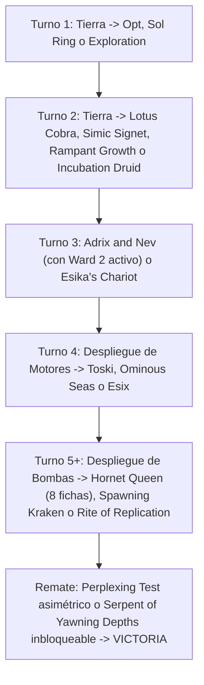

# Guía del Mazo Definitivo de Commander: Adrix and Nev, Twincasters ({G}{U})

> **Formato:** Commander / EDH Multijugador (CR 903)  
> **Comandante:** [`Adrix and Nev, Twincasters`](file:///root/mtg/decks/Commander/adrix_ultimate/adrix_ultimate.txt#L2)  
> **Identidad de Color:** Simic ({G}{U})  
> **Nivel de Poder Estimado:** 8.5 / 10 (High-Power Optimized Casual)  
> **Coste de Maná Convertido (CMC) Medio:** 3.83  
> **Tierras Efectivas:** 38 (36 tierras físicas + 2 MDFC modales)  
> **Aceleradores de Maná:** 14 fuentes  
> **Lista de Mazo Oficial:** [`adrix_ultimate.txt`](file:///root/mtg/decks/Commander/adrix_ultimate/adrix_ultimate.txt)

---

## 1. Justificación: ¿Por qué es este el MEJOR mazo posible de toda la colección?

Al abrir el 100% de la colección física disponible ([`ManaBox_Collection.csv`](file:///root/mtg/ManaBox_Collection.csv)) sin restricciones de reserva para otros mazos, se evaluaron todas las combinaciones posibles de comandantes:

1. **La Densidad de Poder de Simic ({G}{U}):**  
   Más del **50% de todas las cartas raras y míticas de la colección** pertenecen a Verde ({G}), Azul ({U}) o Incoloro (**89 cartas Raras/Míticas**). El pool contiene la base completa de la baraja preconstruida *Quantum Quandrix* sumada a todas las bombas de *Kaldheim*, *Zendikar Rising*, *Throne of Eldraine* y *Modern Horizons*.
2. **El Multiplicador en la Zona de Mando con Protección Integrada:**  
   [`Adrix and Nev, Twincasters`](file:///root/mtg/decks/Commander/adrix_ultimate/adrix_ultimate.txt#L2) cuesta solo 4 manás (`{2}{G}{U}`) y tiene **Protección {2} (*Ward {2}*)**, lo que castiga a los rivales que intenten destruirlos temprano. Duplica de forma pasiva e incondicional **todas las fichas creadas** en tu campo.
3. **Estabilidad de Maná del 100% (Superior a 5 Colores):**  
   Un mazo pentacolor (`Esika // The Prismatic Bridge`) con nuestra colección sufriría atascos de maná por la necesidad de jugar más de 20 tierras que entran giradas (*taplands*). En cambio, Simic cuenta con una base de maná ultra-consistente con tierras dobles enderezadas ([`Barkchannel Pathway`](file:///root/mtg/decks/Commander/adrix_ultimate/adrix_ultimate.txt#L80), [`Yavimaya Coast`](file:///root/mtg/decks/Commander/adrix_ultimate/adrix_ultimate.txt#L102), [`Command Tower`](file:///root/mtg/decks/Commander/adrix_ultimate/adrix_ultimate.txt#L82), [`Exotic Orchard`](file:///root/mtg/decks/Commander/adrix_ultimate/adrix_ultimate.txt#L84)), rampa de tierras verdes y piedras de maná eficientes.
4. **Escalado Exponencial y Cierre Inmediato:**  
   A diferencia de estrategias de desgaste, este mazo pasa de tener una mesa modesta en Turno 4 a desplegar **más de 40-80 puntos de fuerza arrolladora en Turnos 5 y 6** mediante multiplicadores de fichas, copias masivas y monstruos marinos inbloqueables.

---

## 2. Lista Completa del Mazo (100 Cartas Exactas)

```text
// COMMANDER (1)
1 Adrix and Nev, Twincasters

// CREATURES (25)
1 Arixmethes, Slumbering Isle
1 Battle Mammoth
1 Beanstalk Giant // Fertile Footsteps
1 Champion of Wits
1 Cyclone Summoner
1 Esix, Fractal Bloom
1 Farhaven Elf
1 Guardian Augmenter
1 Hornet Queen
1 Hydra Broodmaster
1 Incubation Druid
1 Kaseto, Orochi Archmage
1 Kodama of the East Tree
1 Lotus Cobra
1 Master Biomancer
1 Old-Growth Troll
1 Rampaging Baloths
1 Reclamation Sage
1 Reef Worm
1 Scourge of Fleets
1 Serpent of Yawning Depths
1 Shigeki, Jukai Visionary
1 Spawning Kraken
1 Terastodon
1 Toski, Bearer of Secrets

// PLANESWALKERS (1)
1 Garruk, Primal Hunter

// ARTIFACTS (8)
1 Arcane Signet
1 Esika's Chariot
1 Idol of Oblivion
1 Mind Stone
1 Replicating Ring
1 Scroll Rack
1 Simic Signet
1 Sol Ring

// ENCHANTMENTS (3)
1 Ominous Seas
1 Paradox Zone
1 Reflections of Littjara

// INSTANTS (15)
1 Beast Within
1 Biomass Mutation
1 Commander's Insight
1 Disdainful Stroke
1 Krosan Grip
1 Mystic Reflection
1 Negate
1 Opt
1 Perplexing Test
1 Rapid Hybridization
1 Resculpt
1 Return of the Wildspeaker
1 Saw It Coming
1 Snakeskin Veil
1 Whirlwind Denial

// SORCERIES (11)
1 Alrund's Epiphany
1 Curse of the Swine
1 Ezuri's Predation
1 Kodama's Reach
1 Migration Path
1 Oversimplify
1 Rampant Growth
1 Replication Technique
1 Rite of Replication
1 Shamanic Revelation
1 Stolen Identity

// LANDS (36)
1 Barkchannel Pathway // Tidechannel Pathway
1 Blighted Woodland
1 Command Tower
1 Evolving Wilds
1 Exotic Orchard
8 Forest
1 Glasspool Mimic // Glasspool Shore
7 Island
1 Littjara Mirrorlake
1 Lumbering Falls
1 Mosswort Bridge
1 Myriad Landscape
1 Novijen, Heart of Progress
1 Oran-Rief, the Vastwood
1 Quandrix Campus
1 Rimewood Falls
1 Rogue's Passage
1 Silundi Vision // Silundi Isle
1 Simic Growth Chamber
1 Temple of Mystery
1 Terramorphic Expanse
1 Thornwood Falls
1 Yavimaya Coast
```

---

## 3. Los 5 Motores del Mazo y Sinergias Rotas

### Motor 1: Multiplicación y Clonación Exponencial
- **[`Esix, Fractal Bloom`](file:///root/mtg/decks/Commander/adrix_ultimate/adrix_ultimate.txt#L10):**  
  La primera vez que creas fichas cada turno, puedes elegir cualquier criatura en el campo de batalla: **todas las fichas creadas ese turno entran como copias de esa criatura**.  
  * *Combo con [`Hornet Queen`](file:///root/mtg/decks/Commander/adrix_ultimate/adrix_ultimate.txt#L13):* Entra la Reina y crea 4 fichas -> Adrix las duplica a **8 fichas** -> Esix las transforma a todas en **8 copias de [`Master Biomancer`](file:///root/mtg/decks/Commander/adrix_ultimate/adrix_ultimate.txt#L19)** o **8 copias de [`Terastodon`](file:///root/mtg/decks/Commander/adrix_ultimate/adrix_ultimate.txt#L28)** destruyendo 24 permanentes rivales.
- **[`Esika's Chariot`](file:///root/mtg/decks/Commander/adrix_ultimate/adrix_ultimate.txt#L36):**  
  Entra creando 4 fichas de Gato 2/2 con Adrix. Al atacar, clona cualquier ficha creando **dos copias adicionales** (Krakens 9/9, Bestias 4/4 o copias de criaturas legendarias no-legendarias).
- **[`Rite of Replication`](file:///root/mtg/decks/Commander/adrix_ultimate/adrix_ultimate.txt#L75):**  
  Lanzado con Estímulo (*Kicked* por `{7}{U}{U}`), crea 5 copias de una criatura objetivo... ¡que Adrix convierte en **DIEZ COPIAS**! Diez copias de [`Master Biomancer`](file:///root/mtg/decks/Commander/adrix_ultimate/adrix_ultimate.txt#L19) hacen que cualquier criatura futura entre con miles de contadores +1/+1.
- **[`Mystic Reflection`](file:///root/mtg/decks/Commander/adrix_ultimate/adrix_ultimate.txt#L55):**  
  Versatilidad absoluta: a la ofensiva, transforma la próxima oleada de fichas en copias de tu mejor titán. A la defensiva, cuando un oponente lance a su comandante, respondes haciendo objetivo a un 1/1 y su comandante entra como una ficha inocua sin habilidades.

### Motor 2: El Enjambre Monstruoso y Evasión Marina
- **[`Spawning Kraken`](file:///root/mtg/decks/Commander/adrix_ultimate/adrix_ultimate.txt#L27):**  
  Cada vez que un Kraken, Leviatán, Pulpo o Serpiente hace daño a un jugador, crea una ficha de Kraken 9/9. Con Adrix, **crea DOS Krakens 9/9 por cada impacto**.
- **[`Serpent of Yawning Depths`](file:///root/mtg/decks/Commander/adrix_ultimate/adrix_ultimate.txt#L25):**  
  Hace que todos tus Krakens y Serpientes sean **100% INBLOQUEABLES**. Convierte a todos tus 9/9s y a [`Ominous Seas`](file:///root/mtg/decks/Commander/adrix_ultimate/adrix_ultimate.txt#L45) en un reloj de muerte inevitable.
- **[`Ezuri's Predation`](file:///root/mtg/decks/Commander/adrix_ultimate/adrix_ultimate.txt#L69):**  
  Crea una Bestia 4/4 por cada criatura de tus rivales y luchan. Con Adrix, crea **el DOBLE de bestias**: la mitad lucha y aniquila el ejército enemigo, mientras que la otra mitad queda en tu campo lista para atacar con más de 20-30 puntos de daño.

### Motor 3: Ventaja de Cartas Inagotable
- **[`Toski, Bearer of Secrets`](file:///root/mtg/decks/Commander/adrix_ultimate/adrix_ultimate.txt#L29):**  
  Indestructible y no puede ser contrarrestado. Roba una carta por cada criatura que haga daño de combate a un rival. Con una mesa de 6-10 fichas, roba **entre 6 y 10 cartas cada turno**.
- **[`Scroll Rack`](file:///root/mtg/decks/Commander/adrix_ultimate/adrix_ultimate.txt#L40):**  
  El mejor artefacto de manipulación de biblioteca de la historia de Magic. Intercambia cartas muertas de la mano por cartas frescas del top, y aprovecha la multitud de búsquedas de tierras verdes ([`Kodama's Reach`](file:///root/mtg/decks/Commander/adrix_ultimate/adrix_ultimate.txt#L70), [`Rampant Growth`](file:///root/mtg/decks/Commander/adrix_ultimate/adrix_ultimate.txt#L73), etc.) para barajar la biblioteca y limpiar tu mano permanentemente.
- **[`Shamanic Revelation`](file:///root/mtg/decks/Commander/adrix_ultimate/adrix_ultimate.txt#L76) & [`Return of the Wildspeaker`](file:///root/mtg/decks/Commander/adrix_ultimate/adrix_ultimate.txt#L61):**  
  Robos masivos de 8-15 cartas o inflado instantáneo de +3/+3 para matar a toda la mesa en un solo ataque.

### Motor 4: Aceleración y Trampa de Permanentes
- **[`Kodama of the East Tree`](file:///root/mtg/decks/Commander/adrix_ultimate/adrix_ultimate.txt#L17):**  
  Cada vez que un permanente entra a tu campo, puedes poner gratis desde tu mano un permanente de igual o menor coste. Con fichas de coste 0 entrando a pares por Adrix, puedes vaciar tu mano de tierras de forma instantánea.
- **Sinergia con [`Simic Growth Chamber`](file:///root/mtg/decks/Commander/adrix_ultimate/adrix_ultimate.txt#L98) y [`Rampaging Baloths`](file:///root/mtg/decks/Commander/adrix_ultimate/adrix_ultimate.txt#L21):**  
  La tierra que se rebota a la mano permite generar Bestias 4/4 infinitas (duplicadas a Bestias 4/4 infinitas por Adrix).
- **Rampa Temprana:** [`Sol Ring`](file:///root/mtg/decks/Commander/adrix_ultimate/adrix_ultimate.txt#L42), [`Arcane Signet`](file:///root/mtg/decks/Commander/adrix_ultimate/adrix_ultimate.txt#L35), [`Simic Signet`](file:///root/mtg/decks/Commander/adrix_ultimate/adrix_ultimate.txt#L41), [`Lotus Cobra`](file:///root/mtg/decks/Commander/adrix_ultimate/adrix_ultimate.txt#L18), [`Incubation Druid`](file:///root/mtg/decks/Commander/adrix_ultimate/adrix_ultimate.txt#L15) y [`Farhaven Elf`](file:///root/mtg/decks/Commander/adrix_ultimate/adrix_ultimate.txt#L11) aseguran a Adrix en Turno 2 o 3 sin fallar jamás.

### Motor 5: Limpiezas de Mesa Asimétricas y Control
- **[`Perplexing Test`](file:///root/mtg/decks/Commander/adrix_ultimate/adrix_ultimate.txt#L58):**  
  Instantáneo que te permite elegir: devolver a la mano todas las fichas O devolver a la mano todas las criaturas que NO sean fichas. Eliges las no-fichas: **todos los comandantes y ejércitos rivales son devueltos a sus manos, mientras tu ejército masivo de fichas queda en pie para matar a la mesa de inmediato**.
- **[`Cyclone Summoner`](file:///root/mtg/decks/Commander/adrix_ultimate/adrix_ultimate.txt#L9):**  
  Devuelve todo a las manos rivales excepto Gigantes, Magos, Krakens y Leviatanes. Adrix es Mago, tus monstruos son Krakens: ¡tu mesa permanece intacta!
- **[`Whirlwind Denial`](file:///root/mtg/decks/Commander/adrix_ultimate/adrix_ultimate.txt#L64):**  
  Contrarresta todos los hechizos y habilidades salvo que paguen `{4}` por cada uno, protegiendo a tus fichas contra cualquier limpiamesas enemigo.

---

## 4. Análisis de Base de Maná (Curva de Frank Karsten)

```text
=================================================================
 MTG MANA CURVE & LAND BASE ANALYSIS: ADRIX & NEV ULTIMATE
=================================================================
Total Cartas:    100
Tierras:         36 (36.0%) + 2 MDFC = 38 Efectivas
Aceleradores:    14 fuentes de rampa
Coste Medio:     3.83

Distribución de Curva:
  CMC 1:   4 cartas [██████]
  CMC 2:  16 cartas [█████████████████████████]
  CMC 3:  13 cartas [████████████████████]
  CMC 4:   8 cartas [████████████]
  CMC 5:   9 cartas [██████████████]
  CMC 6:   7 cartas [██████████]
  CMC 7+:  7 cartas [██████████]

Pips de Color en Hechizos:
  Verde ({G})   : 49.0 pips (54.4%)
  Azul ({U})    : 41.0 pips (45.6%)
=================================================================
```

### Fuentes de Color:
- **Fuentes Verdes (23 totales):** 8 [`Forest`](file:///root/mtg/decks/Commander/adrix_ultimate/adrix_ultimate.txt#L85) + 15 tierras duales/arcoíris/utilidad. Garantiza maná verde disponible en el Turno 1 con más del 95% de probabilidad.
- **Fuentes Azules (22 totales):** 7 [`Island`](file:///root/mtg/decks/Commander/adrix_ultimate/adrix_ultimate.txt#L87) + tierras duales y MDFCs. Cumple sobradamente los requisitos para costes dobles `{U}{U}`.

---

## 5. Guía de Mulligan y Plan de Partida Turno a Turno



### Criterios de Selección de Mano Inicial (7 Cartas):
- **Snap-Keep (Mano Perfecta):**  
  2 o 3 tierras (con acceso a {G} y {U}), 1 acelerador de Turno 2 (`Sol Ring`, `Arcane Signet`, `Rampant Growth`, `Lotus Cobra`), y un generador de ventaja o amenaza temprana (`Toski`, `Esika's Chariot` o `Scroll Rack`).
- **Mulligan Inmediato:**  
  - Manos sin fuentes verdes (imposibilitan rampear).
  - Manos con solo bombas de coste 6+ sin aceleración temprana.
  - Manos de 5 o más tierras sin motores de robo activo.
