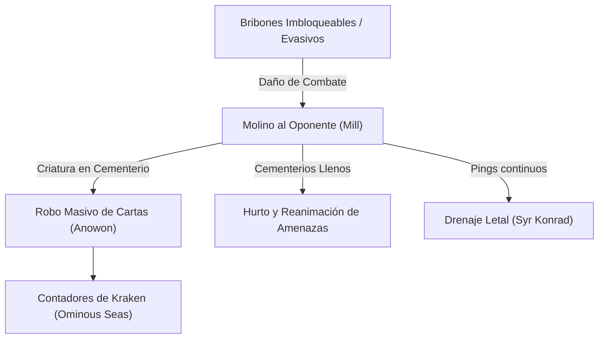
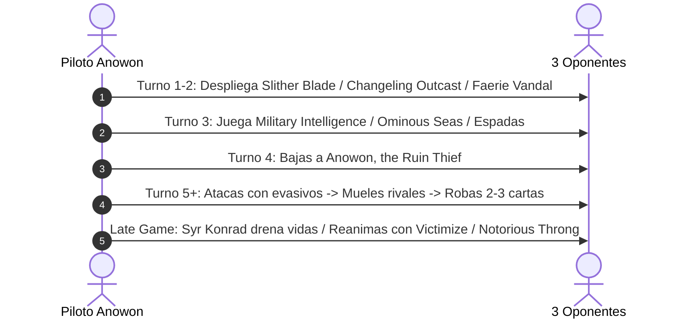

# Guía Estratégica: Anowon, the Ruin Thief
### Infiltración Tribal, Molino de Combate y Hurto de Cementerios (Dimir Rogues & Reanimation)

> **Formato:** Commander / EDH (CR 903)  
> **Comandante:** [Anowon, the Ruin Thief](file:///root/mtg/decks/Commander/anowon/anowon.txt#L2)  
> **Identidad de Color:** Dimir (`{U, B}`)  
> **Total Cartas:** 100 cartas exactas (Conforme a la normativa oficial CR 903.5)  
> **Lista del mazo:** [`decks/Commander/anowon/anowon.txt`](file:///root/mtg/decks/Commander/anowon/anowon.txt)  
> **Compatibilidad:** 0 cartas compartidas con el mazo de [Adrix and Nev](file:///root/mtg/decks/Commander/adrix/adrix.txt)

---

## 1. El Comandante: Mecánicas y Reglas Oficiales

| Característica | Detalle |
| :--- | :--- |
| **Coste de Maná** | `{2}{U}{B}` (CMC: 4) |
| **Tipo de Carta** | Criatura Legendaria — Bribón Vampiro (2/4) |
| **Efecto Lord Tribal** | *"Los otros Bribones que controlas obtienen +1/+1."* |
| **Habilidad de Combate** | *"Siempre que uno o más Bribones que controlas hagan daño de combate a un jugador, ese jugador muele (*mills*) una carta por cada 1 punto de daño recibido. Si ese jugador molió al menos una carta de criatura de esta manera, robas una carta."* |

### Reglas Oficiales Clave (CR 903 & CR 510)
1. **Disparo por Cada Jugador Impactado:** La habilidad se comprueba **por cada oponente individual**. Si atacas a 3 oponentes distintos con al menos un Rogue a cada uno y los 3 reciben daño, mueles a los 3 y puedes **robar hasta 3 cartas en un solo turno de combate**.
2. **Cálculo del Daño:** Mueles tantas cartas como **daño total de combate** hayan hecho tus Rogues a ese jugador. Un Rogue 3/3 noqueando al rival le muele 3 cartas.
3. **Condición de Robo:** Solo necesitas que entre las cartas molidas en ese disparo haya **al menos una criatura** para activar el robo. En Commander (donde los mazos llevan entre 25 y 40 criaturas), la probabilidad de robar carta en cada impacto es altísima (>70%).

---

## 2. Curva de Maná y Base de Tierras

El mazo fue reestructurado para eliminar el problema de atasco (*flooding*) de la lista original (que tenía 41 tierras), ajustándolo al modelo matemático de **Frank Karsten**:

```text
=================================================================
 MTG MANA CURVE & LAND BASE ANALYSIS
=================================================================
Total Cartas:           100
Coste Medio (CMC):      3.10 (Curva agresiva y ultra ágil)
Tierras Totales:        37 tierras efectivas (35 tradicionales + 2 MDFC)
Piezas de Rampa:        5 rocas de coste 2 (*Sol Ring*, *Signets*, etc.)
Distribución de Pips:   Negro (B): 52.0%  |  Azul (U): 48.0%
=================================================================
```

### Gráfico de Distribución de Curva

```text
  CMC  1:  6 cartas | ██████
  CMC  2: 22 cartas | █████████████████████████ (PICO MÁXIMO DE AGRESIVIDAD)
  CMC  3: 11 cartas | ████████████
  CMC  4: 14 cartas | ███████████████
  CMC  5:  6 cartas | ███████
  CMC  6:  2 cartas | ██
  CMC 7+:  2 cartas | ██
```

* **Pico masivo en CMC 2 (22 cartas):** Te garantiza siempre tener presencia en mesa en turno 1 y turno 2 para conectar con el rival en cuanto Anowon toque el campo en turno 4.
* **39 Cartas de coste 1 a 3:** Velocidad pura de formato *Tempo*. Mientras tus rivales juegan tierras giradas o rocas lentas, tú ya estás vaciando sus bibliotecas y llenando tu mano.

---

## 3. Desglose Estratégico por Pilares



### Pilar 1: La Vanguardia Evasiva (30 Criaturas)
La clave para que Anowon funcione es que tus criaturas **no puedan ser bloqueadas**:

* **Imbloqueables Naturales de Coste 1 y 2:**
  * [Slither Blade](file:///root/mtg/decks/Commander/anowon/anowon.txt#L27), [Triton Shorestalker](file:///root/mtg/decks/Commander/anowon/anowon.txt#L33) y [Changeling Outcast](file:///root/mtg/decks/Commander/anowon/anowon.txt#L7): Atacantes de turno 1 que garantizan daño en todos los turnos.
  * [Invisible Stalker](file:///root/mtg/decks/Commander/anowon/anowon.txt#L16): Imbloqueable y con **Antimaleficio** (*Hexproof*). Es el mejor portador de equipos de todo el mazo.
  * [Daring Saboteur](file:///root/mtg/decks/Commander/anowon/anowon.txt#L9): Se hace imbloqueable pagando `{1}{U}` y filtra tu mano robando y descartando.
* **Voladores y Flash con Utilidad:**
  * [Soaring Thought-Thief](file:///root/mtg/decks/Commander/anowon/anowon.txt#L28): Entra a velocidad instantánea (*Flash*), da +1/+0 a tus Rogues y muele 2 cartas a cada rival al atacar.
  * [Faerie Vandal](file:///root/mtg/decks/Commander/anowon/anowon.txt#L12): Vuela y gana un contador +1/+1 cada vez que robas tu segunda carta del turno (automático con Anowon).
  * [Merfolk Windrobber](file:///root/mtg/decks/Commander/anowon/anowon.txt#L18) y [Nightveil Sprite](file:///root/mtg/decks/Commander/anowon/anowon.txt#L21): Aceleran el molino y vigilan (*Surveil*) la parte superior de tu baraja.
* **Señores Bribones (*Lords*) y Disrupción:**
  * [Oona's Blackguard](file:///root/mtg/decks/Commander/anowon/anowon.txt#L24): Pone contadores +1/+1 sobre tus Rogues y hace que **los oponentes descarten una carta** cada vez que una de tus criaturas con contador les haga daño de combate.
  * [Stinkdrinker Bandit](file:///root/mtg/decks/Commander/anowon/anowon.txt#L29): Otorga la habilidad de **Merodear** (*Prowl*): cada vez que un Rogue no sea bloqueado, obtiene **+2/+1**. Con 3 criaturas imbloqueables es un impulso de +6 de daño.
  * [Frogtosser Banneret](file:///root/mtg/decks/Commander/anowon/anowon.txt#L13): Reduce en `{1}` el coste de todos tus Bribones.
  * [Notion Thief](file:///root/mtg/decks/Commander/anowon/anowon.txt#L22): Carta brutal en Commander. Si un oponente fuera a robar cartas adicionales, **las robas tú en su lugar**.

---

### Pilar 2: Amenazas que Escalan con el Molino (Payoffs)
A medida que Anowon vacía las bibliotecas enemigas, estas cartas se convierten en monstruos descomunales:

1. **[Consuming Aberration](file:///root/mtg/decks/Commander/anowon/anowon.txt#L8):**
   * Su fuerza y resistencia son iguales a **todas las cartas en todos los cementerios oponentes** (fácilmente un 30/30 o 40/40 en turnos medios).
   * Cada vez que lanzas un hechizo, un rival muele cartas hasta revelar una tierra.
2. **[Syr Konrad, the Grim](file:///root/mtg/decks/Commander/anowon/anowon.txt#L32):**
   * Cada vez que una carta de criatura entra a un cementerio desde cualquier lugar (incluyendo al ser molida por Anowon), **hace 1 punto de daño a cada oponente**.
   * Con 3 oponentes moliendo criaturas en combate, Syr Konrad drena entre 4 y 8 vidas por turno a toda la mesa sin tener que atacar.
3. **[Nighthowler](file:///root/mtg/decks/Commander/anowon/anowon.txt#L20):**
   * Criatura con *Bestow* que obtiene +X/+X igual a todas las criaturas en todos los cementerios.
   * Puedes encantar a un [Invisible Stalker](file:///root/mtg/decks/Commander/anowon/anowon.txt#L16) para convertirlo en un atacante imbloqueable 15/15 con antimaleficio.
4. **[Nighthawk Scavenger](file:///root/mtg/decks/Commander/anowon/anowon.txt#L19):**
   * Vampiro con volar, toque mortal y vínculo vital cuya fuerza escala con la cantidad de tipos de carta en los cementerios rivales (tierra, criatura, instantáneo, conjuro, artefacto, encantamiento, planeswalker).

---

### Pilar 3: Reanimación y Hurto del Rival (Reanimation & Theft)
¿Para qué gastar maná en criaturas gigantes cuando puedes robar las de tus oponentes?

* **[Whispersteel Dagger](file:///root/mtg/decks/Commander/anowon/anowon.txt#L47):**
  * Equipo estelar para Anowon. Cuando la criatura equipada hace daño de combate a un rival, **puedes lanzar cartas de su cementerio** gastando maná de cualquier color. Te juegas sus mejores hechizos y criaturas recién molidas.
* **[Victimize](file:///root/mtg/decks/Commander/anowon/anowon.txt#L76):**
  * Por solo `{2}{B}`, sacrificas un Rogue de coste 1 como *Slither Blade* y regresas al campo de batalla **dos cartas de criatura** de tu cementerio (por ejemplo, *Consuming Aberration* y *Sepulchral Primordial*).
* **[Sepulchral Primordial](file:///root/mtg/decks/Commander/anowon/anowon.txt#L26):**
  * Entra al campo con intimidar y pone bajo tu control la mejor criatura del cementerio de **cada uno de tus oponentes** (3 criaturas gigantes de golpe).
* **[Extract from Darkness](file:///root/mtg/decks/Commander/anowon/anowon.txt#L70):**
  * Muele 2 cartas a cada jugador y reanima cualquier criatura de cualquier cementerio.
* **[King Narfi's Betrayal](file:///root/mtg/decks/Commander/anowon/anowon.txt#L52):**
  * Saga que muele 4 cartas a toda la mesa y en los dos turnos siguientes te permite lanzar criaturas y planeswalkers de entre las cartas molidas.
* **[Lazav, Dimir Mastermind](file:///root/mtg/decks/Commander/anowon/anowon.txt#L17):**
  * Criatura 3/3 con antimaleficio que, cada vez que una criatura enemiga va al cementerio, puede transformarse en una copia de esa criatura manteniendo su nombre y antimaleficio.

---

### Pilar 4: Artefactos, Equipos y Armamento (12 Cartas)

* **[Grafted Wargear](file:///root/mtg/decks/Commander/anowon/anowon.txt#L41):** 
  * Equipo estelar con coste de equipar de `{0}` manás. Otorga **+3/+2**, transformando a cualquier Bribón 1/1 inbloqueable en un temible 4/3 que inflige 4 de daño y **muele 4 cartas por impacto**, acelerando enormemente el motor de robo de Anowon.
* **[Blackblade Reforged](file:///root/mtg/decks/Commander/anowon/anowon.txt#L38):**
  * Otorga +1/+1 por cada tierra que controlas. Equipado a Anowon, permite noquear a los rivales por daño de comandante (21 puntos).
* **[Obelisk of Urd](file:///root/mtg/decks/Commander/anowon/anowon.txt#L44):**
  * Artefacto con convocar (*Convoke*). Tus propios bribones te ayudan a lanzarlo gratis; da **+2/+2 a todos tus Rogues**.
* **[Heirloom Blade](file:///root/mtg/decks/Commander/anowon/anowon.txt#L42):**
  * Da +3/+1. Cuando la criatura equipada muere, revela cartas de tu biblioteca hasta encontrar otro Bribón y ponerlo en tu mano, asegurando que nunca te quedes sin criaturas.
* **[Scytheclaw](file:///root/mtg/decks/Commander/anowon/anowon.txt#L45):**
  * Cada vez que conecta daño a un oponente, ese jugador **pierde la mitad de su total de vidas**.

---

### Pilar 5: Interacción, Contrahechizos e Iras Asimétricas

* **[Crippling Fear](file:///root/mtg/decks/Commander/anowon/anowon.txt#L68) (Ira Unilateral):**
  * Eliges el tipo **Bribón (*Rogue*)**. Todas las criaturas que no sean Bribones obtienen **-3/-3**. Barres los aceleradores, fichas y defensas rivales mientras todo tu ejército sigue intacto en mesa.
* **[Soul Manipulation](file:///root/mtg/decks/Commander/anowon/anowon.txt#L65):**
  * Respuesta 2-en-1 de enorme valor por `{1}{U}{B}` a velocidad de instantáneo: contrarresta una criatura peligrosa del oponente y a la vez recupera a tu mejor Bribón muerto del cementerio a tu mano.
* **[Open into Wonder](file:///root/mtg/decks/Commander/anowon/anowon.txt#L75):** Hace que X Bribones sean inbloqueables este turno y roben carta adicional por cada impacto, combinando evasión absoluta y ventaja masiva.
* **[Notorious Throng](file:///root/mtg/decks/Commander/anowon/anowon.txt#L74) (Finisher Absoluto):**
  * Si hiciste daño con un Rogue ese turno, pagas su coste de *Prowl* `{5}{U}`: pones fichas de Hada Bribón 1/1 con volar iguales al daño causado y **tomas un turno extra inmediatamente**.
* **Contrahechizos Clave:**
  * [Saw It Coming](file:///root/mtg/decks/Commander/anowon/anowon.txt#L63): Puedes dejarlo en *Foretell* por `{2}` y contrarrestar cualquier hechizo por `{U}{U}`.
  * [Disdainful Stroke](file:///root/mtg/decks/Commander/anowon/anowon.txt#L58): Por solo `{1}{U}` contrarresta cualquier hechizo de coste 4 o más, frenando limpiamesas masivos (*Wrath of God*, *Farewell*) y la inmensa mayoría de comandantes rivales.
  * [Negate](file:///root/mtg/decks/Commander/anowon/anowon.txt#L60): Protección directa frente a iras de mesa o combos no-criatura.

---

## 4. Plan de Partida: Turno a Turno



### Turnos 1 a 3: Asedio Evasivo
1. Baja siempre una criatura de turno 1 o 2 ([Slither Blade](file:///root/mtg/decks/Commander/anowon/anowon.txt#L27), [Invisible Stalker](file:///root/mtg/decks/Commander/anowon/anowon.txt#L16), [Changeling Outcast](file:///root/mtg/decks/Commander/anowon/anowon.txt#L7)).
2. Coloca motores pasivos de robo como [Military Intelligence](file:///root/mtg/decks/Commander/anowon/anowon.txt#L53) o [Ominous Seas](file:///root/mtg/decks/Commander/anowon/anowon.txt#L54).

### Turno 4: La Llegada del Comandante
1. Entra **Anowon, the Ruin Thief**. Automáticamente todos tus atacantes se convierten en 2/2 o 3/3.
2. Si tus criaturas ya atacaron o atacan ese turno, inicias la rueda de molino y comienzas a robar cartas adicionales en cada combate.

### Turnos 5 y 6: El Dominio de Mesa
1. Equipa [Whispersteel Dagger](file:///root/mtg/decks/Commander/anowon/anowon.txt#L47) para empezar a castear los hechizos más potentes que tus rivales hayan molido.
2. Mantén maná abierto para [Saw It Coming](file:///root/mtg/decks/Commander/anowon/anowon.txt#L63), [Resculpt](file:///root/mtg/decks/Commander/anowon/anowon.txt#L62) o [Aetherize](file:///root/mtg/decks/Commander/anowon/anowon.txt#L57).

### Turno 7+: Ejecución del Cierre
1. **Opción A (Combate Agresivo):** Lanza [Notorious Throng](file:///root/mtg/decks/Commander/anowon/anowon.txt#L74) para llenar la mesa de hadas y jugar un turno extra.
2. **Opción B (Drenaje Pasivo):** Baja a [Syr Konrad, the Grim](file:///root/mtg/decks/Commander/anowon/anowon.txt#L32) y lanza [Maddening Cacophony](file:///root/mtg/decks/Commander/anowon/anowon.txt#L72) estimulada (*Kicked*) para vaciar la mitad de las bibliotecas rivales y matarlos instantáneamente por daño de impacto de criaturas molidas.
3. **Opción C (Reanimación Masiva):** Lanza [Sepulchral Primordial](file:///root/mtg/decks/Commander/anowon/anowon.txt#L26) para robar los 3 mejores monstruos de los cementerios enemigos.

---

## 5. Tierras Modales (MDFC): El Secreto de la Consistencia

El mazo cuenta con **37 tierras efectivas** gracias a dos cartas modales de doble cara:

1. **[Blackbloom Rogue // Blackbloom Bog](file:///root/mtg/decks/Commander/anowon/anowon.txt#L5):**
   * *Cara Delantera:* Bribón 2/3 con amenaza que se transforma en un **5/3 temible** cuando un oponente tiene 6 o más cartas en su cementerio.
   * *Cara Trasera:* Tierra que entra girada y produce maná negro `{B}` si te has quedado corto de tierras en mano.
2. **[Glasspool Mimic // Glasspool Shore](file:///root/mtg/decks/Commander/anowon/anowon.txt#L14):**
   * *Cara Delantera:* Clona a cualquiera de tus mejores Bribones o a un monstruo rival en mesa.
   * *Cara Trasera:* Tierra que entra girada y da maná azul `{U}`.

---

## 6. Lista Oficial del Mazo (Formato ManaBox)

La lista íntegra, optimizada sin cartas compartidas con el mazo de Adrix y lista para importar en **ManaBox Android**, se encuentra en:

👉 **[`decks/Commander/anowon/anowon.txt`](file:///root/mtg/decks/Commander/anowon/anowon.txt)**
