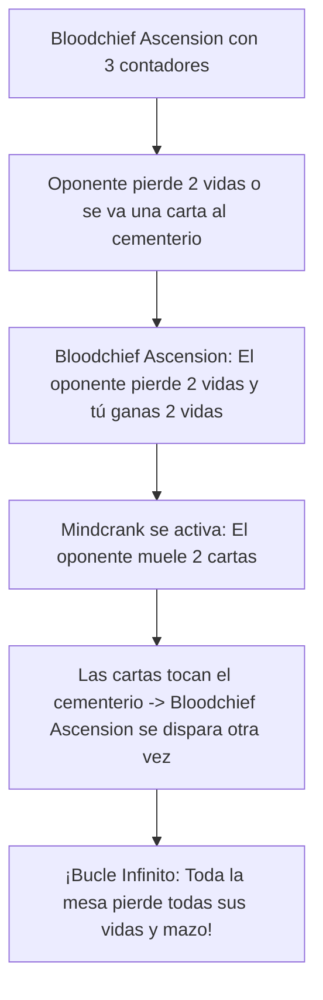

# Guía de Mejoras y Upgrades Futuros: Anowon, the Ruin Thief
### De Infiltración de Bribones a Robo de Cementerios y Combo de Molino Letal (Power Level 8)

> **Mazo Base:** [`decks/Commander/anowon/anowon.txt`](file:///root/mtg/decks/Commander/anowon/anowon.txt)  
> **Guía Estratégica Base:** [`decks/Commander/anowon/anowon_guide.md`](file:///root/mtg/decks/Commander/anowon/anowon_guide.md)  
> **Comandante:** [Anowon, the Ruin Thief](file:///root/mtg/decks/Commander/anowon/anowon.txt#L2)  
> **Identidad de Color:** Dimir (`{U, B}`)  
> **Presupuesto Estimado:** Escalonado en 3 fases modulares (desde 12 €).

---

## 1. Visión General: Los Cuellos de Botella de Anowon

Anowon es extremadamente rápido y genera una ventaja de cartas pasiva constante si tus Bribones conectan. Sin embargo, en mesas de nivel medio-alto presenta tres puntos vulnerables:

1. **El "Efecto Búmeran" del Molino (*Self-Harm Mill*):** Moler cartas a los oponentes puede beneficiar a mazos que jueguen con el cementerio (como Karador, Muldrotha o Meren). Necesitas cartas que **exilien lo que mueles o te permitan robarlo antes de que lo usen**.
2. **Bribones de relleno de bajo impacto:** Criaturas como [Dhund Operative](file:///root/mtg/decks/Commander/anowon/anowon.txt#L10) o [Expedition Skulker](file:///root/mtg/decks/Commander/anowon/anowon.txt#L11) son simples cuerpos 2/2 que aportan poco. Deben sustituirse por Bribones de utilidad estelar (*Dauthi Voidwalker*, *Brazen Borrower*).
3. **Cierre de partida sin combate masivo:** Si una mesa se llena de bloqueadores voladores gigantes, al mazo le cuesta cerrar la partida solo por daño de combate. La solución es un **combo letal de molino instantáneo** (*Mindcrank* + *Bloodchief Ascension*).



---

## 2. Hoja de Ruta de Adquisición por Fases

---

### FASE 1: Mejoras "Budget" de Alto Impacto (~12 € - 15 € en total)
*Reemplazan cartas lentas por la mejor interacción y herramientas de molino por menos de 3 € cada una.*

| Carta a Incluir | Coste Maná | Tipo | Precio Aprox. | Rol Estratégico |
| :--- | :---: | :--- | :---: | :--- |
| **Drown in the Loch** | `{U}{B}` | Instantáneo | ~1.20 € | **El hechizo definitivo para Anowon.** Como siempre mueles al rival, por solo 2 manás es un *Counterspell* universal O un *Murder* a cualquier criatura. |
| **Rogue Class** | `{1}{U}{B}` | Encantamiento — Clase | ~2.50 € | Nivel 1: Cada golpe de criatura exilia la primera carta enemiga para jugarla. Nivel 2: Toda tu tropa gana *Amenaza*. Nivel 3: Juegas las cartas exiliadas con maná de cualquier color. |
| **Mindcrank** | `{2}` | Artefacto | ~3.50 € | Cada vez que un oponente pierde vidas, muele esa misma cantidad de cartas. Duplica de inmediato el molino de tus Bribones y activa combos letales. |
| **Animate Dead** | `{1}{B}` | Encantamiento — Aura | ~4.50 € | Por solo 2 manás, robas del cementerio de cualquier rival el dragón, ángel o titán que le acabas de moler. |
| **Counterspell** | `{U}{U}` | Instantáneo | ~1.00 € | Cancelación dura incondicional para proteger a Anowon o detener victorias rivales. |
| **Sunken Hollow** | Tierra | Tierra Doble | ~0.80 € | Tierra dual con tipos de Pantano e Isla; entra enderezada si tienes dos básicas. |
| **Tainted Isle** | Tierra | Tierra Doble | ~0.50 € | Da maná incoloro o `{U}`/`{B}` enderezado si controlas un Pantano. |

> **Resultado de la Fase 1:** El mazo neutraliza amenazas con *Drown in the Loch*, acelera el vaciado de bibliotecas con *Mindcrank* y reanima amenazas enemigas por tan solo 2 manás.

---

### FASE 2: Motores de Élite y el Combo Letal (~35 € - 45 € en total)
*Incorpora el Bribón más poderoso del juego y la condición de victoria infinita.*

| Carta a Incluir | Coste Maná | Tipo | Precio Aprox. | Rol Estratégico |
| :--- | :---: | :--- | :---: | :--- |
| **Dauthi Voidwalker** | `{B}{B}` | Criatura — Bribón (3/2) | ~9.50 € | **La mejor carta posible para este mazo.** Tiene *Sombra (Shadow)*, por lo que es virtualmente **100% inbloqueable**. Exilia con un contador de vacío todo lo que fuera al cementerio enemigo. Puedes sacrificarlo para lanzar GRATIS cualquier carta exiliada. |
| **Bloodchief Ascension** | `{B}` | Encantamiento | ~9.00 € | Se carga con 3 contadores muy rápido con tus Bribones atacando. En cuanto se activa, drena 2 vidas por cada carta que toque el cementerio. **Combo infinito instantáneo con Mindcrank.** |
| **Brazen Borrower** | `{1}{U}{U}` | Criatura — Bribón (3/1) | ~4.50 € | Criatura con Flash y Vuela de 3 de fuerza que viene acompañada de una aventura para rebotar permanentes enemigos molestos. |
| **Reanimate** | `{B}` | Conjuro | ~7.00 € | El reanimador más eficiente de Magic: roba cualquier titán molido de la mesa por un solo maná negro. |
| **Morphic Pool** | Tierra | Tierra Doble | ~7.00 € | La tierra dual perfecta de Commander: entra enderezada siempre en partidas multijugador. |

> **Resultado de la Fase 2:** Con *Dauthi Voidwalker* eliminas el riesgo de alimentar cementerios ajenos, y con *Bloodchief Ascension* tienes una victoria fulminante que no depende del combate.

---

### FASE 3: Upgrades de Lujo / Nivel Competitivo (~50 €+)
*Para llevar a Anowon a mesas de máxima exigencia:*

* **Opposition Agent** (~13 €): Criatura Bribón con Flash. Cuando un rival busca en su biblioteca (con *fetch lands*, tutores o rampas), tú controlas su búsqueda, le robas la carta y la exilias para jugarla tú.
* **Cyclonic Rift** (~30 €): Limpia toda la mesa enemiga de forma asimétrica permitiendo que tus 30 Bribones pasen sin oposición a rematar la partida.
* **Watery Grave** (~12 €) y **Polluted Delta** (~12 €): La base de tierras profesional para buscar colores en turno 1 sin perder vidas.
* **Fierce Guardianship** (~35 €): Contrahechizo gratuito con Anowon en mesa.

---

## 3. Tabla de Sustituciones 1 a 1 (Qué entra y qué sale)

| Sale de la Lista Actual | Entra como Mejora | Motivo del Cambio |
| :--- | :--- | :--- |
| [Dhund Operative](file:///root/mtg/decks/Commander/anowon/anowon.txt#L10) | **Dauthi Voidwalker** | Cambias un 2/2 débil por el Bribón más roto del formato con evasión absoluta y hurto gratis. |
| [Expedition Skulker](file:///root/mtg/decks/Commander/anowon/anowon.txt#L11) | **Brazen Borrower** | Cambias una criatura mediocre por un Bribón volador con flash y rebote incorporado. |
| [Bloodline Pretender](file:///root/mtg/decks/Commander/anowon/anowon.txt#L6) | **Opposition Agent** | Cambias un changeling plano por el mayor freno a tutores del juego en tipo Bribón. |
| [Sure-Footed Infiltrator](file:///root/mtg/decks/Commander/anowon/anowon.txt#L30) | **Rogue Class** | Quitas un Bribón lento de coste 4 para meter un motor de robo, evasión y hurto continuo. |
| [Bonehoard](file:///root/mtg/decks/Commander/anowon/anowon.txt#L39) | **Mindcrank** | Cambias un equipo que solo da fuerza por el artefacto que duplica el molino y habilita el combo. |
| [Extract from Darkness](file:///root/mtg/decks/Commander/anowon/anowon.txt#L70) | **Reanimate** | Pagas 1 maná en vez de 5 para quedarte con la mejor criatura molida del juego. |
| [Necromantic Selection](file:///root/mtg/decks/Commander/anowon/anowon.txt#L73) | **Animate Dead** | Quitas un wipe pesado de 7 manás para meter reanimación rápida y agresiva de 2 manás. |
| [Soul Manipulation](file:///root/mtg/decks/Commander/anowon/anowon.txt#L65) | **Drown in the Loch** | Cambias un contrahechizo condicional de 3 manás por la respuesta instantánea modal definitiva de 2 manás. |
| [Distant Melody](file:///root/mtg/decks/Commander/anowon/anowon.txt#L69) | **Bloodchief Ascension** | Quitas un conjuro condicional de 4 manás por la condición de victoria definitiva. |
| [Submerged Boneyard](file:///root/mtg/decks/Commander/anowon/anowon.txt#L91) | **Morphic Pool** | Sustituyes una tierra que entra girada obligatoria por la mejor dual enderezada. |
| [Dismal Backwater](file:///root/mtg/decks/Commander/anowon/anowon.txt#L83) | **Sunken Hollow** | Eliminas tierra tapada por dual con tipos de tierra buscable. |

---

## 4. El Combo Infinito Explicado: Mindcrank + Bloodchief Ascension

```text
Condición: [Bloodchief Ascension] con 3 contadores + [Mindcrank] en campo.

1. Se produce cualquier pérdida de vidas o se pone una carta en el cementerio rival:
   - Un Bribón conecta 1 punto de daño de combate.
   - O destruyes una criatura enemiga.
   - O un rival lanza una carta o activa una fetch land.

2. Se activa el disparador en bucle cerrado:
   a) La carta va al cementerio -> Bloodchief Ascension hace que ese oponente pierda 2 vidas y tú ganes 2 vidas.
   b) El oponente pierde 2 vidas -> Mindcrank hace que ese oponente muela 2 cartas de su biblioteca.
   c) Esas 2 cartas van al cementerio -> Bloodchief Ascension se dispara 2 VECES (pierde 4 vidas).
   d) Pierde 4 vidas -> Mindcrank le hace moler 4 cartas.

3. Resultado:
   El bucle no se detiene hasta vaciar toda la biblioteca del oponente y drenar todas sus vidas a 0 en el acto.
```
