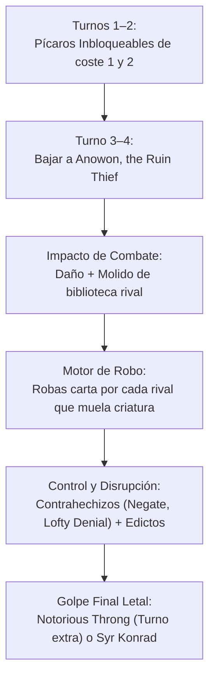

# Guía Estratégica: Anowon, the Ruin Thief — Versión Optimizada Colección (`anowon_optimized`)

**Comandante**: [`Anowon, the Ruin Thief`](file:///root/mtg/decks/Commander/anowon_optimized/anowon_optimized.txt#L2)  
**Formato**: Commander / EDH (Legal según Magic Comprehensive Rules CR 903)  
**Identidad de Color**: Dimir (`{U}{B}`)  
**Enfoque**: Tempo Tribal de Pícaros, Evasión Inbloqueable, Robo Masivo de Cartas e Interacción Rápida  
**Nivel de Liga**: **Bracket 2 Alto / Nivel 6.5 Focused Casual**  
**Origen de Cartas**: **100% de tu colección física ([`ManaBox_Collection.csv`](file:///root/mtg/ManaBox_Collection.csv))**, con **0 solapamientos** con tus otros mazos activos ([Liesa](file:///root/mtg/decks/Commander/liesa_optimized/liesa_optimized.txt), [Adrix](file:///root/mtg/decks/Commander/adrix_optimized/adrix_optimized.txt), [Kardur](file:///root/mtg/decks/Commander/kardur/kardur.txt) y [Svella](file:///root/mtg/decks/Commander/svella/svella.txt)).

---

## 1. El Salto de Calidad Frente a la Versión Anterior

El mazo preconstruido original de Anowon sufría del clásico problema de los precons antiguos: incluía costes 6 y 7 pesados que se atascaban en mano y tierras que entraban giradas sin aportar valor. En esta versión optimizada:

1. **Reducción Drástica de la Curva (CMC 2.77)**:
   * El mazo baja su coste medio de **3.11 a 2.77**. Con **29 cartas de coste 1 y 2**, la baraja empieza a meter presión desde el turno 1. Se eliminaron por completo las cartas de coste 7 que frenaban el mazo.
2. **Entrada de la Mejor Tierra Dimir de la Historia**:
   * [`Watery Grave`](file:///root/mtg/decks/Commander/anowon_optimized/anowon_optimized.txt#L93) (*Cripta del agua*, obtenida en tu presentación de Star Trek): entra desgirada por 2 vidas, tiene los subtipos Isla y Pantano y garantiza jugar tus cartas de tempo a tiempo.
3. **El Nuevo Pícaro Tecnológico de Star Trek**:
   * [`Lore, Positronic Provocateur`](file:///root/mtg/decks/Commander/anowon_optimized/anowon_optimized.txt#L16): Un Pícaro 2/3 por solo `{1}{U/B}{U/B}` que al entrar otorga **inbloqueable** a una criatura o hace **Vigilar 2**, asegurando que conectes daño de combate para disparar el robo de Anowon.
4. **Interacción y Eliminación Eficiente de Bajo Coste**:
   * [`Resistance Is Futile`](file:///root/mtg/decks/Commander/anowon_optimized/anowon_optimized.txt#L74) (Star Trek): Destruye cualquier criatura no artefacto por solo 2 manás, o recupera un artefacto criatura caído.
   * [`Consider the Prime Directive`](file:///root/mtg/decks/Commander/anowon_optimized/anowon_optimized.txt#L54) (Star Trek): Contrahechizo modal o aturdimiento con robo de carta.
   * [`Lofty Denial`](file:///root/mtg/decks/Commander/anowon_optimized/anowon_optimized.txt#L58): Con un volador en mesa (muy fácil con tus hadas pícaras), contrarresta a menos que el rival pague 4 manás.
   * [`Ghastly Demise`](file:///root/mtg/decks/Commander/anowon_optimized/anowon_optimized.txt#L57): Por un mísero maná negro (`{B}`), destruye casi cualquier amenaza aprovechando que tu cementerio se llena rápidamente.
5. **Pícaros Incombustibles y Evasivos**:
   * [`Marang River Prowler`](file:///root/mtg/decks/Commander/anowon_optimized/anowon_optimized.txt#L17): 2/1 inbloqueable que puedes relanzar desde el cementerio una y otra vez mientras controles un permanente negro.
   * [`Zulaport Duelist`](file:///root/mtg/decks/Commander/anowon_optimized/anowon_optimized.txt#L34): Pícaro con Destello de coste 1 que hace moler 2 cartas en velocidad instantánea.
   * [`Mistwalker`](file:///root/mtg/decks/Commander/anowon_optimized/anowon_optimized.txt#L19): Cambiaformas volador 1/4 (cuenta como Pícaro) que defiende los cielos y puede inflar su fuerza.

---

## 2. ¿En qué Liga / Bracket juega este mazo?

* **Sistema Oficial de WotC**: **Bracket 2 Alto (Focused Casual)**.  
  No lleva cartas de la lista de *Game Changers* (a diferencia de Liesa que lleva dos), lo que lo convierte en un mazo 100% amigable para cualquier mesa de juego casual, pero optimizado para ser el más veloz de la mesa.
* **Escala Tradicional de la Comunidad**: **Nivel 6.5 (Tempo / Aggro)**.  
  Su fuerza reside en que mientras los oponentes gastan sus primeros turnos bajando piedras de maná giradas, tú ya tienes 2 pícaros en mesa, has bajado a Anowon y estás robando 2 o 3 cartas extra por turno mientras mueles los recursos rivales.

---

## 3. Los Grandes Motores de la Baraja

### A. El Motor de Molido y Drenaje Letal
* [`Syr Konrad, the Grim`](file:///root/mtg/decks/Commander/anowon_optimized/anowon_optimized.txt#L31): Cada vez que una carta de criatura cae a un cementerio desde cualquier parte (¡incluido el molido de Anowon!), inflige 1 daño a **cada oponente**. Con Konrad y Anowon en mesa, atacar a los 3 rivales moliendo cartas puede drenar entre 6 y 12 vidas en un solo turno sin combatir.
* [`Consuming Aberration`](file:///root/mtg/decks/Commander/anowon_optimized/anowon_optimized.txt#L8): Crece con cada carta en todos los cementerios y muele bibliotecas enteras con cada hechizo que lanzas.

### B. Los Remates de Partida
* [`Notorious Throng`](file:///root/mtg/decks/Commander/anowon_optimized/anowon_optimized.txt#L72): La carta estrella de los Pícaros. Si has infligido daño con un Pícaro, pagas su coste de *Merodear* (`{5}{U}`): **crea tantas fichas de Hada Pícara 1/1 voladoras como daño hayas hecho este turno... ¡y juegas un TURNO ADICIONAL!**
* [`Stinkdrinker Bandit`](file:///root/mtg/decks/Commander/anowon_optimized/anowon_optimized.txt#L28): Otorga **+2/+1 a cada pícaro que no sea bloqueado**. Convierte un ataque de 4 pícaros pequeños en más de 15 puntos de daño directo a la cara.
* [`Oona's Blackguard`](file:///root/mtg/decks/Commander/anowon_optimized/anowon_optimized.txt#L24): Hace que tus pícaros entren con contadores +1/+1 y que, cada vez que conecten daño de combate, el oponente **descarte una carta**. Desarma la mano de toda la mesa.

---

## 4. Plan de Partida y Secuencia por Turnos

* **Turnos 1–2**: Baja tus criaturas con evasión: [`Changeling Outcast`](file:///root/mtg/decks/Commander/anowon_optimized/anowon_optimized.txt#L7), [`Slither Blade`](file:///root/mtg/decks/Commander/anowon_optimized/anowon_optimized.txt#L26), [`Triton Shorestalker`](file:///root/mtg/decks/Commander/anowon_optimized/anowon_optimized.txt#L32) o [`Invisible Stalker`](file:///root/mtg/decks/Commander/anowon_optimized/anowon_optimized.txt#L14). Corrige tu maná con [`Watery Grave`](file:///root/mtg/decks/Commander/anowon_optimized/anowon_optimized.txt#L93).
* **Turno 3**: Si tienes rampa o tierra desgirada, despliega a [`Anowon, the Ruin Thief`](file:///root/mtg/decks/Commander/anowon_optimized/anowon_optimized.txt#L2) o a [`Lore, Positronic Provocateur`](file:///root/mtg/decks/Commander/anowon_optimized/anowon_optimized.txt#L16). Ataca con los pícaros de turno 1 para empezar a robar cartas y llenar los cementerios rivales.
* **Turno 4–5**: Mantén 1 o 2 manás abiertos para proteger tu mesa con [`Lofty Denial`](file:///root/mtg/decks/Commander/anowon_optimized/anowon_optimized.txt#L58), [`Negate`](file:///root/mtg/decks/Commander/anowon_optimized/anowon_optimized.txt#L59) o [`Consider the Prime Directive`](file:///root/mtg/decks/Commander/anowon_optimized/anowon_optimized.txt#L54).
* **Turno 6+**: Despliega a [`Syr Konrad`](file:///root/mtg/decks/Commander/anowon_optimized/anowon_optimized.txt#L31) o resuelve [`Notorious Throng`](file:///root/mtg/decks/Commander/anowon_optimized/anowon_optimized.txt#L72) con merodear para cerrar la partida con un ejército volador y un turno extra.
