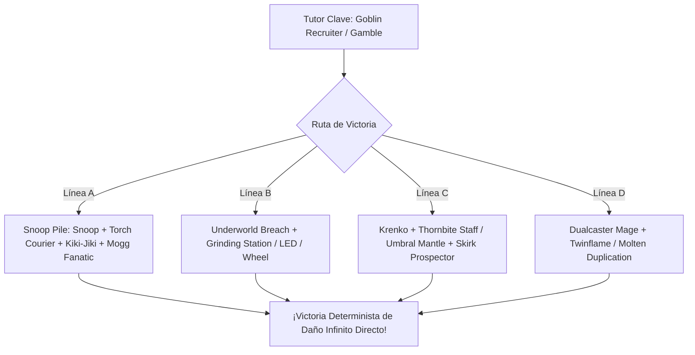
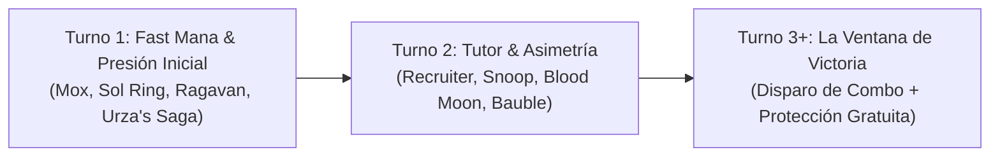

# Guía del Mazo Competitivo de Commander: Krenko, Mob Boss ({R})
### cEDH / Turbo Goblin Storm & Snoop Combo (Power Level 9.0 - 9.5)

> **Formato:** Commander / cEDH Multijugador (CR 903)  
> **Comandante:** [`Krenko, Mob Boss`](file:///root/mtg/decks/Commander/krenko/krenko.txt#L2)  
> **Identidad de Color:** Mono-Rojo (`{R}`)  
> **Nivel de Poder:** 9.0–9.5 / 10 (cEDH / High-Power Competitive)  
> **Coste de Maná Convertido (CMC) Medio:** 1.38  
> **Tierras:** 29 (14 Montañas básicas + 15 tierras de utilidad, fetches y MDFC)  
> **Aceleradores y Maná Positivo:** 15 fuentes (Moxes, LED, Lotus Petal, Mana Vault, Treasonous Ogre, rituales)  
> **Lista Oficial:** [`krenko.txt`](file:///root/mtg/decks/Commander/krenko/krenko.txt)  
> **Guía de Upgrades y Cortes:** [`krenko_upgrades.md`](file:///root/mtg/decks/Commander/krenko/krenko_upgrades.md)  

---

## 1. Filosofía y Arquitectura Competitiva

La gran debilidad de los mazos tribales convencionales de trasgos en Commander es su dependencia del combate y de mantener una mesa llena frente a 3 oponentes con 40 vidas cada uno (120 de vida total). En una mesa competitiva (cEDH / Nivel 9-10), barridos de mesa de bajo coste (*Toxic Deluge*, *Culling Ritual*, *Fire Covenant*) y combos rápidos de turno 2 y 3 anulan por completo las estrategias de desgaste.

Esta versión competitiva transforma a **Krenko, Mob Boss** en un mazo de **combo ultra-rápido, tormenta y stax asimétrico**:
1. **Curva hiper-optimizada (CMC 1.38):** Permite vaciar la mano inmediatamente, alimentar a [`The One Ring`](file:///root/mtg/decks/Commander/krenko/krenko.txt#L44) y capitalizar ruedas como [`Wheel of Fortune`](file:///root/mtg/decks/Commander/krenko/krenko.txt#L74) y [`Wheel of Misfortune`](file:///root/mtg/decks/Commander/krenko/krenko.txt#L75).
2. **Maná Positivo Explosivo (*Fast Mana*):** El chasis incluye toda la aceleración de coste 0 y 1 ([`Chrome Mox`](file:///root/mtg/decks/Commander/krenko/krenko.txt#L30), [`Mox Diamond`](file:///root/mtg/decks/Commander/krenko/krenko.txt#L37), [`Mox Opal`](file:///root/mtg/decks/Commander/krenko/krenko.txt#L38), [`Lotus Petal`](file:///root/mtg/decks/Commander/krenko/krenko.txt#L34), [`Lion's Eye Diamond`](file:///root/mtg/decks/Commander/krenko/krenko.txt#L33), [`Mana Vault`](file:///root/mtg/decks/Commander/krenko/krenko.txt#L36), [`Rite of Flame`](file:///root/mtg/decks/Commander/krenko/krenko.txt#L72), [`Simian Spirit Guide`](file:///root/mtg/decks/Commander/krenko/krenko.txt#L27)), permitiendo amenazar victorias en Turno 2 o 3.
3. **El Doble Rol de Krenko:** Krenko no es una pieza indispensable de la que dependa cada jugada; es un **motor de amenaza masiva desde la Zona de Mando** que exige removal inmediato a los oponentes, abriendo la ventana perfecta para colar los combos de [`Conspicuous Snoop`](file:///root/mtg/decks/Commander/krenko/krenko.txt#L7) o [`Underworld Breach`](file:///root/mtg/decks/Commander/krenko/krenko.txt#L54).
4. **Stax Asimétrico Mono-Rojo:** Castiga las bases de maná codiciosas de 4 y 5 colores con [`Blood Moon`](file:///root/mtg/decks/Commander/krenko/krenko.txt#L49) y [`Magus of the Moon`](file:///root/mtg/decks/Commander/krenko/krenko.txt#L22), mientras [`Vexing Bauble`](file:///root/mtg/decks/Commander/krenko/krenko.txt#L47) neutraliza de raíz los contrahechizos gratuitos enemigos (*Force of Will*, *Fierce Guardianship*, *Pact of Negation*).

---

## 2. Las 4 Líneas Maestras de Victoria Determinista (Combos de Turno 2-3)

---

### Línea A: La Pila de Snoop (`Conspicuous Snoop` + `Goblin Recruiter`)
*La línea de victoria insignia de los Trasgos en cEDH. Gana en el turno en que se resuelve sin necesidad de pasar por la fase de combate ni requerir turnos adicionales.*

1. **Requisitos:** Tener a [`Conspicuous Snoop`](file:///root/mtg/decks/Commander/krenko/krenko.txt#L7) en mesa y resolver [`Goblin Recruiter`](file:///root/mtg/decks/Commander/krenko/krenko.txt#L13) (o tutorear a Snoop si tienes maná para lanzarlo).
2. **Apilamiento de la Biblioteca:** Con la habilidad de `Goblin Recruiter`, colocas en la parte superior de tu baraja las siguientes cartas exactamente en este orden:
   * **Superior (Top 1):** [`Torch Courier`](file:///root/mtg/decks/Commander/krenko/krenko.txt#L29)
   * **Top 2:** [`Kiki-Jiki, Mirror Breaker`](file:///root/mtg/decks/Commander/krenko/krenko.txt#L21)
   * **Top 3:** [`Mogg Fanatic`](file:///root/mtg/decks/Commander/krenko/krenko.txt#L24) (o [`Goblin Chirurgeon`](file:///root/mtg/decks/Commander/krenko/krenko.txt#L10) / [`Skirk Prospector`](file:///root/mtg/decks/Commander/krenko/krenko.txt#L28))
3. **Ejecución del Bucle:**
   * Snoop ve la parte superior de la baraja. Lanzas a [`Torch Courier`](file:///root/mtg/decks/Commander/krenko/krenko.txt#L29) desde la biblioteca pagando `{R}`.
   * Sacrificas a `Torch Courier` haciendo objetivo a Snoop para concederle **Prisa**.
   * Ahora la carta superior de la biblioteca es [`Kiki-Jiki, Mirror Breaker`](file:///root/mtg/decks/Commander/krenko/krenko.txt#L21). Snoop gana la habilidad activada de Kiki-Jiki.
   * Giras a Snoop activando la habilidad de Kiki-Jiki haciendo objetivo al propio Snoop. Se crea una copia ficha de Snoop con prisa.
   * La copia de Snoop también ve a Kiki-Jiki en la parte superior. Giras la copia para crear otra copia de Snoop. **Repites este proceso tantas veces como quieras para crear un millón de fichas de Snoop enderezadas con prisa**.
   * Con la última copia de Snoop, antes de girarla, robas una carta o sacrificas un trasgo mediante otra habilidad si fuera necesario; o simplemente giras a la última copia haciendo objetivo a `Goblin Recruiter` para robar/cambiar la carta superior, revelando a [`Mogg Fanatic`](file:///root/mtg/decks/Commander/krenko/krenko.txt#L24).
   * Al estar `Mogg Fanatic` en la cima, **todas las infinitas copias de Snoop ganan su habilidad activada**: *"Sacrificar esta criatura: Hace 1 punto de daño a cualquier objetivo"*.
   * Sacrificas las copias una a una para infligir **daño infinito a los tres oponentes**. ¡Victoria sin atacar!

---

### Línea B: El Motor de Tormenta de `Underworld Breach`
*El motor de ventaja y combo por antonomasia de formatos eternos.*

1. **Requisitos:** Resolver [`Underworld Breach`](file:///root/mtg/decks/Commander/krenko/krenko.txt#L54) teniendo [`Grinding Station`](file:///root/mtg/decks/Commander/krenko/krenko.txt#L31) en juego (o en cementerio) y cualquier artefacto de coste 0 ([`Lion's Eye Diamond`](file:///root/mtg/decks/Commander/krenko/krenko.txt#L33), [`Lotus Petal`](file:///root/mtg/decks/Commander/krenko/krenko.txt#L34), [`Chrome Mox`](file:///root/mtg/decks/Commander/krenko/krenko.txt#L30)).
2. **Bucle de Molino Infinito:**
   * Lanzas `Lion's Eye Diamond` (o `Lotus Petal`) desde el cementerio usando *Escape* (exiliando 3 cartas del cementerio).
   * Al entrar el artefacto, se dispara [`Grinding Station`](file:///root/mtg/decks/Commander/krenko/krenko.txt#L31), enderezándose.
   * Sacrificas el artefacto para agregar 3 manás `{R}{R}{R}` (LED) o 1 maná `{R}` (Petal).
   * Giras `Grinding Station` sacrificando el artefacto que lanzaste para moler 3 cartas de tu propia biblioteca.
   * Esas 3 cartas molidas te proporcionan el combustible exacto para volver a lanzar el artefacto con *Escape*.
3. **Cierre:**
   * Mueles tu biblioteca entera mientras acumulas decenas de manás rojos y un contador de tormenta astronómico.
   * Escapas [`Goblin Bombardment`](file:///root/mtg/decks/Commander/krenko/krenko.txt#L50), [`Impact Tremors`](file:///root/mtg/decks/Commander/krenko/krenko.txt#L51) o [`Agate Instigator`](file:///root/mtg/decks/Commander/krenko/krenko.txt#L5), y luego escapas criaturas de coste 0/1 repetidamente para drenar la vida de toda la mesa.

---

### Línea C: Krenko Infinito con Motores de Desenderezar
*Cuando Krenko toca la mesa y se le otorga prisa, gana la partida de inmediato con piezas de sinergia.*

* **Bucle 1 (`Krenko` + `Thornbite Staff` + `Skirk Prospector` / `Phyrexian Altar`):**
  1. Equipa [`Thornbite Staff`](file:///root/mtg/decks/Commander/krenko/krenko.txt#L45) a Krenko (gratis al entrar Krenko si el bastón ya está en mesa, por ser Chamán).
  2. Gira a Krenko para crear 2 o más fichas de Trasgo.
  3. Sacrifica una ficha con [`Skirk Prospector`](file:///root/mtg/decks/Commander/krenko/krenko.txt#L28) o [`Phyrexian Altar`](file:///root/mtg/decks/Commander/krenko/krenko.txt#L41) agregando `{R}`.
  4. La muerte de la criatura dispara [`Thornbite Staff`](file:///root/mtg/decks/Commander/krenko/krenko.txt#L45), desenderezando a Krenko.
  5. Repite el ciclo: **Fichas infinitas, Maná rojo infinito y Daño infinito** si tienes a [`Goblin Sharpshooter`](file:///root/mtg/decks/Commander/krenko/krenko.txt#L14), [`Pashalik Mons`](file:///root/mtg/decks/Commander/krenko/krenko.txt#L25) o [`Impact Tremors`](file:///root/mtg/decks/Commander/krenko/krenko.txt#L51).

* **Bucle 2 (`Krenko` + `Mana Echoes` + `Umbral Mantle` / `Staff of Domination`):**
  1. Con [`Mana Echoes`](file:///root/mtg/decks/Commander/krenko/krenko.txt#L52) en mesa y al menos 2 trasgos previos, giras a Krenko creando 2 fichas.
  2. Cada ficha que entra dispara `Mana Echoes`, generando maná incoloro abundante (4 o más manás `{C}`).
  3. Pagas `{3}` para desenderezar a Krenko con [`Umbral Mantle`](file:///root/mtg/decks/Commander/krenko/krenko.txt#L46).
  4. Repites el proceso: el maná generado crece exponencialmente y Krenko gana fuerza infinita junto a infinitos trasgos.

---

### Línea D: El Paquete de Copias Instantáneas (`Dualcaster Mage` + `Twinflame`)
1. Lanzas [`Twinflame`](file:///root/mtg/decks/Commander/krenko/krenko.txt#L73) o [`Molten Duplication`](file:///root/mtg/decks/Commander/krenko/krenko.txt#L71) haciendo objetivo a cualquier criatura tuya.
2. Manteniendo prioridad, lanzas con destello a [`Dualcaster Mage`](file:///root/mtg/decks/Commander/krenko/krenko.txt#L8).
3. Al entrar Dualcaster Mage, su disparo copia a Twinflame.
4. Haces que la copia apunte al propio Dualcaster Mage. La copia se resuelve creando un nuevo Dualcaster Mage con prisa.
5. El nuevo Dualcaster vuelve a copiar el Twinflame original aún en la pila.
6. Repites el proceso para generar **infinitos magos 2/2 con prisa** que atacan para cerrar la partida por solo `{1}{R}{R} + {1}{R}` manás.

---

## 3. Plan de Partida y Secuencia de Turnos (Tempo & Sequencing)

### Turno 1: Aceleración Rápida y Anclaje
* Tu objetivo principal es desplegar una fuente de maná positivo o una criatura generadora de ventaja:
  * [`Ragavan, Nimble Pilferer`](file:///root/mtg/decks/Commander/krenko/krenko.txt#L26) en Turno 1 genera tesoros y roba cartas de la parte superior del rival más lento.
  * [`Urza's Saga`](file:///root/mtg/decks/Commander/krenko/krenko.txt#L97) en Turno 1 es un reloj que en Turno 3 pondrá en el campo a [`Sol Ring`](file:///root/mtg/decks/Commander/krenko/krenko.txt#L43), [`Mana Vault`](file:///root/mtg/decks/Commander/krenko/krenko.txt#L36), [`Grinding Station`](file:///root/mtg/decks/Commander/krenko/krenko.txt#L31) o [`Skullclamp`](file:///root/mtg/decks/Commander/krenko/krenko.txt#L42).
  * Si tienes [`Vexing Bauble`](file:///root/mtg/decks/Commander/krenko/krenko.txt#L47), bájala inmediatamente para apagar el 70% de la interacción gratuita de la mesa.

### Turno 2: El Despliegue de Motores o Stax
* Si tienes piezas de stax como [`Blood Moon`](file:///root/mtg/decks/Commander/krenko/krenko.txt#L49) o [`Magus of the Moon`](file:///root/mtg/decks/Commander/krenko/krenko.txt#L22), lánzalas de inmediato para neutralizar las tierras dobles y tricolores de tus rivales.
* Si tienes tutores, busca la pieza faltante de la Pila de Snoop ([`Imperial Recruiter`](file:///root/mtg/decks/Commander/krenko/krenko.txt#L20), [`Goblin Recruiter`](file:///root/mtg/decks/Commander/krenko/krenko.txt#L13), [`Gamble`](file:///root/mtg/decks/Commander/krenko/krenko.txt#L69)).

### Turno 3+: La Ventana de Victoria y Protección
* **Nunca intentes el combo a ciegas con la mesa abierta.** Espera a tener en mano al menos una respuesta gratuita:
  * [`Deflecting Swat`](file:///root/mtg/decks/Commander/krenko/krenko.txt#L58) redirige cualquier contrahechizo o *removal* puntual hacia otro objetivo legal.
  * [`Flare of Duplication`](file:///root/mtg/decks/Commander/krenko/krenko.txt#L61) te permite contrarrestar un contrahechizo rival copiándolo y sacrificando un trasgo prescindible.
  * [`Pyroblast`](file:///root/mtg/decks/Commander/krenko/krenko.txt#L63) y [`Red Elemental Blast`](file:///root/mtg/decks/Commander/krenko/krenko.txt#L64) destruyen o contrarrestan piezas clave azules por solo `{R}`.
* Si un oponente se gira por completo buscando armar su juego, aprovecha la ventana con [`Final Fortune`](file:///root/mtg/decks/Commander/krenko/krenko.txt#L60) para robarte un turno inmediato y ganar la partida antes de que vuelva a enderezar.

---

## 4. Guía de Mulligan: ¿Qué manos buscar?

* **La Mano de Oro ("Snap Keep"):**
  * 1-2 Tierras (preferiblemente una fetch o [`Ancient Tomb`](file:///root/mtg/decks/Commander/krenko/krenko.txt#L83)).
  * 2 Aceleradores de maná rápido ([`Sol Ring`](file:///root/mtg/decks/Commander/krenko/krenko.txt#L43), [`Chrome Mox`](file:///root/mtg/decks/Commander/krenko/krenko.txt#L30) o [`Lotus Petal`](file:///root/mtg/decks/Commander/krenko/krenko.txt#L34)).
  * 1 Tutor o pieza de combo ([`Goblin Recruiter`](file:///root/mtg/decks/Commander/krenko/krenko.txt#L13) o [`Underworld Breach`](file:///root/mtg/decks/Commander/krenko/krenko.txt#L54)).
  * 1 Hechizo de protección ([`Deflecting Swat`](file:///root/mtg/decks/Commander/krenko/krenko.txt#L58) o [`Pyroblast`](file:///root/mtg/decks/Commander/krenko/krenko.txt#L63)).
  * *Resultado:* Amenaza victoria entre turnos 2 y 3 con respaldo garantizado.

* **La Mano Trampa ("Trap Hand" - MULLIGAN INMEDIATO):**
  * 4 Montañas básicas, [`Kiki-Jiki`](file:///root/mtg/decks/Commander/krenko/krenko.txt#L21), [`Thornbite Staff`](file:///root/mtg/decks/Commander/krenko/krenko.txt#L45) y [`Goblin Warchief`](file:///root/mtg/decks/Commander/krenko/krenko.txt#L15).
  * Aunque contiene cartas potentes, carece de rampa rápida y de tutores; no harás nada relevante antes de turno 4 o 5, cuando la partida cEDH ya habrá concluido.

---

## 5. Matriz de Roles y Clasificación de las 100 Cartas

| Categoría | Cant. | Cartas Clave y Ejemplos |
| :--- | :---: | :--- |
| **Comandante** | 1 | [`Krenko, Mob Boss`](file:///root/mtg/decks/Commander/krenko/krenko.txt#L2) |
| **Combo / Win-Conditions** | 14 | `Conspicuous Snoop`, `Kiki-Jiki`, `Torch Courier`, `Mogg Fanatic`, `Underworld Breach`, `Grinding Station`, `Dualcaster Mage`, `Twinflame`, `Molten Duplication`, `Thornbite Staff`, `Umbral Mantle`, `Mana Echoes`, `Goblin Bombardment`, `Impact Tremors` |
| **Tutores & Búsqueda** | 5 | `Goblin Recruiter`, `Imperial Recruiter`, `Goblin Matron`, `Goblin Engineer`, `Gamble` |
| **Aceleradores (Fast Mana & Rocks)** | 15 | `Chrome Mox`, `Mox Diamond`, `Mox Opal`, `Lion's Eye Diamond`, `Lotus Petal`, `Mana Vault`, `Sol Ring`, `Springleaf Drum`, `Treasonous Ogre`, `Simian Spirit Guide`, `Rite of Flame`, `Brightstone Ritual`, `Desperate Ritual`, `Seething Song`, `Jeska's Will` |
| **Protección e Interacción** | 12 | `Deflecting Swat`, `Flare of Duplication`, `Pyroblast`, `Red Elemental Blast`, `Redirect Lightning`, `Abrade`, `Lightning Bolt`, `Vexing Bauble`, `Hexing Squelcher`, `Goblin Chirurgeon`, `Final Fortune`, `Goblin Welder` |
| **Motores de Ventaja de Cartas** | 6 | `The One Ring`, `Wheel of Fortune`, `Wheel of Misfortune`, `Skullclamp`, `Ragavan, Nimble Pilferer`, `Birgi, God of Storytelling` |
| **Stax & Disrupción Asimétrica** | 3 | `Blood Moon`, `Magus of the Moon`, `Vexing Bauble` |
| **Sinergia & Desenderezadores** | 15 | `Marvin, Murderous Mimic`, `Agate Instigator`, `Pashalik Mons`, `Goblin Sharpshooter`, `Goblin Warchief`, `Goro-Goro`, `General Kreat`, `Howlsquad Heavy`, `Phyrexian Altar`, `Ashnod's Altar`, `Lightning Greaves`, `Magewright's Stone`, `Thousand-Year Elixir`, `Sting, the Glinting Dagger`, `Mass Hysteria` |
| **Base de Tierras Optimizada** | 29 | 14 `Mountain`, `Ancient Tomb`, `City of Traitors`, `Cavern of Souls`, `Arena of Glory`, `Urza's Saga`, `Gemstone Caverns`, `Command Beacon`, `Great Furnace`, `Three Tree City`, `Shatterskull Smashing`, 5 Fetchlands (`Arid Mesa`, `Bloodstained Mire`, `Prismatic Vista`, `Scalding Tarn`, `Wooded Foothills`) |
