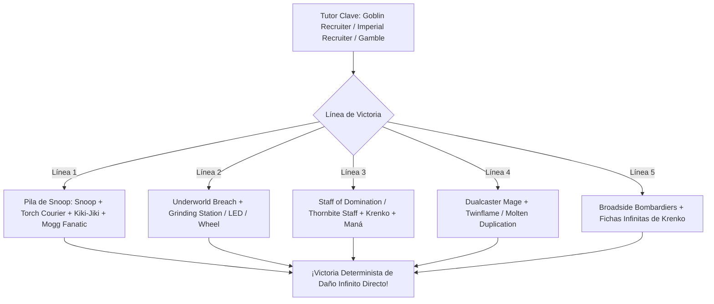
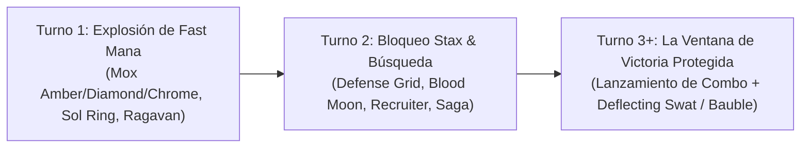

# Guía del Mazo Definitivo de Commander: Krenko, Mob Boss ({R})
### cEDH Turbo Goblin Storm & Snoop Combo — Optimización Absoluta Sin Restricciones (Power Level 9.5 - 10)

> **Formato:** Commander / cEDH Multijugador (CR 903)  
> **Comandante:** [`Krenko, Mob Boss`](file:///root/mtg/decks/Commander/krenko/krenko.txt#L2)  
> **Identidad de Color:** Mono-Rojo (`{R}`)  
> **Nivel de Poder:** 9.5–10 / 10 (cEDH Nivel Máximo Competitivo)  
> **Coste de Maná Convertido (CMC) Medio:** 1.18  
> **Tierras Totales:** 29 (11 Montañas básicas + 18 tierras de utilidad, fetches y MDFC)  
> **Aceleradores y Maná Positivo:** 17 fuentes (Moxes, LED, Lotus Petal, Mana Vault, Grim Monolith, Treasonous Ogre, rituales)  
> **Lista Oficial:** [`krenko.txt`](file:///root/mtg/decks/Commander/krenko/krenko.txt)  
> **Guía de Upgrades y Cortes:** [`krenko_upgrades.md`](file:///root/mtg/decks/Commander/krenko/krenko_upgrades.md)  

---

## 1. Filosofía y Arquitectura Competitiva Sin Restricciones

Esta lista representa la versión **teórica y práctica más competitiva posible en la historia de Magic: The Gathering** para [`Krenko, Mob Boss`](file:///root/mtg/decks/Commander/krenko/krenko.txt#L2). Se ha construido sin límites de presupuesto, sin restricciones de colección y con acceso al catálogo completo de cartas legales en Commander.

El arquetipo evoluciona de un mazo tribal de combate a una **máquina de combo determinista de Turno 2–3 con protección impenetrable y stax asimétrico**:
1. **Velocidad de Torneo (CMC 1.18):** La curva más baja posible en Commander Mono-Rojo. El 80% del mazo cuesta 0, 1 o 2 manás, permitiendo vaciar la mano de inmediato, alimentar a [`The One Ring`](file:///root/mtg/decks/Commander/krenko/krenko.txt#L42) y ciclar con [`Wheel of Fortune`](file:///root/mtg/decks/Commander/krenko/krenko.txt#L70).
2. **El Ecosistema de Fast Mana:** Incorpora todo el maná positivo legal ([`Chrome Mox`](file:///root/mtg/decks/Commander/krenko/krenko.txt#L29), [`Mox Diamond`](file:///root/mtg/decks/Commander/krenko/krenko.txt#L38), [`Mox Opal`](file:///root/mtg/decks/Commander/krenko/krenko.txt#L39), [`Mox Amber`](file:///root/mtg/decks/Commander/krenko/krenko.txt#L37), [`Lion's Eye Diamond`](file:///root/mtg/decks/Commander/krenko/krenko.txt#L34), [`Lotus Petal`](file:///root/mtg/decks/Commander/krenko/krenko.txt#L35), [`Mana Vault`](file:///root/mtg/decks/Commander/krenko/krenko.txt#L36), [`Grim Monolith`](file:///root/mtg/decks/Commander/krenko/krenko.txt#L32), [`Sol Ring`](file:///root/mtg/decks/Commander/krenko/krenko.txt#L40)).
3. **Escudo Anti-Interacción Imparable:** A los clásicos [`Deflecting Swat`](file:///root/mtg/decks/Commander/krenko/krenko.txt#L56) y [`Pyroblast`](file:///root/mtg/decks/Commander/krenko/krenko.txt#L61) se suman [`Defense Grid`](file:///root/mtg/decks/Commander/krenko/krenko.txt#L30) (hace pagar `{3}` adicionales a cualquier interacción enemiga en tu turno), [`Vexing Bauble`](file:///root/mtg/decks/Commander/krenko/krenko.txt#L47) (apaga *Force of Will*, *Pact of Negation* y *Fierce Guardianship*) y [`Tibalt's Trickery`](file:///root/mtg/decks/Commander/krenko/krenko.txt#L64) (contrahechizo duro incondicional).
4. **Respuesta a Odio Asimétrico:** [`Wild Magic Surge`](file:///root/mtg/decks/Commander/krenko/krenko.txt#L65) y [`Abrade`](file:///root/mtg/decks/Commander/krenko/krenko.txt#L54) eliminan stax letales contra Krenko como *Cursed Totem*, *Torpor Orb*, *Drannith Magistrate* o *Humility*.

---

## 2. Las 5 Líneas Maestras de Victoria Determinista (Turnos 2 y 3)

---

### Línea 1: La Pila de Snoop (`Conspicuous Snoop` + `Goblin Recruiter`)
*La línea de victoria insignia de los Trasgos en cEDH. Gana en el turno en que se resuelve sin pasar por combate.*

1. **Requisitos:** Tener a [`Conspicuous Snoop`](file:///root/mtg/decks/Commander/krenko/krenko.txt#L7) en mesa y resolver [`Goblin Recruiter`](file:///root/mtg/decks/Commander/krenko/krenko.txt#L12) (o tutorear a Snoop si tienes maná para lanzarlo).
2. **Apilamiento de la Biblioteca:** Con la habilidad de `Goblin Recruiter`, colocas en la cima de tu baraja:
   * **Superior (Top 1):** [`Torch Courier`](file:///root/mtg/decks/Commander/krenko/krenko.txt#L27)
   * **Top 2:** [`Kiki-Jiki, Mirror Breaker`](file:///root/mtg/decks/Commander/krenko/krenko.txt#L19)
   * **Top 3:** [`Mogg Fanatic`](file:///root/mtg/decks/Commander/krenko/krenko.txt#L22) (o [`Skirk Prospector`](file:///root/mtg/decks/Commander/krenko/krenko.txt#L26) / [`Pashalik Mons`](file:///root/mtg/decks/Commander/krenko/krenko.txt#L23))
3. **Ejecución del Bucle:**
   * Snoop ve la cima de la biblioteca. Lanzas a [`Torch Courier`](file:///root/mtg/decks/Commander/krenko/krenko.txt#L27) desde arriba pagando `{R}`.
   * Sacrificas a `Torch Courier` haciendo objetivo a Snoop para darle **Prisa**.
   * Ahora la carta superior es [`Kiki-Jiki, Mirror Breaker`](file:///root/mtg/decks/Commander/krenko/krenko.txt#L19). Snoop gana la habilidad activada de Kiki-Jiki.
   * Giras a Snoop activando la habilidad de Kiki-Jiki haciendo objetivo al propio Snoop. Se crea una copia ficha de Snoop con prisa.
   * La copia ve a Kiki-Jiki en la cima y se gira copiándose a sí misma. **Repites este proceso tantas veces como quieras para crear un millón de fichas de Snoop enderezadas con prisa**.
   * Con la última copia de Snoop, antes de girarla, usas una habilidad o disparas un robo/sacrificio (o apuntas al propio `Goblin Recruiter`) para revelar a [`Mogg Fanatic`](file:///root/mtg/decks/Commander/krenko/krenko.txt#L22) en la cima.
   * Al estar `Mogg Fanatic` en la cima, **todas las infinitas copias de Snoop ganan su habilidad activada**: *"Sacrificar esta criatura: Hace 1 punto de daño a cualquier objetivo"*.
   * Sacrificas las copias una a una para infligir **daño infinito a los tres oponentes**. ¡Victoria sin atacar!

> **Solución a cartas atascadas en mano:** Si robas por error a *Kiki-Jiki* o *Torch Courier*, [`Valakut Awakening`](file:///root/mtg/decks/Commander/krenko/krenko.txt#L90) los devuelve al fondo de la biblioteca a velocidad de instantáneo para poder volver a apilarlos.

---

### Línea 2: El Motor de Tormenta de `Underworld Breach`
*El motor de tormenta más dominante de Magic.*

1. **Requisitos:** Resolver [`Underworld Breach`](file:///root/mtg/decks/Commander/krenko/krenko.txt#L53) con [`Grinding Station`](file:///root/mtg/decks/Commander/krenko/krenko.txt#L31) en juego (o en cementerio) y cualquier artefacto de coste 0 ([`Lion's Eye Diamond`](file:///root/mtg/decks/Commander/krenko/krenko.txt#L34), [`Lotus Petal`](file:///root/mtg/decks/Commander/krenko/krenko.txt#L35), [`Mox Opal`](file:///root/mtg/decks/Commander/krenko/krenko.txt#L39)).
2. **Bucle de Molino Infinito:**
   * Lanzas `Lion's Eye Diamond` (o `Lotus Petal`) desde el cementerio usando *Escape* (exiliando 3 cartas del cementerio).
   * Al entrar el artefacto, se dispara [`Grinding Station`](file:///root/mtg/decks/Commander/krenko/krenko.txt#L31), enderezándose.
   * Sacrificas el artefacto agregando 3 manás `{R}{R}{R}` (LED) o 1 maná `{R}` (Petal).
   * Giras `Grinding Station` sacrificando el artefacto que lanzaste para moler 3 cartas de tu biblioteca.
   * Esas 3 cartas proporcionan el combustible exacto para volver a escapar el artefacto.
3. **Cierre:**
   * Mueles tu biblioteca entera, acumulas maná infinito y escapas [`Goblin Bombardment`](file:///root/mtg/decks/Commander/krenko/krenko.txt#L49), [`Impact Tremors`](file:///root/mtg/decks/Commander/krenko/krenko.txt#L50) o [`Agate Instigator`](file:///root/mtg/decks/Commander/krenko/krenko.txt#L5) para matar a la mesa de inmediato.

---

### Línea 3: Krenko + `Staff of Domination` / `Thornbite Staff`
*La condición de victoria de un solo artefacto con Krenko.*

* **Bucle con `Staff of Domination`:**
  1. Con Krenko y [`Mana Echoes`](file:///root/mtg/decks/Commander/krenko/krenko.txt#L51) o [`Skirk Prospector`](file:///root/mtg/decks/Commander/krenko/krenko.txt#L26), giras a Krenko creando al menos 5 trasgos / manás.
  2. Pagas `{3}` con [`Staff of Domination`](file:///root/mtg/decks/Commander/krenko/krenko.txt#L41) para desenderezarlo.
  3. Pagas `{1}` con el bastón para desenderezar a Krenko.
  4. Repites el proceso para generar **fichas infinitas y maná incoloro infinito**.
  5. Una vez generado el maná infinito, pagas `{4}` repetidamente para **robar tu biblioteca entera**, ganas **vidas infinitas** pagando `{2}`, y giras todas las criaturas de tus rivales pagando `{1}`.

* **Bucle con `Thornbite Staff`:**
  1. Krenko equipado con [`Thornbite Staff`](file:///root/mtg/decks/Commander/krenko/krenko.txt#L43) + [`Skirk Prospector`](file:///root/mtg/decks/Commander/krenko/krenko.txt#L26) o [`Phyrexian Altar`](file:///root/mtg/decks/Commander/krenko/krenko.txt#L39).
  2. Giras a Krenko creando trasgos; sacrificas un trasgo para agregar `{R}`; el bastón se dispara y desendereza a Krenko automáticamente. Bucle infinito.

---

### Línea 4: `Dualcaster Mage` + `Twinflame` / `Molten Duplication`
*Combo de 2 cartas por solo 3 manás.*
1. Lanzas [`Twinflame`](file:///root/mtg/decks/Commander/krenko/krenko.txt#L69) o [`Molten Duplication`](file:///root/mtg/decks/Commander/krenko/krenko.txt#L67) haciendo objetivo a cualquier criatura tuya.
2. Manteniendo prioridad, lanzas [`Dualcaster Mage`](file:///root/mtg/decks/Commander/krenko/krenko.txt#L8).
3. La habilidad de Dualcaster copia el hechizo apuntando al propio Dualcaster, creando copias infinitas 2/2 con prisa en ese mismo instante.

---

### Línea 5: El Cañoneo de `Broadside Bombardiers`
* [`Broadside Bombardiers`](file:///root/mtg/decks/Commander/krenko/krenko.txt#L6) posee **Prisa** y **Alardear (Boast)**.
* Si tienes fichas infinitas o maná infinito, sacrifica artefactos o trasgos para infligir daño directo igual a $2 + \text{coste}$ a cualquier objetivo, aniquilando a cualquier oponente detrás de efectos de prevención de combate como *Glacial Chasm* o *Ensnaring Bridge*.

---

## 3. Plan de Partida y Secuencia de Turnos (Tempo & Sequencing)

### Turno 1: Despliegue de Velocidad Terminal
* Bajas tierras de maná doble como [`Ancient Tomb`](file:///root/mtg/decks/Commander/krenko/krenko.txt#L72) o [`City of Traitors`](file:///root/mtg/decks/Commander/krenko/krenko.txt#L77).
* Despliegas tus rocas de maná cero. Si inicias con [`Gemstone Caverns`](file:///root/mtg/decks/Commander/krenko/krenko.txt#L79), comienzas el juego con tierra adicional.
* Si tienes [`Defense Grid`](file:///root/mtg/decks/Commander/krenko/krenko.txt#L30) o [`Vexing Bauble`](file:///root/mtg/decks/Commander/krenko/krenko.txt#L47), bájalos inmediatamente: apagarás el 80% de las respuestas de tus rivales para el resto del juego.

### Turno 2: Stax Asimétrico y Tutores de Élite
* Lanzas [`Blood Moon`](file:///root/mtg/decks/Commander/krenko/krenko.txt#L48) o [`Magus of the Moon`](file:///root/mtg/decks/Commander/krenko/krenko.txt#L20) para desarmar a los mazos tricolor y pentacolor.
* Tutoreas el engranaje faltante con [`Imperial Recruiter`](file:///root/mtg/decks/Commander/krenko/krenko.txt#L18), [`Goblin Recruiter`](file:///root/mtg/decks/Commander/krenko/krenko.txt#L12) o [`Gamble`](file:///root/mtg/decks/Commander/krenko/krenko.txt#L65).
* [`Inventors' Fair`](file:///root/mtg/decks/Commander/krenko/krenko.txt#L81) se activa con 3 artefactos para poner en tu mano directamente a [`Staff of Domination`](file:///root/mtg/decks/Commander/krenko/krenko.txt#L41) o [`The One Ring`](file:///root/mtg/decks/Commander/krenko/krenko.txt#L42).

### Turno 3: La Ejecución Protegida del Combo
* Lanza el combo respaldado por tu suite de protección gratuita:
  * [`Deflecting Swat`](file:///root/mtg/decks/Commander/krenko/krenko.txt#L56) redirige cualquier counter o removal.
  * [`Flare of Duplication`](file:///root/mtg/decks/Commander/krenko/krenko.txt#L59) copia counterspells gratis sacrificando un trasgo 1/1.
  * [`Plaza of Heroes`](file:///root/mtg/decks/Commander/krenko/krenko.txt#L83) se sacrifica para hacer a Krenko indestructible y darle antimaleficio si intentan removerlo.

---

## 4. Clasificación Funcional de las 100 Cartas

| Función Estratégica | Cant. | Cartas Incluidas |
| :--- | :---: | :--- |
| **Comandante** | 1 | [`Krenko, Mob Boss`](file:///root/mtg/decks/Commander/krenko/krenko.txt#L2) |
| **Combo / Win-Conditions** | 15 | `Conspicuous Snoop`, `Kiki-Jiki`, `Torch Courier`, `Mogg Fanatic`, `Underworld Breach`, `Grinding Station`, `Dualcaster Mage`, `Twinflame`, `Molten Duplication`, `Staff of Domination`, `Thornbite Staff`, `Umbral Mantle`, `Mana Echoes`, `Goblin Bombardment`, `Impact Tremors` |
| **Fast Mana & Aceleración Positiva** | 17 | `Chrome Mox`, `Mox Diamond`, `Mox Opal`, `Mox Amber`, `Lion's Eye Diamond`, `Lotus Petal`, `Mana Vault`, `Grim Monolith`, `Sol Ring`, `Treasonous Ogre`, `Simian Spirit Guide`, `Rite of Flame`, `Brightstone Ritual`, `Desperate Ritual`, `Seething Song`, `Jeska's Will`, `Great Furnace` |
| **Tutores & Búsqueda Absoluta** | 6 | `Goblin Recruiter`, `Imperial Recruiter`, `Goblin Matron`, `Goblin Engineer`, `Gamble`, `Inventors' Fair` |
| **Protección e Interrupción** | 13 | `Deflecting Swat`, `Flare of Duplication`, `Pyroblast`, `Red Elemental Blast`, `Tibalt's Trickery`, `Wild Magic Surge`, `Abrade`, `Lightning Bolt`, `Defense Grid`, `Vexing Bauble`, `Hexing Squelcher`, `Goblin Chirurgeon`, `Final Fortune` |
| **Motores de Ventaja de Cartas** | 6 | `The One Ring`, `Wheel of Fortune`, `Skullclamp`, `Ragavan, Nimble Pilferer`, `Birgi, God of Storytelling`, `Valakut Awakening` |
| **Stax & Odio Asimétrico** | 3 | `Blood Moon`, `Magus of the Moon`, `Vexing Bauble` |
| **Sinergia, Haste y Utilidad** | 10 | `Broadside Bombardiers`, `Marvin, Murderous Mimic`, `Agate Instigator`, `Pashalik Mons`, `Goblin Sharpshooter`, `Goblin Warchief`, `Goro-Goro`, `Goblin Welder`, `Thousand-Year Elixir`, `Mass Hysteria` |
| **Base de Tierras cEDH** | 29 | 11 `Mountain`, `Ancient Tomb`, `City of Traitors`, `Cavern of Souls`, `Arena of Glory`, `Urza's Saga`, `Gemstone Caverns`, `Command Beacon`, `Inventors' Fair`, `Plaza of Heroes`, `Three Tree City`, `Shatterskull Smashing`, `Valakut Awakening`, 5 Fetchlands (`Arid Mesa`, `Bloodstained Mire`, `Prismatic Vista`, `Scalding Tarn`, `Wooded Foothills`) |
