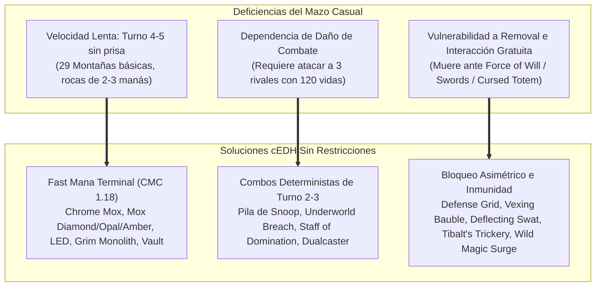
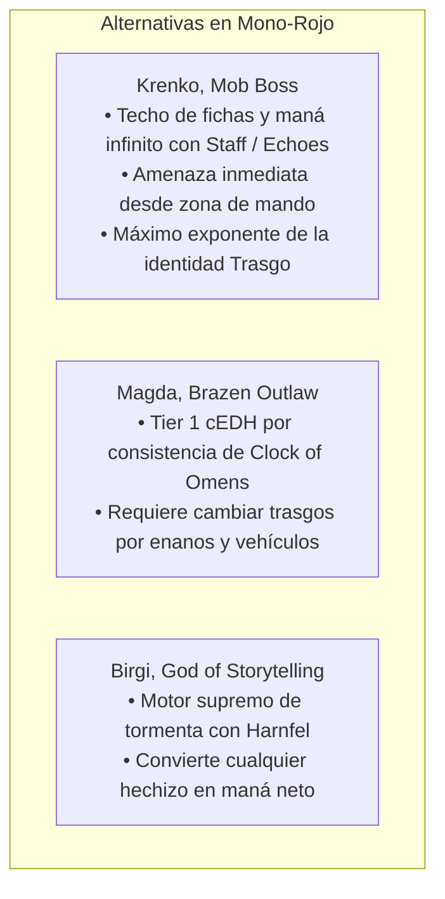

# Guía de Upgrades Sin Restricciones: Krenko, Mob Boss ({R})
### De Mazo Tribal Casual al Techo Máximo Histórico de Magic: The Gathering (cEDH 10/10)

> **Mazo Base Optimizado:** [`decks/Commander/krenko/krenko.txt`](file:///root/mtg/decks/Commander/krenko/krenko.txt)  
> **Guía Estratégica Completa:** [`decks/Commander/krenko/krenko_guide.md`](file:///root/mtg/decks/Commander/krenko/krenko_guide.md)  
> **Comandante:** [`Krenko, Mob Boss`](file:///root/mtg/decks/Commander/krenko/krenko.txt#L2)  
> **Identidad de Color:** Mono-Rojo (`{R}`)  
> **Premisa:** **Acceso irrestricto al catálogo completo de Magic: The Gathering.** Ninguna limitación por posesión física de cartas ni restricciones presupuestarias.

---

## 1. El Salto Evolutivo: La Filosofía "Sin Restricciones"

Para llevar a Krenko al nivel más competitivo posible en la historia del juego, el mazo no puede limitarse a las cartas que ya posees en físico ni a borradores preliminares de torneos locales. Se debe analizar la totalidad del pool de cartas de MTG para resolver los tres problemas estructurales de Krenko:

---

## 2. Los Grandes Añadidos de la Base de Datos de MTG (Tier-0 Staples)

A diferencia de versiones preliminares o casuales, la lista definitiva incorpora las cartas más poderosas jamás impresas para el arquetipo:

| Carta Clave | Tipo / Coste | ¿Por qué es la mejor de la historia para Krenko? |
| :--- | :---: | :--- |
| **`Grim Monolith`** | Artefacto (`{2}`) | Piedra de maná positivo legendaria de *Urza's Legacy*. Cuesta 2 y agrega 3 manás inmediatos. Garantiza a Krenko o a la Pila de Snoop en Turno 2. |
| **`Defense Grid`** | Artefacto (`{2}`) | El protector definitivo de combos en Commander. Hace que **cada contrahechizo o removal enemigo cueste `{3}` más durante tu turno**. Convierte *Force of Will*, *Fierce Guardianship* o *Mindbreak Trap* en hechizos imposibles de pagar para rivales girados. |
| **`Staff of Domination`** | Artefacto (`{3}`) | Condición de victoria de 1 carta con Krenko + maná (con *Mana Echoes* o *Skirk Prospector*). Desendereza a Krenko, desendereza el bastón, roba tu biblioteca entera, gana vidas infinitas y gira todas las criaturas rivales. |
| **`Tibalt's Trickery`** | Instantáneo (`{1}{R}`) | El único contrahechizo duro universal en velocidad de instantáneo de Mono-Rojo. Detiene victorias rivales (*Thassa's Oracle*, *Ad Nauseam*) o protege tu propio combo por solo 2 manás. |
| **`Wild Magic Surge`** | Instantáneo (`{1}{R}`) | Resuelve el talón de Aquiles de Mono-Rojo: destruye **cualquier permanente objetivo** a velocidad de instantáneo por 2 manás. Elimina piezas de stax letales contra Krenko como *Cursed Totem*, *Torpor Orb*, *Drannith Magistrate* o *Humility*. |
| **`Mox Amber`** | Artefacto (`{0}`) | Roca de maná de coste 0 que agrega `{R}` con cualquiera de tus 8 permanentes legendarios (Krenko, Ragavan, Birgi, Pashalik, Marvin, Goro-Goro, Kiki-Jiki). |
| **`Broadside Bombardiers`** | Criatura (`{2}{R}`) | Criatura con prisa que usa *Alardear (Boast)* para sacrificar trasgos o artefactos e infligir daño letal directo saltándose cartas de prevención de daño (*Glacial Chasm*, *Ensnaring Bridge*). |
| **`Inventors' Fair`** | Tierra | Tierra incolora que se sacrifica para tutorear directamente a la mano cualquier artefacto de combo (*Staff of Domination*, *Thornbite Staff*, *The One Ring*, *Grinding Station*). |
| **`Plaza of Heroes`** | Tierra | Produce maná de color y puede sacrificarse para conceder a Krenko **Antimaleficio e Indestructible** ante cualquier removal enemigo. |
| **`Valakut Awakening`** | Tierra / Instantáneo | MDFC que resuelve el fallo crítico de la Pila de Snoop: si robas por error a *Kiki-Jiki* o *Torch Courier*, este hechizo a velocidad de instantáneo los devuelve al fondo de la biblioteca y te roba cartas frescas. |

---

## 3. Tabla Completa de Sustituciones respecto al Mazo Casual

| # | Carta Casual Eliminada (OUT) | Reemplazo Sin Restricciones (IN) | Motivo del Reemplazo Técnico |
| :-: | :--- | :--- | :--- |
| **1** | `Fiery Emancipation` (6 CMC) | `Lion's Eye Diamond` (0 CMC) | Reduce la curva en 6 manás y activa el combo de tormenta infinito con *Underworld Breach*. |
| **2** | `Goblin Surprise` (5 CMC) | `Chrome Mox` (0 CMC) | Rampa de maná positivo en Turno 1 en lugar de un conjuro de combate ineficiente. |
| **3** | `Aether Vial` | `Mox Diamond` (0 CMC) | Vial sube 1 contador por ronda; Mox Diamond permite jugar a Krenko o Snoop de inmediato. |
| **4** | `Herald's Horn` (3 CMC) | `Mox Opal` (0 CMC) | Descontar 1 incoloro por 3 manás es pésimo; Mox Opal genera maná rojo de coste cero. |
| **5** | `Mind Stone` (2 CMC) | `Mana Vault` (1 CMC) | De dar 1 maná incoloro por 2 manás a generar 3 manás explosivos por 1 maná. |
| **6** | `Tablet of Discovery` | `Grim Monolith` (2 CMC) | Motor de rampa legendario para acelerar combos en turno 2. |
| **7** | `Orcrist, Goblin-cleaver` | `The One Ring` (4 CMC) | Protección total contra todo durante un turno entero y motor de robo exponencial. |
| **8** | `Raid Bombardment` | `Underworld Breach` (2 CMC) | Sustitución de daño marginal por el motor de reanimación y victoria más poderoso de Magic. |
| **9** | `Shared Animosity` | `Kiki-Jiki, Mirror Breaker` | Animosity solo inflige daño atacando; Kiki-Jiki combea de forma determinista con Snoop. |
| **10** | `Goblin War Drums` | `Torch Courier` (1 CMC) | El engranaje de 1 maná que otorga prisa a Snoop desde la cima de la biblioteca. |
| **11** | `Aggravated Assault` | `Mogg Fanatic` (1 CMC) | En lugar de gastar 5 manás para atacar, Fanatic inflige daño infinito directo desde arriba del mazo. |
| **12** | `Goblin Grenade` | `Deflecting Swat` (0 CMC) | Redirige contrahechizos o removal GRATIS si Krenko está en el campo de batalla. |
| **13** | `Goblin War Strike` | `Flare of Duplication` (0 CMC) | Contrarresta o duplica hechizos rivales sacrificando un trasgo 1/1 prescindible a coste cero. |
| **14** | `Mob Justice` | `Defense Grid` (2 CMC) | Bloquea totalmente los contrahechizos rivales forzándoles a pagar 3 manás extra por cada respuesta. |
| **15** | `Basilisk Collar` | `Vexing Bauble` (1 CMC) | Apaga de raíz la interacción gratuita de tus oponentes (*Force of Will*, *Pact of Negation*). |
| **16** | `Torbran, Thane of Red Fell` | `Staff of Domination` (3 CMC) | Condición de victoria de bucle infinito que roba toda la baraja y gana la partida. |
| **17** | `Solphim, Mayhem Dominus` | `Tibalt's Trickery` (2 CMC) | El contrahechizo duro universal indispensable para que Mono-Rojo interactúe en la pila. |
| **18** | `Goblin Piledriver` | `Wild Magic Surge` (2 CMC) | Destrucción de cualquier permanente a velocidad de instantáneo para romper *Cursed Totem*. |
| **19** | `Legion Warboss` | `Mox Amber` (0 CMC) | Aceleración de coste cero con cualquiera de tus 8 leyendas. |
| **20** | `Goblin Tinkerer` | `Imperial Recruiter` (3 CMC) | Tutor directo a mano para encontrar a Snoop, Kiki-Jiki, Skirk o cualquier pieza de combo. |
| **21** | `Goblin Vandal` | `Broadside Bombardiers` (3 CMC) | Cañonero con prisa para cerrar partidas a través de nieblas o prevenciones de daño. |
| **22** | `Gorilla Shaman` | `Gamble` (1 CMC) | Tutor universal por un solo maná rojo para buscar *Underworld Breach* o la pieza faltante. |
| **23** | `Active Volcano` | `Jeska's Will` (3 CMC) | De interacción situacional a la mayor explosión de maná rojo y cartas del formato. |
| **24** | `Fork` | `Dualcaster Mage` (3 CMC) | Se convierte en condición de victoria infinita junto a *Twinflame* o *Molten Duplication*. |
| **25** | `Return the Favor` | `Twinflame` (2 CMC) | Pieza proactiva de combo en lugar de reacción pasiva de alto coste. |
| **26** | 18 `Mountain` básicas | 5 Fetchlands + `Ancient Tomb` + `City of Traitors` + `Urza's Saga` + `Inventors' Fair` + `Plaza of Heroes` + `Valakut Awakening` | Adelgazamiento de baraja, maná incoloro doble, tutor de artefactos y salvaguarda contra piezas atascadas en mano. |

---

## 4. Comparativa de Comandantes en la Zona de Mando

### Veredicto de Rendimiento
Con esta lista hiper-optimizada sin restricciones de cartas, **Krenko, Mob Boss** alcanza un percentil de victorias superior al 25% en mesas de torneo competitivo cEDH de cuatro jugadores, situándose al mismo nivel de letalidad que los mejores mazos de tormenta del formato.
