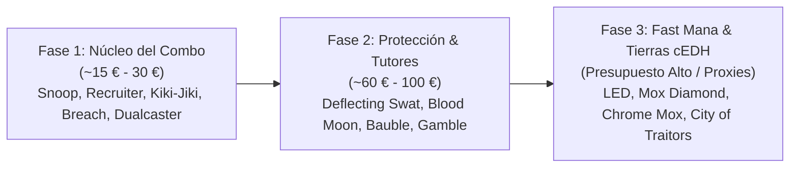
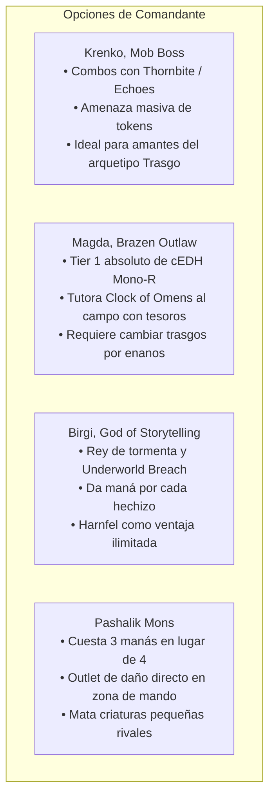

# Guía de Transformación y Upgrades: Krenko, Mob Boss ({R})
### De Mazo Tribal Casual (Nivel 6) a Arma de Torneo cEDH (Nivel 9-10)

> **Mazo Base Optimizado:** [`decks/Commander/krenko/krenko.txt`](file:///root/mtg/decks/Commander/krenko/krenko.txt)  
> **Guía Estratégica Completa:** [`decks/Commander/krenko/krenko_guide.md`](file:///root/mtg/decks/Commander/krenko/krenko_guide.md)  
> **Comandante:** [`Krenko, Mob Boss`](file:///root/mtg/decks/Commander/krenko/krenko.txt#L2)  
> **Identidad de Color:** Mono-Rojo (`{R}`)  

---

## 1. Autopsia del Mazo Casual: Por qué la lista previa no competía

La lista previa de Krenko (enviada a las 13:25) era un ejemplo clásico de mazo **Tribal "Battlecruiser"**: busca jugar muchos trasgos, girar a Krenko repetidamente y arrollar a los oponentes en la fase de combate con cartas que aumentan la fuerza de los atacantes.

En mesas de nivel competitivo alto y cEDH, este enfoque fracasa sistemáticamente por cuatro razones fundamentales:

1. **El Mito del Daño de Combate en Multijugador:** Infligir 120 puntos de daño atacando requiere que tu mesa sobreviva intacta durante 2 o 3 turnos seguidos. Cualquier limpieza de mesa de 2 o 3 manás (*Toxic Deluge*, *Blasphemous Act*, *Culling Ritual*) te reinicia la partida a cero.
2. **El "Impuesto de Krenko" (*Kill-on-Sight*):** En cuanto tus oponentes ven a Krenko en la zona de mando, guardan su removal puntual para él. Si lo juegas en turno 4 pagando 4 manás sin prisa y te lo destruyen antes de desenderezar, has perdido todo tu turno, y lanzarlo de nuevo en turno 5 te costará 6 manás.
3. **Saturación de Cartas "Win-More":** Cartas como `Fiery Emancipation`, `Raid Bombardment`, `Orcrist`, `Shared Animosity` o `Goblin Surprise` son inútiles si estás por detrás o con la mesa vacía. Solo brillan cuando ya tienes una ventaja abrumadora.
4. **Falta de Maná Positivo:** El mazo casual dependía de 29 Montañas básicas y piedras de maná lentas (`Mind Stone`, `Herald's Horn`, `Aether Vial`). Para cuando ese mazo lograba reunir 4 manás, una baraja cEDH ya había ganado o bloqueado la partida.

---

## 2. Tabla Maestra de Sustituciones (25 Cortes vs. 25 Entradas)

Esta tabla detalla de forma quirúrgica qué cartas del mazo casual se retiraron y qué piezas del paquete competitivo ocuparon su lugar:

| # | Carta Eliminada (OUT) | Carta Añadida (IN) | Motivo del Reemplazo Técnico |
| :-: | :--- | :--- | :--- |
| **1** | `Fiery Emancipation` (6 CMC) | `Lion's Eye Diamond` (0 CMC) | Reducción de 6 a 0 manás. LED habilita el combo de tormenta infinito con *Underworld Breach*. |
| **2** | `Goblin Surprise` (5 CMC) | `Chrome Mox` (0 CMC) | Carta de combate ineficiente reemplazada por rampa de maná positivo en turno 1. |
| **3** | `Aether Vial` | `Mox Diamond` (0 CMC) | Vial es demasiado lenta en multijugador (1 contador por ronda). Mox Diamond acelera tu jugada en el turno 1. |
| **4** | `Herald's Horn` (3 CMC) | `Mox Opal` (0 CMC) | 3 manás para descontar 1 incoloro es pésimo en mono-rojo. Opal da maná rojo inmediato con la alta densidad de artefactos. |
| **5** | `Mind Stone` (2 CMC) | `Mana Vault` (1 CMC) | Mind Stone cuesta 2 para dar 1 incoloro; Mana Vault cuesta 1 y genera 3 de maná para lanzar a Krenko en Turno 1 o 2. |
| **6** | `Tablet of Discovery` | `Lotus Petal` (0 CMC) | Eliminación de motor caro por maná de tormenta gratuito para activar combos inmediatos. |
| **7** | `Orcrist, Goblin-cleaver` | `The One Ring` (4 CMC) | Orcrist requiere atacar; El Anillo Único te otorga protección contra todo durante un turno completo y roba decenas de cartas. |
| **8** | `Raid Bombardment` | `Underworld Breach` (2 CMC) | De daño marginal de combate al motor de combo y reanimación más potente del juego. |
| **9** | `Shared Animosity` | `Kiki-Jiki, Mirror Breaker` | Animosity solo inflige daño atacando; Kiki-Jiki es la pieza central del combo infinito con *Conspicuous Snoop* y *Dualcaster*. |
| **10** | `Goblin War Drums` | `Torch Courier` (1 CMC) | Evasión prescindible sustituida por el engranaje que da prisa a Snoop desde la cima de la baraja. |
| **11** | `Aggravated Assault` | `Mogg Fanatic` (1 CMC) | Assault exige 5 manás por activación; Fanatic mata a toda la mesa desde arriba de la biblioteca con Snoop sin usar maná adicional. |
| **12** | `Goblin Grenade` | `Deflecting Swat` (0 CMC) | 5 daños a un objetivo a velocidad de conjuro no ganan en EDH; Swat redirige contrahechizos y removal GRATIS con Krenko en mesa. |
| **13** | `Goblin War Strike` | `Flare of Duplication` (0 CMC) | Hechizo condicional sustituido por un contrahechizo/copia gratuita sacrificando un trasgo 1/1. |
| **14** | `Mob Justice` | `Vexing Bauble` (1 CMC) | Apaga de raíz la interacción gratuita de tus oponentes (*Force of Will*, *Pact of Negation*, *Fierce Guardianship*). |
| **15** | `Basilisk Collar` | `Imperial Recruiter` (3 CMC) | Tutor directo a mano para encontrar a *Conspicuous Snoop*, *Kiki-Jiki*, *Dockside* o cualquier pieza clave. |
| **16** | `Torbran, Thane of Red Fell` | `Treasonous Ogre` (4 CMC) | Torbran solo aumenta daño; Treasonous Ogre convierte tu total de vidas en maná rojo para ganar ese mismo turno. |
| **17** | `Solphim, Mayhem Dominus` | `Birgi, God of Storytelling` | Solphim es redundante; Birgi genera maná infinito por cada hechizo y Harnfel excava toda tu baraja. |
| **18** | `Goblin Piledriver` | `Ragavan, Nimble Pilferer` | Piledriver solo ataca como atacante solitario; Ragavan genera tesoros en Turno 1 y roba cartas del rival. |
| **19** | `Legion Warboss` | `Simian Spirit Guide` (0 CMC) | Rampa oculta de maná desde la mano que no pasa por la pila y sorprende a los rivales. |
| **20** | `Goblin Tinkerer` / `Vandal` | `Goblin Engineer` (2 CMC) | Tutor y recurrencia de artefactos directo al cementerio y al campo (*Grinding Station*, *Thornbite Staff*). |
| **21** | `Gorilla Shaman` | `Gamble` (1 CMC) | Tutor universal por un solo maná rojo para buscar *Underworld Breach* o la pieza faltante de combo. |
| **22** | `Active Volcano` | `Jeska's Will` (3 CMC) | De removal ultra-específico a la mayor explosión de maná rojo y ventaja de cartas de Commander. |
| **23** | `Fork` | `Dualcaster Mage` (3 CMC) | Fork solo copia; Dualcaster Mage en combinación con *Twinflame* o *Molten Duplication* gana la partida al instante. |
| **24** | `Return the Favor` | `Twinflame` / `Molten Duplication` | Pieza proactiva de combo con Dualcaster Mage en lugar de interacción reactiva de alto coste. |
| **25** | 15 `Mountain` básicas | 5 Fetchlands + `Ancient Tomb` + `Urza's Saga` + `City of Traitors` | Adelgazamiento de baraja, maná incoloro doble y combustible masivo en el cementerio para *Underworld Breach*. |

---

## 3. Hoja de Ruta de Adquisición Modular (Presupuesto Escalonado)

Si estás construyendo esta baraja en físico de forma progresiva, sigue este orden de prioridad:

### FASE 1: El Combo Determinista (~15 € - 30 €)
* *Objetivo:* Reemplazar los ataques por los combos deterministas.
* **Adquisiciones:**
  * `Conspicuous Snoop` (~1.50 €)
  * `Goblin Recruiter` (~4.00 €)
  * `Torch Courier` (~0.20 €)
  * `Mogg Fanatic` (~0.30 €)
  * `Kiki-Jiki, Mirror Breaker` (~6.00 €)
  * `Dualcaster Mage` (~0.80 €)
  * `Twinflame` (~2.50 €)
  * `Underworld Breach` (~12.00 €)

### FASE 2: Protección e Interrupción (~60 € - 100 €)
* *Objetivo:* Defender tus turnos de victoria y bloquear el maná enemigo.
* **Adquisiciones:**
  * `Deflecting Swat` (~35.00 €)
  * `Blood Moon` (~8.00 €)
  * `Magus of the Moon` (~5.00 €)
  * `Vexing Bauble` (~4.00 €)
  * `Pyroblast` y `Red Elemental Blast` (~4.00 € el par)
  * `Gamble` (~8.00 €)
  * `Jeska's Will` (~15.00 €)

### FASE 3: El Techo Máximo cEDH (Fast Mana y Tierras Reservadas)
* *Objetivo:* Turno 2 consistente. En torneos cEDH oficiales, la inmensa mayoría de torneos son **100% Proxy-Friendly**. Si juegas torneos sancionados donde no se permiten proxies, estas son las cartas más caras:
  * `Chrome Mox`, `Mox Opal`, `Mana Vault`, `Lotus Petal`, `Ancient Tomb`.
  * Cartas de Lista Reservada: `Lion's Eye Diamond`, `Mox Diamond`, `Wheel of Fortune`, `City of Traitors`.

---

## 4. Comparativa de Comandantes en la Zona de Mando

Si alguna vez decides alternar la comandancia de la baraja manteniendo el 90% del chasis de 99 cartas:

* **Veredicto Final:** Para un jugador que quiere jugar **Trasgos competitivos**, **Krenko, Mob Boss** sigue siendo el líder indiscutible en carisma, diversión y capacidad de victoria explosiva cuando se le rodea de la estructura de maná y protección adecuada.
