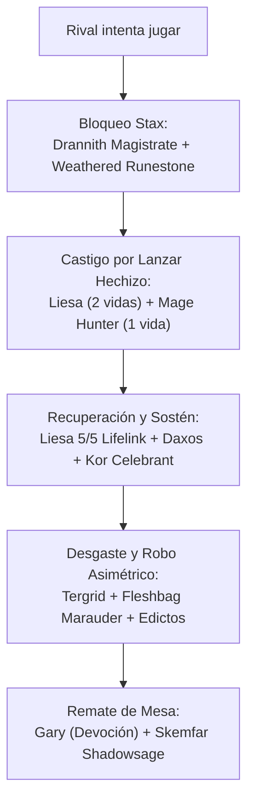

# Guía Estratégica: Liesa, Shroud of Dusk — Versión Optimizada Colección (`liesa_optimized`)

**Comandante**: [`Liesa, Shroud of Dusk`](file:///root/mtg/decks/Commander/liesa_optimized/liesa_optimized.txt#L2)  
**Formato**: Commander / EDH (Legal según Magic Comprehensive Rules CR 903)  
**Identidad de Color**: Orzhov (`{W}{B}`)  
**Enfoque**: Impuestos Asimétricos (Stax / Tax), Drenaje Constante de Vidas y Robo de Recursos con Tergrid  
**Nivel de Liga**: **Bracket 3 Oficial WotC / Nivel 7.5 High-Power Casual** (Lleva 2 *Game Changers* oficiales: Drannith Magistrate y Tergrid)  
**Origen de Cartas**: **100% de tu colección física ([`ManaBox_Collection.csv`](file:///root/mtg/ManaBox_Collection.csv))**, con **0 solapamientos** con tus otros 4 mazos activos ([Adrix](file:///root/mtg/decks/Commander/adrix/adrix.txt), [Anowon](file:///root/mtg/decks/Commander/anowon/anowon.txt), [Kardur](file:///root/mtg/decks/Commander/kardur/kardur.txt) y [Svella](file:///root/mtg/decks/Commander/svella/svella.txt)).

---

## 1. El Salto de Calidad Frente a la Versión Anterior

Tu mazo original de Liesa tenía cartas pesadas de relleno de draft que ralentizaban la estrategia. Esta versión optimizada consigue:

1. **Reducción de Curva Radical (CMC 2.86)**:
   * El mazo baja de 3.45 a **2.86 de coste medio**. Con **13 cartas de coste 1** y **17 cartas de coste 2**, el mazo empieza a jugar desde el turno 1 sin depender de que los rivales te dejen respirar.
2. **El Doble Candado Stax (Bloqueo Total a la Mesa)**:
   * [`Drannith Magistrate`](file:///root/mtg/decks/Commander/liesa_optimized/liesa_optimized.txt#L10) impide a los oponentes lanzar nada desde zonas que no sean su mano (¡adiós a los comandantes enemigos!).
   * [`Weathered Runestone`](file:///root/mtg/decks/Commander/liesa_optimized/liesa_optimized.txt#L43) impide que entren permanentes desde cementerios y bibliotecas, y que se lancen hechizos desde allí. La combinación de ambas cartas paraliza por completo a la mayoría de barajas de Commander.
3. **Máquina de Rampa Terrestre y Bloqueadores**:
   * [`Keeper of the Accord`](file:///root/mtg/decks/Commander/liesa_optimized/liesa_optimized.txt#L18) busca una Llanura básica al campo en cada turno rival donde tengan más tierras, y crea soldados 1/1 cuando tengan más criaturas.
4. **Inmunidad al Daño Fuera de Combate**:
   * [`Blessed Sanctuary`](file:///root/mtg/decks/Commander/liesa_optimized/liesa_optimized.txt#L48) anula por completo todo daño de fuego, chispas o habilidades rivales, y puebla la mesa con Unicornios 2/2.
5. **Protección Ultrabarata para Liesa**:
   * Mantener 1 maná abierto te permite salvar a Liesa o a Drannith con [`Fight as One`](file:///root/mtg/decks/Commander/liesa_optimized/liesa_optimized.txt#L52) o [`Professor's Warning`](file:///root/mtg/decks/Commander/liesa_optimized/liesa_optimized.txt#L58) frente a destrucciones o iras.

---

## 2. ¿En qué Liga / Bracket juega este mazo?

### A. Sistema Oficial de Brackets de Wizards of the Coast (WotC): **Bracket 3 (Optimized Casual)**
Wizards of the Coast clasifica los mazos de Commander en 5 Brackets basándose en su velocidad y en la presencia de cartas de la lista oficial de ***Game Changers*** (cartas con impacto polarizante y disruptivo en la partida):
* **Bracket 1 y 2 (Precons y Casual Clásico)**: Prohibidos los *Game Changers*.
* **Bracket 3 (Optimized / High Power Casual)**: Se permiten **hasta un máximo de 3 *Game Changers***.
* **Bracket 4 y 5 (High-Power sin límite y cEDH)**: Sin restricciones de *Game Changers*, con maná rápido de coste 0 y combos en turno 2-3.

> [!IMPORTANT]
> Tu mazo de Liesa lleva exactamente **2 cartas oficiales de la lista Game Changers**:
> 1. [`Drannith Magistrate`](file:///root/mtg/decks/Commander/liesa_optimized/liesa_optimized.txt#L10) (por anular la zona de mando y bloquear a los comandantes enemigos).
> 2. [`Tergrid, God of Fright`](file:///root/mtg/decks/Commander/liesa_optimized/liesa_optimized.txt#L29) (por robo masivo asimétrico de recursos al sacrificar/descartar).
>
> Al llevar 2 de 3 permitidos, este mazo es un **Bracket 3 canónico**: legal y perfectamente encajado en mesas de Commander optimizadas.

### B. Escala Tradicional de la Comunidad: **Nivel 7 – 7.5 (High-Power Casual / FNM)**
* **Dónde arrasa (Nivel 5–6 / Precons)**: Si juegas este mazo contra barajas preconstruidas sin modificar o decks casuales lentos, los asfixiarás. La presión constante del drenaje de Liesa (2 vidas por hechizo) sumada a Drannith Magistrate y los edictos no les permite desarrollar su juego.
* **Su hábitat ideal (Nivel 7–8 / Ligas de Tienda y FNM)**: Mesas donde todo el mundo juega mazos tuneados y con respuestas. Aquí Liesa brilla como la policía de la mesa: castiga a los mazos de tormenta de hechizos, frena reanimaciones abusivas y gana la carrera de vidas en el aire.
* **Por qué no es cEDH (Nivel 9–10)**: No llevas piedras de maná rápido de coste 0 (*Mana Crypt*, *Mox Diamond*, *Chrome Mox*), ni tutores de 1 maná negro (*Demonic Tutor*, *Vampiric Tutor*), ni combos de victoria inmediata en turno 2 o 3. Tu base de maná procede de tu colección física y juega con tierras justas.

---

## 3. Los Grandes Motores de la Baraja

### A. El Motor Tergrid (Robo de Recursos)
* [`Tergrid, God of Fright`](file:///root/mtg/decks/Commander/liesa_optimized/liesa_optimized.txt#L29) es una de las cartas más temidas de Magic.
* Cada vez que un oponente descarta o sacrifica un permanente que no sea ficha, **entra al campo bajo tu control**.
* Con cartas como [`Fleshbag Marauder`](file:///root/mtg/decks/Commander/liesa_optimized/liesa_optimized.txt#L16), [`Demon's Disciple`](file:///root/mtg/decks/Commander/liesa_optimized/liesa_optimized.txt#L8), [`Tergrid's Shadow`](file:///root/mtg/decks/Commander/liesa_optimized/liesa_optimized.txt#L59), [`Elderfang Disciple`](file:///root/mtg/decks/Commander/liesa_optimized/liesa_optimized.txt#L13) y [`Go Blank`](file:///root/mtg/decks/Commander/liesa_optimized/liesa_optimized.txt#L69), robas 3 criaturas o permanentes en un solo movimiento.

### B. El Castigo Activo
* [`Liesa, Shroud of Dusk`](file:///root/mtg/decks/Commander/liesa_optimized/liesa_optimized.txt#L2) impone 2 vidas por cada hechizo lanzado **a cualquier jugador, incluido tú**: prioriza tierras, habilidades activadas y pocos hechizos de alto impacto.
* [`Mage Hunter`](file:///root/mtg/decks/Commander/liesa_optimized/liesa_optimized.txt#L20) suma 1 punto de daño directo extra por hechizo lanzado o copiado. ¡Cada interacción enemiga les cuesta 3 vidas!
* [`Marauding Blight-Priest`](file:///root/mtg/decks/Commander/liesa_optimized/liesa_optimized.txt#L21) y [`Nadier's Nightblade`](file:///root/mtg/decks/Commander/liesa_optimized/liesa_optimized.txt#L22) aceleran la pérdida de vidas cada vez que ganas vidas o sacrificas fichas.

### C. El Motor de Ventaja de Cartas
* [`Thorn of the Black Rose`](file:///root/mtg/decks/Commander/liesa_optimized/liesa_optimized.txt#L31): Te corona como el Monarca. Gracias a los bloqueadores 1/1 de *Keeper of the Accord*, los espíritus de *Clarion Spirit* y el toque mortal, mantienes la corona para robar 1 carta extra cada turno.
* [`Bushmeat Poacher`](file:///root/mtg/decks/Commander/liesa_optimized/liesa_optimized.txt#L5): Sacrifica fichas sobrantes para ganar 2 vidas y robar carta.
* [`Embrose, Dean of Shadow`](file:///root/mtg/decks/Commander/liesa_optimized/liesa_optimized.txt#L25): Roba cartas cada vez que mueren criaturas con contadores.
* [`Plumb the Forbidden`](file:///root/mtg/decks/Commander/liesa_optimized/liesa_optimized.txt#L57) y [`Village Rites`](file:///root/mtg/decks/Commander/liesa_optimized/liesa_optimized.txt#L60): Robo masivo a velocidad de instantáneo en respuesta a limpiezas enemigas.

---

## 4. Plan de Partida y Secuencia por Turnos

* **Turnos 1–2**: Desarrolla tu mesa baja con [`Doomed Traveler`](file:///root/mtg/decks/Commander/liesa_optimized/liesa_optimized.txt#L9), [`Usher of the Fallen`](file:///root/mtg/decks/Commander/liesa_optimized/liesa_optimized.txt#L33) o [`Dispeller's Capsule`](file:///root/mtg/decks/Commander/liesa_optimized/liesa_optimized.txt#L39). Frena a la mesa con [`Drannith Magistrate`](file:///root/mtg/decks/Commander/liesa_optimized/liesa_optimized.txt#L10) o [`Weathered Runestone`](file:///root/mtg/decks/Commander/liesa_optimized/liesa_optimized.txt#L43).
* **Turnos 3–4**: Coloca tus piezas de valor: [`Keeper of the Accord`](file:///root/mtg/decks/Commander/liesa_optimized/liesa_optimized.txt#L18) o [`Thorn of the Black Rose`](file:///root/mtg/decks/Commander/liesa_optimized/liesa_optimized.txt#L31) para asegurar ventaja de cartas y rampa antes de que Liesa entre en juego. Despliega [`Fugitive Listener`](file:///root/mtg/decks/Commander/liesa_optimized/liesa_optimized.txt#L28) si tienes a Tergrid en mano.
* **Turno 5**: Despliega a [`Liesa, Shroud of Dusk`](file:///root/mtg/decks/Commander/liesa_optimized/liesa_optimized.txt#L2). Mantén 1 maná abierto si tienes [`Fight as One`](file:///root/mtg/decks/Commander/liesa_optimized/liesa_optimized.txt#L52) o [`Professor's Warning`](file:///root/mtg/decks/Commander/liesa_optimized/liesa_optimized.txt#L58).
* **Turnos 6+**: Ataca con Liesa para ganar 5 vidas por turno mientras el reloj de desgaste aprieta a los rivales. Remata con [`Gray Merchant of Asphodel`](file:///root/mtg/decks/Commander/liesa_optimized/liesa_optimized.txt#L17) o [`Skemfar Shadowsage`](file:///root/mtg/decks/Commander/liesa_optimized/liesa_optimized.txt#L27).

---

## 5. Notas de Juego Importantes (actualización 2026-11-08)

* **Anti-sinergia de [`Weathered Runestone`](file:///root/mtg/decks/Commander/liesa_optimized/liesa_optimized.txt#L43)**: impide que entren permanentes desde cualquier cementerio, así que anula a tu propia [`Tergrid`](file:///root/mtg/decks/Commander/liesa_optimized/liesa_optimized.txt#L29), a Blood on the Snow (la parte de reanimar), Return Upon the Tide, Shepherd of the Cosmos y Nullpriest con kicker. Úsala contra mazos de cementerio o combo (Krenko, Anowon) y no la juegues junto a Tergrid.
* **Blessed Sanctuary** previene daño, no pérdida de vida: no te protege de drenajes como los de Kardur ni del propio impuesto de Liesa.
* **Cartas de Star Trek añadidas**: [`Fugitive Listener`](file:///root/mtg/decks/Commander/liesa_optimized/liesa_optimized.txt#L28) (descarte para Tergrid), [`Impossible Choice`](file:///root/mtg/decks/Commander/liesa_optimized/liesa_optimized.txt#L55), [`Resistance Is Futile`](file:///root/mtg/decks/Commander/liesa_optimized/liesa_optimized.txt#L75) y [`The Unicomplex`](file:///root/mtg/decks/Commander/liesa_optimized/liesa_optimized.txt#L89).
