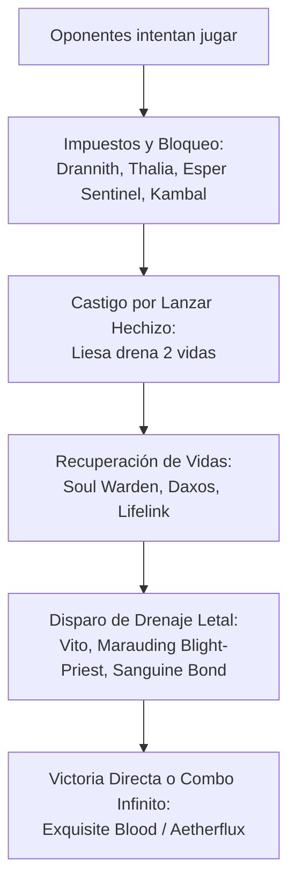

# Guía Estratégica: Liesa, Shroud of Dusk — Castigo Total, Drenaje e Impuestos (`liesa_test_skill`)

**Comandante**: [`Liesa, Shroud of Dusk`](file:///root/mtg/decks/Commander/liesa_test_skill/liesa_test_skill.txt#L2)  
**Formato**: Commander / EDH (Legal según Magic Comprehensive Rules CR 903)  
**Identidad de Color**: Orzhov (`{W}{B}`)  
**Enfoque**: Impuestos Implacables (Stax / Tax), Drenaje Asimétrico de Vidas (Bleed) y Combos de Fin de Partida  

---

## 1. ¿Por qué Liesa es el Comandante Más Fuerte de tu Baraja?

[`Liesa, Shroud of Dusk`](file:///root/mtg/decks/Commander/liesa_test_skill/liesa_test_skill.txt#L2) posee una combinación de habilidades casi injusta para el formato multijugador:

1. **Inmunidad al Impuesto de Maná (CR 903.8 & CR 118.9)**:
   * *"En lugar de pagar {2} por cada vez previa que hayas lanzado este hechizo desde la zona de mando, pagas 2 vidas por cada vez previa."*
   * **Consecuencia demoledora**: Liesa cuesta **SIEMPRE exactamente 5 manás** (`{2}{W}{W}{B}`). No importa si ha muerto 1, 3 o 6 veces: jamás sube a 7, 9 u 11 manás. Como el mazo genera decenas de vidas pasivas, pagar 2 o 4 vidas por relanzarla es prácticamente gratis.
2. **Castigo Universal Ineludible (Pérdida de Vidas, CR 119.3)**:
   * *"Siempre que un jugador lance un hechizo, ese jugador pierde 2 vidas."*
   * En una mesa de 4 jugadores donde se juegan decenas de hechizos por ronda, los oponentes se desangran a un ritmo vertiginoso (perdiendo 10-20 vidas cada uno por simple inercia de juego).
   * Al ser **pérdida de vidas** y no daño, no se puede prevenir ni reducir.
   * La habilidad va a la pila por encima del hechizo lanzado: si un rival está a 2 vidas y lanza una respuesta, **muere antes de que su hechizo llegue a resolverse**.
3. **Cuerpo 5/5 Vuela y Vínculo Vital**:
   * Cada vez que Liesa ataca o bloquea, recuperas **5 vidas**, compensando holgadamente los hechizos que juegues tú y manteniendo tu total de vidas en la estratosfera.

---

## 2. Los Grandes Motores de la Baraja

### A. El Cerco de Impuestos y Disrupción (Stax / Tax)
El mazo frena en seco a los mazos rápidos e injustos mientras tú ejecutas tu plan:
* [`Drannith Magistrate`](file:///root/mtg/decks/Commander/liesa_test_skill/liesa_test_skill.txt#L10): **Cierra el juego a los comandantes enemigos**. Los oponentes no pueden lanzar hechizos desde ninguna zona que no sea su mano (ni zona de mando, ni exilio, ni cementerio).
* [`Kambal, Consul of Allocation`](file:///root/mtg/decks/Commander/liesa_test_skill/liesa_test_skill.txt#L16): Cada hechizo que no sea de criatura drena 2 vidas al rival y te da 2 vidas a ti. Sumado a Liesa, ¡un solo artefacto o tutor les cuesta **4 vidas netas**!
* [`Esper Sentinel`](file:///root/mtg/decks/Commander/liesa_test_skill/liesa_test_skill.txt#L12) & [`Smothering Tithe`](file:///root/mtg/decks/Commander/liesa_test_skill/liesa_test_skill.txt#L54): Convierten cada acción rival en robo de cartas y maná masivo para ti.
* [`Opposition Agent`](file:///root/mtg/decks/Commander/liesa_test_skill/liesa_test_skill.txt#L18): Castiga las búsquedas en bibliotecas (fetches, tutores, rampas terrestres), exiliando sus cartas bajo tu control.
* [`Orcish Bowmasters`](file:///root/mtg/decks/Commander/liesa_test_skill/liesa_test_skill.txt#L19): Dispara daño continuo por cada carta adicional que roben los rivales.

### B. El Combo Infinito de Victoria Directa
* [`Exquisite Blood`](file:///root/mtg/decks/Commander/liesa_test_skill/liesa_test_skill.txt#L48) + [`Vito, Thorn of the Dusk Rose`](file:///root/mtg/decks/Commander/liesa_test_skill/liesa_test_skill.txt#L27) / [`Sanguine Bond`](file:///root/mtg/decks/Commander/liesa_test_skill/liesa_test_skill.txt#L53) / [`Marauding Blight-Priest`](file:///root/mtg/decks/Commander/liesa_test_skill/liesa_test_skill.txt#L17):
  1. Un oponente pierde vidas (por Liesa, un ataque o cualquier fuente).
  2. *Exquisite Blood* se dispara: tú ganas esa misma cantidad de vidas.
  3. *Vito / Sanguine Bond / Blight-Priest* se dispara: ese oponente pierde esa misma cantidad de vidas.
  4. El bucle se repite indefinidamente hasta que todos los oponentes caen a cero vidas instantáneamente.

### C. El Cañón Láser: Aetherflux Reservoir
* Con cartas como [`Soul Warden`](file:///root/mtg/decks/Commander/liesa_test_skill/liesa_test_skill.txt#L22), [`Soul's Attendant`](file:///root/mtg/decks/Commander/liesa_test_skill/liesa_test_skill.txt#L23), [`Daxos, Blessed by the Sun`](file:///root/mtg/decks/Commander/liesa_test_skill/liesa_test_skill.txt#L9) y el vínculo vital de Liesa, tu total de vidas superará rápidamente los 60-80 puntos.
* [`Aetherflux Reservoir`](file:///root/mtg/decks/Commander/liesa_test_skill/liesa_test_skill.txt#L31): Paga 50 vidas para hacer 50 puntos de daño a cualquier objetivo. Puedes dispararlo varias veces seguidas para eliminar a los jugadores restantes de un solo golpe.

---

## 3. Estadísticas de Maná y Eficiencia

* **Coste Medio de Maná (CMC)**: **2.63** (extremadamente rápido y reactivo frente a los 3.66 de Adrix).
* **Tierras**: 35 tierras de máxima consistencia.
* **Aceleración**: 8 rocas y fuentes de maná de coste 2 ([`Sol Ring`](file:///root/mtg/decks/Commander/liesa_test_skill/liesa_test_skill.txt#L37), [`Arcane Signet`](file:///root/mtg/decks/Commander/liesa_test_skill/liesa_test_skill.txt#L32), [`Orzhov Signet`](file:///root/mtg/decks/Commander/liesa_test_skill/liesa_test_skill.txt#L36), [`Talisman of Hierarchy`](file:///root/mtg/decks/Commander/liesa_test_skill/liesa_test_skill.txt#L38), [`Fellwar Stone`](file:///root/mtg/decks/Commander/liesa_test_skill/liesa_test_skill.txt#L34)).
* **Interacción / Remoción**: 18 cartas de interacción entre instantáneos, conjuros y matabichos incondicionales ([`Swords to Plowshares`](file:///root/mtg/decks/Commander/liesa_test_skill/liesa_test_skill.txt#L63), [`Path to Exile`](file:///root/mtg/decks/Commander/liesa_test_skill/liesa_test_skill.txt#L61), [`Anguished Unmaking`](file:///root/mtg/decks/Commander/liesa_test_skill/liesa_test_skill.txt#L57), [`Toxic Deluge`](file:///root/mtg/decks/Commander/liesa_test_skill/liesa_test_skill.txt#L76), [`Damn`](file:///root/mtg/decks/Commander/liesa_test_skill/liesa_test_skill.txt#L70), [`Farewell`](file:///root/mtg/decks/Commander/liesa_test_skill/liesa_test_skill.txt#L73)).

---

## 4. Guía de Mulligan y Plan de Turnos

### Mano Inicial Óptima
* **2-3 Tierras** (al menos una fuente blanca y una negra).
* **1-2 Cartas de Aceleración o Impuesto de Turno 1–2** (`Esper Sentinel`, `Drannith Magistrate`, `Sol Ring`, `Talisman of Hierarchy`, `Blind Obedience`).
* **1 Motor de Vidas o Robo** (`Soul Warden`, `Phyrexian Arena`, `Black Market Connections`, `Night's Whisper`).
* **1 Respuesta Barata** (`Swords to Plowshares`, `Path to Exile`, `Fracture`).

### Secuencia por Turnos
* **Turno 1**: Despliega a [`Esper Sentinel`](file:///root/mtg/decks/Commander/liesa_test_skill/liesa_test_skill.txt#L12), [`Soul Warden`](file:///root/mtg/decks/Commander/liesa_test_skill/liesa_test_skill.txt#L22) o [`Serra Ascendant`](file:///root/mtg/decks/Commander/liesa_test_skill/liesa_test_skill.txt#L21) (un 6/6 que vuela con vínculo vital en turno 1 si tienes 30+ vidas).
* **Turno 2**: Establece el control con [`Drannith Magistrate`](file:///root/mtg/decks/Commander/liesa_test_skill/liesa_test_skill.txt#L10), [`Kambal`](file:///root/mtg/decks/Commander/liesa_test_skill/liesa_test_skill.txt#L16) o rocas de maná.
* **Turnos 3–4**: Lanza un tutor, motor de robo (`Necropotence`, `Phyrexian Arena`) o prepara el terreno con [`Blind Obedience`](file:///root/mtg/decks/Commander/liesa_test_skill/liesa_test_skill.txt#L47).
* **Turnos 4–5**: Despliega a [`Liesa, Shroud of Dusk`](file:///root/mtg/decks/Commander/liesa_test_skill/liesa_test_skill.txt#L2). A partir de este momento, cada hechizo enemigo acelera su reloj de muerte mientras tú ganas 5 vidas por turno en combate.
* **Cierre de Partida**: Ensambla el combo de *Exquisite Blood*, activa *Aetherflux Reservoir* o remata la mesa con un barrido asimétrico con Liesa protegida por [`Teferi's Protection`](file:///root/mtg/decks/Commander/liesa_test_skill/liesa_test_skill.txt#L64).
