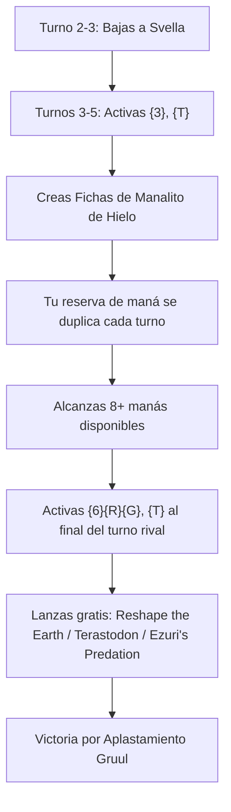
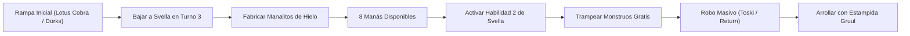

# Guía Estratégica: Svella, Ice Shaper
### Aceleración Masiva de Nieve, Bestias Titánicas y Disparo Gratuito de Biblioteca (Gruul Ramp & Stompy)

> **Formato:** Commander / EDH (CR 903)  
> **Comandante:** [Svella, Ice Shaper](file:///root/mtg/decks/Commander/svella/svella.txt#L2)  
> **Identidad de Color:** Gruul (`{R, G}`)  
> **Total de Cartas:** 100 cartas exactas (Conforme a la normativa oficial CR 903.5)  
> **Archivo de Lista:** [`decks/Commander/svella/svella.txt`](file:///root/mtg/decks/Commander/svella/svella.txt)  
> **Compatibilidad Física:** 0 cartas en conflicto con [Adrix and Nev](file:///root/mtg/decks/Commander/adrix/adrix.txt), [Anowon](file:///root/mtg/decks/Commander/anowon/anowon.txt), [Liesa](file:///root/mtg/decks/Commander/liesa/liesa.txt) y [Kardur](file:///root/mtg/decks/Commander/kardur/kardur.txt). Todos los 5 mazos pueden estar montados físicamente al mismo tiempo.

---

## 1. El Comandante: Mecánicas y Reglas Oficiales

| Característica | Detalle Técnico |
| :--- | :--- |
| **Coste de Maná** | `{1}{R}{G}` (CMC: 3) |
| **Tipo de Carta** | Criatura Nevada Legendaria — Artífice Troll (2/4) |
| **Habilidad 1: Rampa de Manalitos** | *"{3}, {T}: Crea una ficha de artefacto nevado incolora llamada Manalito de hielo con '{T}: Agrega un maná de cualquier color'."* |
| **Habilidad 2: Trampeo de Biblioteca** | *"{6}{R}{G}, {T}: Mira las cuatro primeras cartas de tu biblioteca. Puedes lanzar una carta de entre ellas sin pagar su coste de maná. Pon el resto en el fondo de tu biblioteca en un orden aleatorio."* |



### Reglas Oficiales Clave (CR 602 & CR 608)

1. **Rampa sin Gasto de Cartas de Mano (CR 111.1):**  
   A diferencia de otros mazos de rampa que agotan su mano lanzando cartas de tierra o artefactos, la primera habilidad de Svella te permite **rampear indefinidamente sin gastar recursos de tu mano**. Cada turno conviertes 3 manás en un nuevo acelerador permanente (*Icy Manalith*).

2. **Permanentes Nevados (CR 205.4g):**  
   Tanto Svella como las fichas de Manalito de Hielo son **permanentes nevados**. Esto alimenta de inmediato hechizos que requieren o se benefician del maná nevado como [Blizzard Brawl](file:///root/mtg/decks/Commander/svella/svella.txt#L66), [Tundra Fumarole](file:///root/mtg/decks/Commander/svella/svella.txt#L77) y [Blessing of Frost](file:///root/mtg/decks/Commander/svella/svella.txt#L65).

3. **Velocidad de Instantáneo para la Ruleta de 8 Manás (CR 602.2):**  
   La segunda habilidad de Svella (`{6}{R}{G}, {T}`) es una **habilidad activada sin restricciones de tiempo**. Puedes activarla al final del turno del oponente inmediatamente anterior al tuyo.  
   *Consecuencia demoledora:* Si revelas una criatura gigante como [Terastodon](file:///root/mtg/decks/Commander/svella/svella.txt#L29) o [Rampaging Baloths](file:///root/mtg/decks/Commander/svella/svella.txt#L26), entra al final del turno rival, se libra del mareo de invocación (*summoning sickness*) y está lista para atacar en tu propio turno.

4. **Lanzar Hechizos sin Pagar Coste (CR 118.9):**  
   Puedes elegir **cualquier tipo de carta que no sea tierra** (criatura, conjuro gigante, caminante de planos o artefacto) y lanzarla sin pagar su coste de maná. Puedes trampear hechizos de coste 9 como [Reshape the Earth](file:///root/mtg/decks/Commander/svella/svella.txt#L72) o de coste 8 como [Ezuri's Predation](file:///root/mtg/decks/Commander/svella/svella.txt#L67).

---

## 2. Curva de Maná y Base de Tierras

El mazo presenta una curva media calculada (**CMC medio: 3.88**) diseñada a propósito para maximizar los disparos gratuitos de la segunda habilidad de Svella, respaldada por un motor de rampa sin precedentes con **17 piezas de aceleración directa** en las 99 cartas más la propia Svella en la zona de mando.

```text
=================================================================
 MTG MANA CURVE & LAND BASE ANALYSIS
=================================================================
Total Cartas:           100 (1 Comandante, 63 Hechizos/Criaturas, 36 Tierras)
Coste Medio (CMC):      3.88 (Curva pesada de alto impacto)
Tierras en Baraja:      36 tierras (27 básicas + 9 utilidades/duales)
Piezas de Rampa:        17 fuentes fijas (dorks, rocas y tutores de tierras)
Distribución de Pips:   Verde (G): 66 pips (80.5%)  |  Rojo (R): 16 pips (19.5%)
Fuentes de Color:       25 Fuentes Verdes  |  13 Fuentes Rojas
=================================================================
```

### Gráfico de Curva de Maná

```text
CMC 1: [3]  ████ (Blizzard Brawl, Jaspera Sentinel, Traveler's Amulet)
CMC 2: [14] ███████████████████ (Lotus Cobra, Incubation Druid, Rampant Growth, Adventure Awaits, etc.)
CMC 3: [18] █████████████████████████ (Svella, Jeska's Will, Farhaven Elf, Old-Growth Troll, Cultivate effects, etc.)
CMC 4: [8]  ███████████ (Toski, Esika's Chariot, Migration Path, Beast Within, Wicked Wolf, etc.)
CMC 5: [7]  █████████ (Kodama of the East Tree, Garruk Primal Hunter, Battle Mammoth, Sweet-Gum Recluse, etc.)
CMC 6: [6]  ████████ (Rampaging Baloths, Hornet Queen, Sifter Wurm, Beanstalk Giant, Cinderheart Giant, etc.)
CMC 7+: [8] ███████████ (Terastodon, Reshape the Earth, Ezuri's Predation, Annoyed Altisaur, Hydra Broodmaster, etc.)
```

### Fuentes de Color y Modelo de Frank Karsten

Dado que el 80.5% de los requisitos de color son verdes (incluyendo costes intensivos como `{G}{G}{G}` en [Old-Growth Troll](file:///root/mtg/decks/Commander/svella/svella.txt#L25) y [Garruk, Primal Hunter](file:///root/mtg/decks/Commander/svella/svella.txt#L34), y `{G}{G}{G}{G}` en hechizos finales), la base de tierras prioriza el maná verde mientras el maná rojo se fija con facilidad:
- **25 Fuentes Verdes en Tierras:** 12 [Forest](file:///root/mtg/decks/Commander/svella/svella.txt#L81), 5 [Snow-Covered Forest](file:///root/mtg/decks/Commander/svella/svella.txt#L90), [Highland Forest](file:///root/mtg/decks/Commander/svella/svella.txt#L83), [Rugged Highlands](file:///root/mtg/decks/Commander/svella/svella.txt#L88), [Blighted Woodland](file:///root/mtg/decks/Commander/svella/svella.txt#L80), [Mosswort Bridge](file:///root/mtg/decks/Commander/svella/svella.txt#L85), [Llanowar Reborn](file:///root/mtg/decks/Commander/svella/svella.txt#L84), [Oran-Rief, the Vastwood](file:///root/mtg/decks/Commander/svella/svella.txt#L87), [Tranquil Thicket](file:///root/mtg/decks/Commander/svella/svella.txt#L91) y [Shimmerdrift Vale](file:///root/mtg/decks/Commander/svella/svella.txt#L89).
- **13 Fuentes Rojas en Tierras:** 10 [Mountain](file:///root/mtg/decks/Commander/svella/svella.txt#L86), [Highland Forest](file:///root/mtg/decks/Commander/svella/svella.txt#L83), [Rugged Highlands](file:///root/mtg/decks/Commander/svella/svella.txt#L88), [Gnottvold Slumbermound](file:///root/mtg/decks/Commander/svella/svella.txt#L82), [Shimmerdrift Vale](file:///root/mtg/decks/Commander/svella/svella.txt#L89).
- **Fijación Multicolor:** Todos los Manalitos creados por Svella dan **maná de cualquier color**. Además, [Lotus Cobra](file:///root/mtg/decks/Commander/svella/svella.txt#L23), [Incubation Druid](file:///root/mtg/decks/Commander/svella/svella.txt#L19), [Jaspera Sentinel](file:///root/mtg/decks/Commander/svella/svella.txt#L20), [Gift of Paradise](file:///root/mtg/decks/Commander/svella/svella.txt#L48) y [Altar of the Pantheon](file:///root/mtg/decks/Commander/svella/svella.txt#L37) garantizan acceso ilimitado a ambos colores.

---

## 3. Pilares Estratégicos del Mazo



### Pilar A: El Motor de Manalitos y Rampa Infinita
El mazo está diseñado para pasar de los 3 manás a los 8 manás en tiempo récord:
- En los turnos 1 y 2 aceleras con [Jaspera Sentinel](file:///root/mtg/decks/Commander/svella/svella.txt#L20), [Lotus Cobra](file:///root/mtg/decks/Commander/svella/svella.txt#L23), [Incubation Druid](file:///root/mtg/decks/Commander/svella/svella.txt#L19) o [Rampant Growth](file:///root/mtg/decks/Commander/svella/svella.txt#L71).
- Bajas a [Svella, Ice Shaper](file:///root/mtg/decks/Commander/svella/svella.txt#L2) en el turno 3.
- En el turno 4 y 5 activas la primera habilidad de Svella para poner en juego Manalitos de Hielo, o lanzas [The Weatherseed Treaty](file:///root/mtg/decks/Commander/svella/svella.txt#L50), [Farhaven Elf](file:///root/mtg/decks/Commander/svella/svella.txt#L15) o [Migration Path](file:///root/mtg/decks/Commander/svella/svella.txt#L69).
- [Alena, Kessig Trapper](file:///root/mtg/decks/Commander/svella/svella.txt#L5) se gira para agregar maná rojo igual a la mayor fuerza entre tus criaturas (con [Terastodon](file:///root/mtg/decks/Commander/svella/svella.txt#L29) en mesa, ¡agrega 9 manás de golpe!).
- [Jeska's Will](file:///root/mtg/decks/Commander/svella/svella.txt#L68) genera habitualmente entre 5 y 7 manás rojos y te da 3 cartas de exilio para jugar.

### Pilar B: Las Bombas Titánicas de Biblioteca
Cuando activas la ruleta de 8 manás de Svella o alcanzas el maná suficiente de forma natural, despliegas amenazas devastadoras:
- **[Reshape the Earth](file:///root/mtg/decks/Commander/svella/svella.txt#L72):** Busca **hasta diez cartas de tierra** en tu biblioteca y ponlas en el campo de batalla. Con [Rampaging Baloths](file:///root/mtg/decks/Commander/svella/svella.txt#L26) en mesa, ¡crea inmediatamente **diez fichas de Bestia 4/4** (40 de fuerza total con arrollar)!
- **[Ezuri's Predation](file:///root/mtg/decks/Commander/svella/svella.txt#L67):** Por cada criatura que controlen tus oponentes, crea una Bestia 4/4 que lucha contra ella. Limpia por completo las mesas rivales y te deja con un ejército masivo.
- **[Terastodon](file:///root/mtg/decks/Commander/svella/svella.txt#L29):** Destruye hasta 3 permanentes que no sean criaturas (tierras problemáticas, artefactos clave o encantamientos) sustituyéndolos por humildes elefantes 3/3 mientras tú conservas un titán 9/9.
- **[Kodama of the East Tree](file:///root/mtg/decks/Commander/svella/svella.txt#L22):** Cada vez que un permanente entra a tu campo, puedes poner gratis otro de coste menor o igual de tu mano. ¡Hacer un Manalito de Hielo con Svella te permite bajar tierras gratis de tu mano!
- **[Hornet Queen](file:///root/mtg/decks/Commander/svella/svella.txt#L16):** Cinco cuerpos voladores con toque mortal que bloquean dragones enemigos y dominan el juego aéreo.
- **[Hydra Broodmaster](file:///root/mtg/decks/Commander/svella/svella.txt#L18):** Con la inmensa cantidad de maná acumulada, activas su *Monstruosidad* por X=8 o X=10, creando diez Hidras 10/10 en un solo turno.

### Pilar C: La Duplicación de Fichas con *Esika's Chariot*
- **[Esika's Chariot](file:///root/mtg/decks/Commander/svella/svella.txt#L39):** Entra creando dos gatos 2/2 y se pilota con solo 1 de fuerza (lo pilota cualquier elfo).
- Cada vez que ataca, **copia una ficha que controles**.
  - Si necesitas más maná: ¡Copia un **Manalito de Hielo** para rampear un maná más gratis!
  - Si tienes amenazas: Copia una ficha 4/4 de Bestia de [Rampaging Baloths](file:///root/mtg/decks/Commander/svella/svella.txt#L26), una ficha de [Garruk, Primal Hunter](file:///root/mtg/decks/Commander/svella/svella.txt#L34) o una avispa voladora de [Hornet Queen](file:///root/mtg/decks/Commander/svella/svella.txt#L16).

### Pilar D: Robo Masivo Basado en Fuerza (*Power Draw*)
Los mazos de rampa suelen sufrir de agotamiento de mano. Svella solventa este problema mediante motores de ventaja masiva:
- **[Toski, Bearer of Secrets](file:///root/mtg/decks/Commander/svella/svella.txt#L30):** Indestructible e incontrarestable. Cada vez que cualquiera de tus criaturas haga daño de combate a un rival, **robas una carta**. Con fichas de insectos o bestias arrollando, robas de 3 a 6 cartas por ataque.
- **[Garruk, Primal Hunter](file:///root/mtg/decks/Commander/svella/svella.txt#L34):** Su -3 te hace robar cartas igual a la mayor fuerza entre tus criaturas (habitualmente entre 5 y 9 cartas).
- **[Return of the Wildspeaker](file:///root/mtg/decks/Commander/svella/svella.txt#L58):** A velocidad de instantáneo roba tantas cartas como la mayor fuerza de criatura no humana, o da +3/+3 y arrollar a todo tu ejército para rematar.
- **[Shamanic Revelation](file:///root/mtg/decks/Commander/svella/svella.txt#L76):** Roba una carta por cada criatura que controles y te cura 4 vidas por cada criatura de fuerza 4 o superior.
- **[Hunter's Insight](file:///root/mtg/decks/Commander/svella/svella.txt#L55):** Te permite robar daño masivo al conectar con un titán arrollador.

---

## 4. Desglose Funcional de Cartas

| Categoría Funcional | Cantidad | Cartas Incluidas | Justificación Estratégica |
| :--- | :---: | :--- | :--- |
| **Comandante** | 1 | [Svella, Ice Shaper](file:///root/mtg/decks/Commander/svella/svella.txt#L2) | Motor dual: rampa de Manalitos en juego temprano y ruleta de invocación gratuita en turnos tardíos. |
| **Titanes y Bombas** | 9 | [Terastodon](file:///root/mtg/decks/Commander/svella/svella.txt#L29), [Reshape the Earth](file:///root/mtg/decks/Commander/svella/svella.txt#L72), [Ezuri's Predation](file:///root/mtg/decks/Commander/svella/svella.txt#L67), [Kodama of the East Tree](file:///root/mtg/decks/Commander/svella/svella.txt#L22), [Rampaging Baloths](file:///root/mtg/decks/Commander/svella/svella.txt#L26), [Hornet Queen](file:///root/mtg/decks/Commander/svella/svella.txt#L16), [Hydra Broodmaster](file:///root/mtg/decks/Commander/svella/svella.txt#L18), [Sifter Wurm](file:///root/mtg/decks/Commander/svella/svella.txt#L27), [Annoyed Altisaur](file:///root/mtg/decks/Commander/svella/svella.txt#L6) | Las mejores recompensas para trampear con Svella o lanzar de forma natural con exceso de maná. |
| **Aceleradores y Criaturas de Maná** | 9 | [Lotus Cobra](file:///root/mtg/decks/Commander/svella/svella.txt#L23), [Incubation Druid](file:///root/mtg/decks/Commander/svella/svella.txt#L19), [Jaspera Sentinel](file:///root/mtg/decks/Commander/svella/svella.txt#L20), [Humble Naturalist](file:///root/mtg/decks/Commander/svella/svella.txt#L17), [Farhaven Elf](file:///root/mtg/decks/Commander/svella/svella.txt#L15), [Alena, Kessig Trapper](file:///root/mtg/decks/Commander/svella/svella.txt#L5), [Birgi // Harnfel](file:///root/mtg/decks/Commander/svella/svella.txt#L10), [Old-Growth Troll](file:///root/mtg/decks/Commander/svella/svella.txt#L25), [Beanstalk Giant](file:///root/mtg/decks/Commander/svella/svella.txt#L9) | Garantizan el despliegue de Svella en turno 2 o 3 y catapultan la reserva de maná. |
| **Hechizos de Rampa de Tierras** | 5 | [Rampant Growth](file:///root/mtg/decks/Commander/svella/svella.txt#L71), [Migration Path](file:///root/mtg/decks/Commander/svella/svella.txt#L69), [The Weatherseed Treaty](file:///root/mtg/decks/Commander/svella/svella.txt#L50), [Gift of Paradise](file:///root/mtg/decks/Commander/svella/svella.txt#L48), [Scale the Heights](file:///root/mtg/decks/Commander/svella/svella.txt#L74) | Adelantan tierras al campo para activar el *landfall* de Lotus Cobra y Rampaging Baloths. |
| **Rampa por Artefactos y Tesoros** | 6 | [Jeska's Will](file:///root/mtg/decks/Commander/svella/svella.txt#L68), [Seize the Spoils](file:///root/mtg/decks/Commander/svella/svella.txt#L75), [Altar of the Pantheon](file:///root/mtg/decks/Commander/svella/svella.txt#L37), [Murmuring Volume](file:///root/mtg/decks/Commander/svella/svella.txt#L41), [Armillary Sphere](file:///root/mtg/decks/Commander/svella/svella.txt#L38), [Traveler's Amulet](file:///root/mtg/decks/Commander/svella/svella.txt#L44) | Impulso explosivo de maná y búsqueda de tierras básicas sin fallar turnos. |
| **Robo y Ventaja Masiva** | 8 | [Toski, Bearer of Secrets](file:///root/mtg/decks/Commander/svella/svella.txt#L30), [Garruk, Primal Hunter](file:///root/mtg/decks/Commander/svella/svella.txt#L34), [Return of the Wildspeaker](file:///root/mtg/decks/Commander/svella/svella.txt#L58), [Shamanic Revelation](file:///root/mtg/decks/Commander/svella/svella.txt#L76), [Hunter's Insight](file:///root/mtg/decks/Commander/svella/svella.txt#L55), [Adventure Awaits](file:///root/mtg/decks/Commander/svella/svella.txt#L64), [Roots of Wisdom](file:///root/mtg/decks/Commander/svella/svella.txt#L73), [Entourage of Trest](file:///root/mtg/decks/Commander/svella/svella.txt#L14) | Transforman la presencia de mesa en decenas de cartas en mano para no perder fuelle jamás. |
| **Removal y Control de Mesa** | 8 | [Beast Within](file:///root/mtg/decks/Commander/svella/svella.txt#L53), [Krosan Grip](file:///root/mtg/decks/Commander/svella/svella.txt#L56), [Blizzard Brawl](file:///root/mtg/decks/Commander/svella/svella.txt#L66), [Wicked Wolf](file:///root/mtg/decks/Commander/svella/svella.txt#L31), [Tundra Fumarole](file:///root/mtg/decks/Commander/svella/svella.txt#L77), [Broken Wings](file:///root/mtg/decks/Commander/svella/svella.txt#L54), [Shredded Sails](file:///root/mtg/decks/Commander/svella/svella.txt#L59), [Wilt](file:///root/mtg/decks/Commander/svella/svella.txt#L61) | Eliminan amenazas enemigas problemáticas a velocidad de instantáneo y castigan voladores. |
| **Sinergias de Combate y Cascada** | 6 | [Esika's Chariot](file:///root/mtg/decks/Commander/svella/svella.txt#L39), [Sweet-Gum Recluse](file:///root/mtg/decks/Commander/svella/svella.txt#L28), [Boarding Party](file:///root/mtg/decks/Commander/svella/svella.txt#L11), [Doomskar Titan](file:///root/mtg/decks/Commander/svella/svella.txt#L13), [Cinderheart Giant](file:///root/mtg/decks/Commander/svella/svella.txt#L12), [Battle Mammoth](file:///root/mtg/decks/Commander/svella/svella.txt#L8) | Cascada para encadenar hechizos gratis y presencia arrolladora en combate. |
| **Filtro y Manipulación de Top** | 3 | [Guild Globe](file:///root/mtg/decks/Commander/svella/svella.txt#L40), [Raiders' Karve](file:///root/mtg/decks/Commander/svella/svella.txt#L42), [Scroll Rack](file:///root/mtg/decks/Commander/svella/svella.txt#L43) | Ajuste fino de biblioteca; Scroll Rack prepara el top para lanzar titanes gratis con Svella o controlar la cascada. |
| **Tierras (convencionales)** | 35 | 12 [Forest](file:///root/mtg/decks/Commander/svella/svella.txt#L81), 10 [Mountain](file:///root/mtg/decks/Commander/svella/svella.txt#L86), 5 [Snow-Covered Forest](file:///root/mtg/decks/Commander/svella/svella.txt#L90), duales y tierras de utilidad | Base de maná verde dominante con tierras nevadas y utilidades como [Mosswort Bridge](file:///root/mtg/decks/Commander/svella/svella.txt#L85). |
| **Tierras de Utilidad** | 1 | [Gnottvold Slumbermound](file:///root/mtg/decks/Commander/svella/svella.txt#L82) | Destrucción de tierras enemigas y creación de un Troll 4/4 arrollador en turnos avanzados. |

---

## 5. Plan de Partida Turno a Turno

### Turnos 1 - 2: Rampa Temprana
- Juega tierras buscando abrir con bosque o tierra dual ([Rugged Highlands](file:///root/mtg/decks/Commander/svella/svella.txt#L88), [Highland Forest](file:///root/mtg/decks/Commander/svella/svella.txt#L83)).
- Lanza aceleradores tempranos: [Jaspera Sentinel](file:///root/mtg/decks/Commander/svella/svella.txt#L20), [Lotus Cobra](file:///root/mtg/decks/Commander/svella/svella.txt#L23), [Incubation Druid](file:///root/mtg/decks/Commander/svella/svella.txt#L19) o [Rampant Growth](file:///root/mtg/decks/Commander/svella/svella.txt#L71).
- Prepara la mesa para poner a Svella en el campo en el turno 2 o 3.

### Turnos 3 - 4: Despliegue de Svella y Fabricación de Manalitos
- Lanza a [Svella, Ice Shaper](file:///root/mtg/decks/Commander/svella/svella.txt#L2).
- En el siguiente turno, activa su primera habilidad (`{3}, {T}`) para crear tu primer **Manalito de Hielo**.
- Si la mesa lo exige, utiliza [Blizzard Brawl](file:///root/mtg/decks/Commander/svella/svella.txt#L66) (que cuesta solo `{G}` y hace indestructible a tu criatura si controlas 3 permanentes nevados) o [Beast Within](file:///root/mtg/decks/Commander/svella/svella.txt#L53) para responder a amenazas rivales.

### Turnos 5 - 6: La Explosión de Maná y los Motores de Robo
- Despliega piezas como [Toski, Bearer of Secrets](file:///root/mtg/decks/Commander/svella/svella.txt#L30), [Esika's Chariot](file:///root/mtg/decks/Commander/svella/svella.txt#L39) o [Battle Mammoth](file:///root/mtg/decks/Commander/svella/svella.txt#L8).
- Si juegas [Esika's Chariot](file:///root/mtg/decks/Commander/svella/svella.txt#L39), ataca de inmediato para **duplicar tus Manalitos de Hielo** y acelerar aún más tu reserva.
- Alcanzarás los 8 manás fácilmente entre tierras, manalitos y dorks.

### Turnos 7 en adelante: La Ruleta de Svella y la Estampida Final
- Al final del turno del oponente que juega antes que tú, gira a Svella y paga `{6}{R}{G}` para mirar el top 4 de tu biblioteca.
- Lanza gratis a [Terastodon](file:///root/mtg/decks/Commander/svella/svella.txt#L29), [Reshape the Earth](file:///root/mtg/decks/Commander/svella/svella.txt#L72), [Ezuri's Predation](file:///root/mtg/decks/Commander/svella/svella.txt#L67) o [Annoyed Altisaur](file:///root/mtg/decks/Commander/svella/svella.txt#L6).
- En tu turno, roba tu mano completa con [Return of the Wildspeaker](file:///root/mtg/decks/Commander/svella/svella.txt#L58) o [Garruk, Primal Hunter](file:///root/mtg/decks/Commander/svella/svella.txt#L34), da +3/+3 y arrollar a todo tu ejército, y arrasa la mesa con una estampida imparable.

---

## 6. Sinergias Avanzadas y Reglas Clave

1. **La Interacción Kodama + Manalitos de Hielo:**  
   Cuando [Kodama of the East Tree](file:///root/mtg/decks/Commander/svella/svella.txt#L22) está en mesa y activas la habilidad de Svella para crear un Manalito de Hielo, el Manalito entra al campo. Como es una ficha de artefacto con valor de maná 0, el disparo de Kodama se activa y te permite **poner en el campo cualquier carta de valor de maná 0 de tu mano** (¡lo que incluye **cualquier carta de tierra**!). Rampa doble en una sola activación.

2. **Mosswort Bridge y el Umbral de Poder:**  
   [Mosswort Bridge](file:///root/mtg/decks/Commander/svella/svella.txt#L85) tiene *Hideaway 4*. En un mazo con criaturas de fuerza 6, 7 y 9 ([Terastodon](file:///root/mtg/decks/Commander/svella/svella.txt#L29), [Rampaging Baloths](file:///root/mtg/decks/Commander/svella/svella.txt#L26), [Hydra Broodmaster](file:///root/mtg/decks/Commander/svella/svella.txt#L18)), alcanzar los 10 puntos de fuerza total entre tus criaturas ocurre de forma natural en los primeros turnos, permitiéndote jugar la carta escondida por tan solo `{G}` a velocidad de instantáneo.

3. **Reshape the Earth como Disparador de Fin de Partida:**  
   Si lanzas o trampeas [Reshape the Earth](file:///root/mtg/decks/Commander/svella/svella.txt#L72), buscas 10 tierras de golpe. Si tienes a [Lotus Cobra](file:///root/mtg/decks/Commander/svella/svella.txt#L23), agregas **10 manás de cualquier color** en el acto. Si tienes a [Rampaging Baloths](file:///root/mtg/decks/Commander/svella/svella.txt#L26), creas **diez Bestias 4/4 con arrollar**. Es un cierre de juego fulminante.

4. **El Paraguas de Toski y Battle Mammoth:**  
   [Toski, Bearer of Secrets](file:///root/mtg/decks/Commander/svella/svella.txt#L30) es indestructible y no puede ser contrarrestado, garantizando que siempre tengas un atacante para robar. Junto con [Battle Mammoth](file:///root/mtg/decks/Commander/svella/svella.txt#L8), cualquier intento enemigo de hacer objetivo a tus permanentes te recompensa robando una carta adicional.
