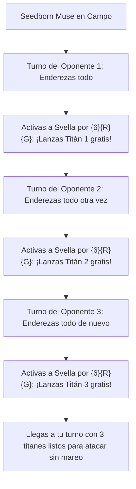

# Guía de Mejoras y Upgrades Futuros: Svella, Ice Shaper
### De Rampa de Manalitos a Ametralladora de Hechizos Colosales Gratuitos (Power Level 8)

> **Mazo Base:** [`decks/Commander/svella/svella.txt`](file:///root/mtg/decks/Commander/svella/svella.txt)  
> **Guía Estratégica Base:** [`decks/Commander/svella/svella_guide.md`](file:///root/mtg/decks/Commander/svella/svella_guide.md)  
> **Comandante:** [Svella, Ice Shaper](file:///root/mtg/decks/Commander/svella/svella.txt#L2)  
> **Identidad de Color:** Gruul (`{R, G}`)  
> **Presupuesto Estimado:** Escalonado en 3 fases modulares (desde 12 €).

---

## 1. Visión General: Los Cuellos de Botella de Svella

Svella es uno de los comandantes con mayor aceleración autosuficiente del juego: su primera habilidad fabrica rocas de maná permanentes sin gastar cartas, y su segunda habilidad te permite lanzar gratis cartas de coste 7, 8 o 10. Para llevarla al siguiente nivel, hay que superar tres limitaciones:

1. **La restricción de girarse una sola vez por ronda:** La habilidad de 8 manás requiere girar a Svella (`{T}`). Si incorporas **efectos de enderezado continuo** (*Seedborn Muse*, *Magewright's Stone*), puedes activar la ruleta de Svella **en el turno de cada uno de tus oponentes**, lanzando 3 o 4 monstruos gigantescos gratis en una sola ronda de mesa.
2. **Duplicar los disparos activados:** Con cartas como *Illusionist's Bracers*, pagar los 8 manás de Svella te permite **mirar y trampear dos cartas gratis a la vez** en vez de una.
3. **Titanes con Cascada Múltiple:** Reemplazar monstruos vainilla por cartas que desaten una avalancha de hechizos gratis encadenados (*Apex Devastator*, *Etali, Primal Storm*).



---

## 2. Hoja de Ruta de Adquisición por Fases

---

### FASE 1: Mejoras "Budget" de Alto Impacto (~12 € - 15 € en total)
*Enderezadores baratos, robo continuo por daño y el mejor removal por menos de 3 € cada uno.*

| Carta a Incluir | Coste Maná | Tipo | Precio Aprox. | Rol Estratégico |
| :--- | :---: | :--- | :---: | :--- |
| **Etali, Primal Storm** | `{4}{R}{R}` | Criatura — Dinosaurio (6/6) | ~2.50 € | Al atacar, exilia la primera carta de la biblioteca de CADA jugador y **lanzas todas las que no sean tierra totalmente gratis**. |
| **Magewright's Stone** | `{2}` | Artefacto | ~3.50 € | `{1}, {T}`: Endereza una criatura con habilidad activada. Te permite activar a Svella dos veces en el mismo turno. |
| **Garruk's Uprising** | `{2}{G}` | Encantamiento | ~1.20 € | Otorga *Arrollar* a todas tus criaturas. Cada vez que entra una criatura de fuerza 4 o superior, robas una carta. |
| **Instill Energy** | `{G}` | Encantamiento — Aura | ~1.50 € | Da pseudoprisa a Svella y te permite **enderezarla gratis una vez en cada uno de tus turnos**. |
| **Blasphemous Act** | `{8}{R}` | Conjuro | ~2.50 € | Se lanza por `{R}` en mesas pobladas y barre 13 daños a todas las criaturas para resetear si vas por detrás. |
| **Chaos Warp** | `{2}{R}` | Instantáneo | ~1.00 € | El mejor removal universal rojo: baraja cualquier permanente problemático enemigo en su biblioteca. |
| **Karplusan Forest** | Tierra | Tierra Doble | ~1.50 € | Tierra que da incoloro gratis o `{R}`/`{G}` por 1 vida, siempre enderezada. |
| **Cinder Glade** | Tierra | Tierra Doble | ~0.50 € | Tierra dual con tipos Montaña y Bosque; entra enderezada si tienes dos básicas. |

> **Resultado de la Fase 1:** El mazo adquiere la capacidad de activar a Svella múltiples veces por turno, otorga arrollar pasivo a todas tus criaturas y mejora drásticamente su interacción.

---

### FASE 2: La Ametralladora de Hechizos y Titanes de Cascada (~35 € - 45 € en total)
*La fase que rompe las matemáticas de Svella.*

| Carta a Incluir | Coste Maná | Tipo | Precio Aprox. | Rol Estratégico |
| :--- | :---: | :--- | :---: | :--- |
| **Seedborn Muse** | `{3}{G}{G}` | Criatura — Espíritu (2/4) | ~8.50 € | **La carta más demoledora para Svella.** Endereza todas tus tierras, artefactos y criaturas en el paso de enderezar de **CADA oponente**. Puedes activar la ruleta de 8 manás de Svella en el turno de cada rival, ¡trampeando 3 monstruos por ronda! |
| **Illusionist's Bracers** | `{2}` | Artefacto — Equipo | ~3.50 € | Cada vez que activas una habilidad de la criatura equipada que no sea de maná, **la habilidad se copia**. Al activar la segunda habilidad de Svella, ¡trampeas **DOS cartas gratis**! |
| **Apex Devastator** | `{8}{G}{G}` | Criatura — Hidra (9/8) | ~10.00 € | Tiene **CUATRO disparos de Cascada**. Si lo trampeas gratis con Svella, lanzas a este titán 9/8 y se disparan cuatro cascadas consecutivas que vacían cartas gratis de tu mazo a la mesa. |
| **Heroic Intervention** | `{1}{G}` | Instantáneo | ~7.00 € | Protege todas tus tierras, manalitos y titanes dándoles indestructible y antimaleficio por 2 manás. |
| **Spire Garden** | Tierra | Tierra Doble | ~7.50 € | *Bond land* Gruul: entra enderezada incondicionalmente en partidas multijugador. |

> **Resultado de la Fase 2:** Con *Seedborn Muse*, el juego termina en cuestión de un ciclo de turnos: Svella pone en mesa más de 25 manás de amenazas gratuitas sin esperar a tu turno.

---

### FASE 3: Upgrades de Lujo / Alta Gama (~50 €+)
*Para competir al máximo nivel de optimización:*

* **Etali, Primal Conqueror** (~14 €): A diferencia del Etali clásico, dispara el robo y lanzamiento gratuito de las 4 bibliotecas **en cuanto entra al campo (ETB)**, sin tener que esperar a atacar.
* **Moraug, Fury of Akoum** (~7 €): Con *Reshape the Earth* buscando 10 tierras de golpe, ¡Moraug te otorga **10 fases de combate adicionales consecutivas** para ganar la partida en el acto!
* **Stomping Ground** (~11 €) y **Wooded Foothills** (~13 €): La base de tierras profesional para entrar enderezado sin retraso.
* **Deflecting Swat** (~40 €): Redirige cualquier hechizo o habilidad enemiga de forma totalmente gratuita si controlas a Svella.

---

## 3. Tabla de Sustituciones 1 a 1 (Qué entra y qué sale)

| Sale de la Lista Actual | Entra como Mejora | Motivo del Cambio |
| :--- | :--- | :--- |
| [Joraga Visionary](file:///root/mtg/decks/Commander/svella/svella.txt#L21) | **Seedborn Muse** | Cambias un 1/3 que roba una carta por el motor que te permite jugar 3 turnos extra por ronda. |
| [Basalt Ravager](file:///root/mtg/decks/Commander/svella/svella.txt#L7) | **Apex Devastator** | Cambias un daño menor condicional por el mayor generador de 4 cascadas de Magic. |
| [Boarding Party](file:///root/mtg/decks/Commander/svella/svella.txt#L11) | **Etali, Primal Storm** | Cambias una cascada menor por robar y lanzar hechizos de los 4 jugadores a la vez. |
| [Humble Naturalist](file:///root/mtg/decks/Commander/svella/svella.txt#L17) | **Garruk's Uprising** | Quitas un dork condicional por robo masivo continuo y *Arrollar* para todo tu ejército. |
| [Murmuring Volume](file:///root/mtg/decks/Commander/svella/svella.txt#L41) | **Illusionist's Bracers** | Quitas un artefacto lento por el equipo que duplica cada tirada de biblioteca de Svella. |
| [Guild Globe](file:///root/mtg/decks/Commander/svella/svella.txt#L40) | **Magewright's Stone** | Quitas un cantrip menor por el artefacto clave para enderezar a Svella y activarla dos veces por turno. |
| [Traveler's Amulet](file:///root/mtg/decks/Commander/svella/svella.txt#L44) | **Heroic Intervention** | Añades el escudo definitivo contra limpiezas de mesa para proteger a tus criaturas y manalitos. |
| [Adventure Awaits](file:///root/mtg/decks/Commander/svella/svella.txt#L64) | **Chaos Warp** | Cambias un cantrip por removal incondicional contra cualquier tipo de permanente. |
| [Scale the Heights](file:///root/mtg/decks/Commander/svella/svella.txt#L74) | **Blasphemous Act** | Quitas un conjuro menor de 3 manás para meter la mejor limpieza roja de coste `{R}`. |
| [Gnottvold Slumbermound](file:///root/mtg/decks/Commander/svella/svella.txt#L82) | **Spire Garden** | Sustituyes una tierra que entra girada por la dual perfecta de Commander. |
| [Tranquil Thicket](file:///root/mtg/decks/Commander/svella/svella.txt#L91) | **Karplusan Forest** | Quitas una tierra que entra tapada por una dual rápida incondicional. |

---

## 4. La Ametralladora de Biblioteca: Seedborn Muse + Svella

```text
Condición: [Svella, Ice Shaper] en campo + [Seedborn Muse] en campo + 8 manás entre tierras y manalitos.

1. Turno del Oponente A:
   - Al inicio de su turno, el paso de enderezar de Seedborn Muse endereza todas tus tierras, manalitos y a Svella.
   - En su fase final (*End Step*), pagas {6}{R}{G} y giras a Svella.
   - Miras el top 4 y lanzas GRATIS a [Terastodon] o [Reshape the Earth].

2. Turno del Oponente B:
   - Al inicio de su turno, Seedborn Muse te vuelve a enderezar TODO.
   - En su fase final, pagas {6}{R}{G} y giras a Svella de nuevo.
   - Miras el top 4 y lanzas GRATIS a [Apex Devastator] (¡que dispara 4 cascadas consecutivas!).

3. Turno del Oponente C:
   - Seedborn Muse te vuelve a enderezar TODO.
   - En su fase final, pagas {6}{R}{G} y giras a Svella por tercera vez.
   - Lanzas GRATIS a [Ezuri's Predation] barriendo todo su campo.

4. Llegas a tu propio turno:
   - Todo tu maná está enderezado de nuevo.
   - Tienes un ejército de más de 30 de fuerza en mesa sin mareo de invocación listos para atacar y ganar la partida.
```
