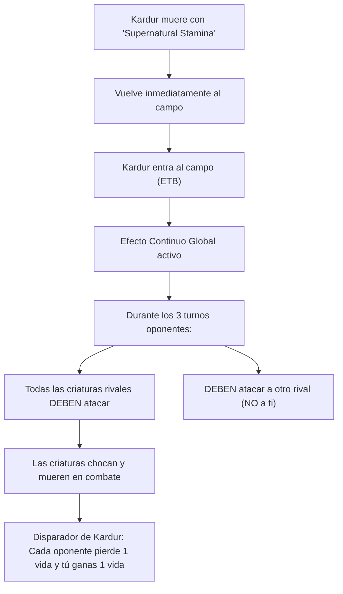
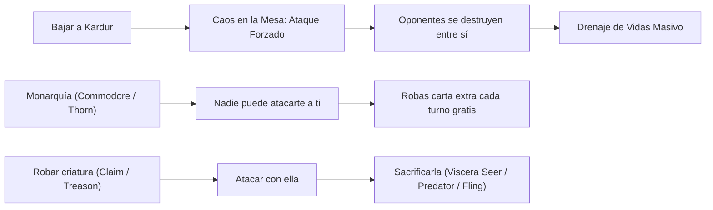

# Guía Estratégica: Kardur, Doomscourge
### Combate Obligatorio, Drenaje Aristócrata y Hurto de Mesa (Rakdos Forced Combat & Aristocrats)

> **Formato:** Commander / EDH (CR 903)  
> **Comandante:** [Kardur, Doomscourge](file:///root/mtg/decks/kardur/kardur.txt#L2)  
> **Identidad de Color:** Rakdos (`{B, R}`)  
> **Total de Cartas:** 100 cartas exactas (Conforme a la normativa oficial CR 903.5)  
> **Archivo de Lista:** [`decks/kardur/kardur.txt`](file:///root/mtg/decks/kardur/kardur.txt)  
> **Compatibilidad Física:** 0 cartas en conflicto con [Adrix and Nev](file:///root/mtg/decks/adrix/adrix.txt), [Anowon](file:///root/mtg/decks/anowon/anowon.txt) y [Liesa](file:///root/mtg/decks/liesa/liesa.txt). Todos los mazos pueden montarse simultáneamente.

---

## 1. El Comandante: Mecánicas y Reglas Oficiales

| Característica | Detalle Técnico |
| :--- | :--- |
| **Coste de Maná** | `{2}{B}{R}` (CMC: 4) |
| **Tipo de Carta** | Criatura Legendaria — Berserker Demonio (4/3) |
| **Disparador de Entrada (ETB)** | *"Cuando Kardur entre al campo de batalla, hasta tu próximo turno, las criaturas que controlan tus oponentes atacan cada combate si pueden y atacan a un jugador que no seas tú si pueden."* |
| **Drenaje de Muerte en Combate** | *"Siempre que una criatura atacante muera, cada oponente pierde 1 vida y tú ganas 1 vida."* |



### Reglas Oficiales Clave (CR 508 & CR 611)

1. **Diferencia Crítica con *Goad* (Incitación):**  
   Kardur **no** usa la palabra clave *Goad*. Su habilidad crea un **efecto continuo que modifica las reglas del juego** afectando a los jugadores oponentes (CR 611.2c).  
   *Consecuencia demoledora:* Afecta a **todas** las criaturas que controlen los rivales en cada fase de combate de esa ronda, **incluyendo criaturas que entren después de Kardur** o criaturas con prisa lanzadas en el turno del propio oponente.

2. **Inmunidad Personal en Partidas Multijugador:**  
   Mientras haya al menos otro oponente con vida o un planeswalker oponente, las criaturas rivales **tienen la obligación legal** de atacar a ese otro jugador o a sus planeswalkers. No pueden elegir atacarte a ti a menos que sea el único ataque legal posible (situación 1 vs 1).

3. **Drenaje Simétrico de Atacantes (CR 510.3):**  
   El segundo disparo dice: *"Siempre que una criatura atacante muera..."*.  
   - Se dispara cuando las criaturas atacantes enemigas mueren al ser bloqueadas por otro oponente.  
   - Se dispara cuando un atacante rival es destruido con un removal durante el combate.  
   - ¡También se dispara cuando **tus propias criaturas atacan y mueren**!  
   Cada muerte le arrebata 1 vida a los 3 oponentes y te otorga a ti 1 vida. Si mueren 6 criaturas en una ronda caótica de combate, ¡la mesa recibe 18 puntos de daño acumulado y tú ganas 6 vidas!

---

## 2. Curva de Maná y Base de Tierras

El mazo opera con una curva de maná de agresividad media-alta (**CMC medio: 3.42**), respaldada por un motor de rampa compuesto por 9 artefactos/aceleradores y generación continua de fichas de Tesoro (*Treasure*).

```text
=================================================================
 MTG MANA CURVE & LAND BASE ANALYSIS
=================================================================
Total Cartas:           100 (1 Comandante, 63 Hechizos/Criaturas, 36 Tierras)
Coste Medio (CMC):      3.42
Tierras en Baraja:      36 tierras (33 estándar/duales + 3 MDFC)
Tierras Efectivas:      39 fuentes potenciales
Rampa / Rocas:          9 piezas de aceleración y filtro de maná
Distribución de Pips:   Negro (B): 39 pips (54.2%)  |  Rojo (R): 33 pips (45.8%)
Fuentes de Color:       21 Fuentes Rojas  |  18 Fuentes Negras
=================================================================
```

### Gráfico de Curva de Maná

```text
CMC 1: [8]  ████████ (Claim the Firstborn, Viscera Seer, Spark Harvest, Blazing Volley, Frost Bite, etc.)
CMC 2: [21] █████████████████████ (Cathartic Reunion, Thrill of Possibility, Fire Diamond, Goldvein Pick, etc.)
CMC 3: [5]  █████ (Act of Treason, Crush the Weak, Kathari Bomber, Slaughter-Priest, etc.)
CMC 4: [13] █████████████ (Kardur, Immersturm Predator, Crimson Fleet Commodore, Thorn of the Black Rose, etc.)
CMC 5: [7]  ███████ (Goldspan Dragon, Staunch Throneguard, Return Upon the Tide, Volcanic Torrent, etc.)
CMC 6: [5]  █████ (Cinderheart Giant, Doomskar Titan, Endless Obedience, Boarding Party, etc.)
CMC 7+: [5] █████ (Meteor Golem, Demon of Loathing, Fated Return, Soulfire Eruption, etc.)
```

### Fuentes de Color y Modelo de Frank Karsten

- **21 Fuentes Rojas en Tierras:** 7 [Mountain](file:///root/mtg/decks/kardur/kardur.txt#L83), 6 [Snow-Covered Mountain](file:///root/mtg/decks/kardur/kardur.txt#L85), [Bloodfell Caves](file:///root/mtg/decks/kardur/kardur.txt#L80), [Sulfurous Mire](file:///root/mtg/decks/kardur/kardur.txt#L88), [Shimmerdrift Vale](file:///root/mtg/decks/kardur/kardur.txt#L84), [Terramorphic Expanse](file:///root/mtg/decks/kardur/kardur.txt#L90), [Unknown Shores](file:///root/mtg/decks/kardur/kardur.txt#L91), y los 3 MDFCs ([Spikefield Hazard](file:///root/mtg/decks/kardur/kardur.txt#L87), [Song-Mad Treachery](file:///root/mtg/decks/kardur/kardur.txt#L86), [Akoum Warrior](file:///root/mtg/decks/kardur/kardur.txt#L78)).
- **18 Fuentes Negras en Tierras:** 12 [Swamp](file:///root/mtg/decks/kardur/kardur.txt#L89), [Bloodfell Caves](file:///root/mtg/decks/kardur/kardur.txt#L80), [Sulfurous Mire](file:///root/mtg/decks/kardur/kardur.txt#L88), [Immersturm Skullcairn](file:///root/mtg/decks/kardur/kardur.txt#L82), [Shimmerdrift Vale](file:///root/mtg/decks/kardur/kardur.txt#L84), [Terramorphic Expanse](file:///root/mtg/decks/kardur/kardur.txt#L90), [Unknown Shores](file:///root/mtg/decks/kardur/kardur.txt#L91).
- **Rampa y Filtro Auxiliar:** [Fire Diamond](file:///root/mtg/decks/kardur/kardur.txt#L32), [Goldvein Pick](file:///root/mtg/decks/kardur/kardur.txt#L34), [Armillary Sphere](file:///root/mtg/decks/kardur/kardur.txt#L30), [Traveler's Amulet](file:///root/mtg/decks/kardur/kardur.txt#L38), [Prophetic Prism](file:///root/mtg/decks/kardur/kardur.txt#L35), [Golden Egg](file:///root/mtg/decks/kardur/kardur.txt#L33), [Sisay's Ring](file:///root/mtg/decks/kardur/kardur.txt#L36) y [Dreamstone Hedron](file:///root/mtg/decks/kardur/kardur.txt#L31).

---

## 3. Pilares Estratégicos del Mazo



### Pilar A: El Bucle de Re-Disparo (*The Kardur Re-Trigger Loop*)
El objetivo óptimo de Kardur es **no dejar nunca que el efecto termine**. Si puedes disparar la habilidad de Kardur dos o tres turnos seguidos, los oponentes liquidarán sus ejércitos y sus totales de vida sin que tú recibas un solo rasguño:
- **[Supernatural Stamina](file:///root/mtg/decks/kardur/kardur.txt#L57) & [Demonic Gifts](file:///root/mtg/decks/kardur/kardur.txt#L48):** Cuando Kardur esté en mesa, lánzale uno de estos instantáneos por `{B}` o `{1}{B}`. Luego, ataca con él, bloquéalo o sacrifícalo con [Viscera Seer](file:///root/mtg/decks/kardur/kardur.txt#L27) o [Immersturm Predator](file:///root/mtg/decks/kardur/kardur.txt#L16). Kardur muere, **regresa inmediatamente enderezado al campo** y dispara su efecto de nuevo para protegerte otra ronda entera.
- **[Kardur's Vicious Return](file:///root/mtg/decks/kardur/kardur.txt#L41):** La saga personal de Kardur. En el Capítulo I sacrificas una criatura (o al propio Kardur) haciendo 3 daños. En el Capítulo II todos descartan. ¡En el Capítulo III devuelves a Kardur del cementerio al campo con un contador +1/+1 para reactivar el goad global!
- **Reanimación Pesada:** [Return Upon the Tide](file:///root/mtg/decks/kardur/kardur.txt#L68), [Rise from the Grave](file:///root/mtg/decks/kardur/kardur.txt#L69), [Unbreakable Bond](file:///root/mtg/decks/kardur/kardur.txt#L74) y [Endless Obedience](file:///root/mtg/decks/kardur/kardur.txt#L67) te permiten traer a Kardur de vuelta si fue al cementerio en vez de pagar el impuesto de mando.
- **[Fated Return](file:///root/mtg/decks/kardur/kardur.txt#L49):** Reanimación a velocidad de instantáneo que otorga **indestructibilidad**. Puedes lanzarlo al final del turno del oponente anterior para que Kardur entre de sorpresa antes de tu turno.

### Pilar B: Hurto de Criaturas y Sacrificio (*Steal & Sac Aristocrats*)
Aprovecha las mejores criaturas de los oponentes para sembrar la discordia:
- **Hechizos de Hurto:** [Claim the Firstborn](file:///root/mtg/decks/kardur/kardur.txt#L65), [Act of Treason](file:///root/mtg/decks/kardur/kardur.txt#L62), [Tentative Connection](file:///root/mtg/decks/kardur/kardur.txt#L73) y [Song-Mad Treachery](file:///root/mtg/decks/kardur/kardur.txt#L86).
- Tomas el control del comandante enemigo o de su amenaza más peligrosa, atacas con ella aprovechando que tiene prisa, y en la segunda fase principal **la sacrificas**:
  - A [Viscera Seer](file:///root/mtg/decks/kardur/kardur.txt#L27) para hacer adivinación (*scry*).
  - A [Immersturm Predator](file:///root/mtg/decks/kardur/kardur.txt#L16) para hacerlo indestructible y ponerle un contador +1/+1.
  - A [Fling](file:///root/mtg/decks/kardur/kardur.txt#L50) o [Heartfire](file:///root/mtg/decks/kardur/kardur.txt#L52) para estamparla contra la cara del oponente.
  - A [Spark Harvest](file:///root/mtg/decks/kardur/kardur.txt#L72) por `{B}` para destruir otra criatura o caminante.
  - A [Bushmeat Poacher](file:///root/mtg/decks/kardur/kardur.txt#L7) para ganar vidas y robar cartas.

### Pilar C: La Monarquía Intocable (*The Untouchable Monarch*)
La mecánica de Monarca suele ser difícil de mantener porque los oponentes te atacan para arrebatártela. Con Kardur, **es imposible que te la quiten**:
- Despliega a [Crimson Fleet Commodore](file:///root/mtg/decks/kardur/kardur.txt#L9), [Thorn of the Black Rose](file:///root/mtg/decks/kardur/kardur.txt#L25) o [Staunch Throneguard](file:///root/mtg/decks/kardur/kardur.txt#L24).
- Te conviertes en el Monarca y robas una carta al final de tu turno.
- Como Kardur obliga a todos los oponentes a atacar a otros jugadores, **nadie puede hacerte daño de combate para robarte la corona**. Mantienes la ventaja de cartas turno tras turno sin oposición.

### Pilar D: Dragones y Bombas de Remate (*Finishers*)
- **[Goldspan Dragon](file:///root/mtg/decks/kardur/kardur.txt#L15):** Bestia de 4/4 con Vuela y Prisa que crea Tesoros al atacar o ser objetivo, y hace que los Tesoros den **dos manás**. Acelera reanimaciones y jugadas gigantescas.
- **[Immersturm Predator](file:///root/mtg/decks/kardur/kardur.txt#L16):** Amenaza aérea que devora cementerios enemigos, gana contadores y esquiva cualquier destrucción sacrificando cualquier criatura.
- **[Toralf, God of Fury](file:///root/mtg/decks/kardur/kardur.txt#L26):** Cada vez que una criatura oponente recibe daño de sobra que no sea de combate (por ejemplo con [Sulfurous Blast](file:///root/mtg/decks/kardur/kardur.txt#L56) o [Crush the Weak](file:///root/mtg/decks/kardur/kardur.txt#L66)), Toralf redirige todo ese daño sobrante a la cara del oponente.
- **[Volcanic Torrent](file:///root/mtg/decks/kardur/kardur.txt#L75) & [Soulfire Eruption](file:///root/mtg/decks/kardur/kardur.txt#L71):** Limpiezas de mesa selectivas que arrasan únicamente el bando rival mientras tú conservas tus criaturas clave.

---

## 4. Desglose Funcional de Cartas

| Categoría Funcional | Cantidad | Cartas Incluidas | Justificación Estratégica |
| :--- | :---: | :--- | :--- |
| **Comandante** | 1 | [Kardur, Doomscourge](file:///root/mtg/decks/kardur/kardur.txt#L2) | El eje del mazo: obliga a la mesa a destruirse entre sí y drena en cada muerte. |
| **Re-Disparo y Rescate** | 6 | [Supernatural Stamina](file:///root/mtg/decks/kardur/kardur.txt#L57), [Demonic Gifts](file:///root/mtg/decks/kardur/kardur.txt#L48), [Kardur's Vicious Return](file:///root/mtg/decks/kardur/kardur.txt#L41), [Raise the Draugr](file:///root/mtg/decks/kardur/kardur.txt#L55), [Corpse Churn](file:///root/mtg/decks/kardur/kardur.txt#L47), [Fated Return](file:///root/mtg/decks/kardur/kardur.txt#L49) | Hacen que Kardur regrese al campo inmediatamente para encadenar turnos de combate forzado. |
| **Reanimación** | 4 | [Return Upon the Tide](file:///root/mtg/decks/kardur/kardur.txt#L68), [Rise from the Grave](file:///root/mtg/decks/kardur/kardur.txt#L69), [Unbreakable Bond](file:///root/mtg/decks/kardur/kardur.txt#L74), [Endless Obedience](file:///root/mtg/decks/kardur/kardur.txt#L67) | Recuperan a Kardur o a tus bombas gigantes directamente al campo sin pagar impuesto de mando. |
| **Hurto de Criaturas** | 4 | [Claim the Firstborn](file:///root/mtg/decks/kardur/kardur.txt#L65), [Act of Treason](file:///root/mtg/decks/kardur/kardur.txt#L62), [Tentative Connection](file:///root/mtg/decks/kardur/kardur.txt#L73), [Song-Mad Treachery](file:///root/mtg/decks/kardur/kardur.txt#L86) | Toman el control de criaturas clave enemigas para atacar con ellas y luego sacrificarlas. |
| **Motores de Sacrificio** | 6 | [Viscera Seer](file:///root/mtg/decks/kardur/kardur.txt#L27), [Immersturm Predator](file:///root/mtg/decks/kardur/kardur.txt#L16), [Slaughter-Priest of Mogis](file:///root/mtg/decks/kardur/kardur.txt#L23), [Fling](file:///root/mtg/decks/kardur/kardur.txt#L50), [Heartfire](file:///root/mtg/decks/kardur/kardur.txt#L52), [Bushmeat Poacher](file:///root/mtg/decks/kardur/kardur.txt#L7) | Convierten a las criaturas robadas o a Kardur en daño, ventaja de cartas o indestructibilidad. |
| **El Monarca** | 3 | [Crimson Fleet Commodore](file:///root/mtg/decks/kardur/kardur.txt#L9), [Thorn of the Black Rose](file:///root/mtg/decks/kardur/kardur.txt#L25), [Staunch Throneguard](file:///root/mtg/decks/kardur/kardur.txt#L24) | Ventaja de cartas acumulada intocable mientras Kardur desvía los ataques enemigos. |
| **Robo y Selección** | 7 | [Cathartic Reunion](file:///root/mtg/decks/kardur/kardur.txt#L64), [Thrill of Possibility](file:///root/mtg/decks/kardur/kardur.txt#L59), [Bitter Revelation](file:///root/mtg/decks/kardur/kardur.txt#L63), [Skull Raid](file:///root/mtg/decks/kardur/kardur.txt#L70), [Spare Supplies](file:///root/mtg/decks/kardur/kardur.txt#L37), [Prophetic Prism](file:///root/mtg/decks/kardur/kardur.txt#L35), [Golden Egg](file:///root/mtg/decks/kardur/kardur.txt#L33) | Circulan la baraja y mandan criaturas al cementerio para alimentar reanimaciones. |
| **Removal y Daño Masivo** | 8 | [Tergrid's Shadow](file:///root/mtg/decks/kardur/kardur.txt#L58), [Murder](file:///root/mtg/decks/kardur/kardur.txt#L53), [Poison the Cup](file:///root/mtg/decks/kardur/kardur.txt#L54), [Sulfurous Blast](file:///root/mtg/decks/kardur/kardur.txt#L56), [Volcanic Torrent](file:///root/mtg/decks/kardur/kardur.txt#L75), [Crush the Weak](file:///root/mtg/decks/kardur/kardur.txt#L66), [Frost Bite](file:///root/mtg/decks/kardur/kardur.txt#L51), [Spark Harvest](file:///root/mtg/decks/kardur/kardur.txt#L72) | Control del campo de batalla y castigo de criaturas pequeñas que intenten no atacar. |
| **Bombas y Rematadores** | 7 | [Goldspan Dragon](file:///root/mtg/decks/kardur/kardur.txt#L15), [Toralf, God of Fury](file:///root/mtg/decks/kardur/kardur.txt#L26), [Cinderheart Giant](file:///root/mtg/decks/kardur/kardur.txt#L8), [Doomskar Titan](file:///root/mtg/decks/kardur/kardur.txt#L11), [Demon of Loathing](file:///root/mtg/decks/kardur/kardur.txt#L10), [Boarding Party](file:///root/mtg/decks/kardur/kardur.txt#L6), [Soulfire Eruption](file:///root/mtg/decks/kardur/kardur.txt#L71) | Amenazas de combate gigantescas para cerrar la partida cuando queden pocos oponentes. |
| **Rampa de Maná y Rocas** | 7 | [Fire Diamond](file:///root/mtg/decks/kardur/kardur.txt#L32), [Goldvein Pick](file:///root/mtg/decks/kardur/kardur.txt#L34), [Armillary Sphere](file:///root/mtg/decks/kardur/kardur.txt#L30), [Traveler's Amulet](file:///root/mtg/decks/kardur/kardur.txt#L38), [Sisay's Ring](file:///root/mtg/decks/kardur/kardur.txt#L36), [Dreamstone Hedron](file:///root/mtg/decks/kardur/kardur.txt#L31), [Impulsive Pilferer](file:///root/mtg/decks/kardur/kardur.txt#L18) | Garantizan el maná necesario para lanzar a Kardur en turno 4 y sostener hechizos caros. |
| **Tierras (convencionales)** | 33 | 7 [Mountain](file:///root/mtg/decks/kardur/kardur.txt#L83), 6 [Snow Mountain](file:///root/mtg/decks/kardur/kardur.txt#L84), 12 [Swamp](file:///root/mtg/decks/kardur/kardur.txt#L89), duales y utilidades | Base balanceada con tierras nevadas para maximizar [Frost Bite](file:///root/mtg/decks/kardur/kardur.txt#L51) y [Faceless Haven](file:///root/mtg/decks/kardur/kardur.txt#L81). |
| **Tierras MDFC** | 3 | [Spikefield Hazard](file:///root/mtg/decks/kardur/kardur.txt#L87), [Song-Mad Treachery](file:///root/mtg/decks/kardur/kardur.txt#L86), [Akoum Warrior](file:///root/mtg/decks/kardur/kardur.txt#L78) | Eliminan el riesgo de atasco de tierras ofreciendo utilidad como hechizos letales. |

---

## 5. Plan de Partida Turno a Turno

### Turnos 1 - 3: Rampa y Preparación de la Mesa
- Baja tierras procurando asegurar `{B}` y `{R}` en los primeros turnos.
- Lanza aceleradores como [Fire Diamond](file:///root/mtg/decks/kardur/kardur.txt#L32), [Armillary Sphere](file:///root/mtg/decks/kardur/kardur.txt#L30) o [Traveler's Amulet](file:///root/mtg/decks/kardur/kardur.txt#L38).
- Despliega criaturas de soporte temprano como [Impulsive Pilferer](file:///root/mtg/decks/kardur/kardur.txt#L18) (que te dejará un Tesoro) o [Viscera Seer](file:///root/mtg/decks/kardur/kardur.txt#L27) como motor de sacrificio listo.
- Si tienes a [Dream Devourer](file:///root/mtg/decks/kardur/kardur.txt#L12), pon en *foretell* cartas clave para reducir sus costes en los turnos venideros.

### Turnos 4 - 5: Despliegue de Kardur y Desate del Caos
- Lanza a [Kardur, Doomscourge](file:///root/mtg/decks/kardur/kardur.txt#L2) en el turno 4 si los oponentes ya tienen criaturas en mesa.
- **La mesa entra en caos:** Durante los 3 turnos siguientes, todos los comandantes y criaturas rivales están obligados a atacarse entre sí. Los jugadores más débiles o que intentaban combar reciben golpes devastadores.
- En cuanto las criaturas atacantes mueran en bloqueos, la habilidad de Kardur drena 1 vida a todos los rivales y te cura a ti.

### Turnos 5 - 6: El Asalto de la Monarquía y los Edictos
- Con la mesa obligada a combatir en direcciones opuestas a la tuya, juega a [Crimson Fleet Commodore](file:///root/mtg/decks/kardur/kardur.txt#L9) o [Thorn of the Black Rose](file:///root/mtg/decks/kardur/kardur.txt#L25) para coronarte como el **Monarca**. ¡Nadie podrá quitártelo!
- Lanza [Supernatural Stamina](file:///root/mtg/decks/kardur/kardur.txt#L57) o [Demonic Gifts](file:///root/mtg/decks/kardur/kardur.txt#L48) sobre Kardur y sacrifícalo a [Viscera Seer](file:///root/mtg/decks/kardur/kardur.txt#L27) o [Immersturm Predator](file:///root/mtg/decks/kardur/kardur.txt#L16) para reiniciar el ciclo de ataque forzado durante otra ronda completa.
- Si los oponentes se niegan a bloquear para conservar sus criaturas, remátalas con [Tergrid's Shadow](file:///root/mtg/decks/kardur/kardur.txt#L58) o [Sulfurous Blast](file:///root/mtg/decks/kardur/kardur.txt#L56).

### Turno 7 en adelante: El Duelo Final (1 vs 1)
- Gracias a la carnicería previa, uno o dos oponentes habrán sido eliminados por sus propios compañeros de mesa.
- Cuando la partida se reduzca a un duelo 1 vs 1, el efecto de Kardur ya no impide que te ataquen, pero el rival estará desangrado y con pocos recursos.
- Roba su última criatura defensora con [Act of Treason](file:///root/mtg/decks/kardur/kardur.txt#L62) o [Song-Mad Treachery](file:///root/mtg/decks/kardur/kardur.txt#L86), ataca con ella junto a [Goldspan Dragon](file:///root/mtg/decks/kardur/kardur.txt#L15) o [Cinderheart Giant](file:///root/mtg/decks/kardur/kardur.txt#L8), y sacrifícala con [Fling](file:///root/mtg/decks/kardur/kardur.txt#L50) o [Heartfire](file:///root/mtg/decks/kardur/kardur.txt#L52) a la cabeza del rival para sellar la victoria.

---

## 6. Sinergias Avanzadas y Reglas Clave

1. **La Interacción con Efectos de "Ganas Control" (Threaten):**  
   Cuando lanzas [Claim the Firstborn](file:///root/mtg/decks/kardur/kardur.txt#L65) sobre una criatura enemiga y atacas con ella, esa criatura es un atacante bajo tu control. Si muere durante ese combate (por ejemplo, bloqueada por una criatura mayor), ¡el disparo de Kardur se activa porque era una criatura atacante que murió! El rival pierde 1 vida, tú ganas 1 vida, y su criatura se va a su cementerio.

2. **Toralf y el Daño Excesivo en Área:**  
   Si lanzas [Sulfurous Blast](file:///root/mtg/decks/kardur/kardur.txt#L56) (que hace 3 daños a cada criatura) con [Toralf, God of Fury](file:///root/mtg/decks/kardur/kardur.txt#L26) en mesa, y el oponente controla tres fichas 1/1, cada una recibe 2 de daño sobrante (6 en total). Toralf dispara tres veces y redirige esos 6 daños directamente al total de vidas del oponente.

3. **Cinderheart Giant como Bomba de Sacrificio:**  
   [Cinderheart Giant](file:///root/mtg/decks/kardur/kardur.txt#L8) es un 7/6 Arrolla. Si ataca y lo sacrificas con [Fling](file:///root/mtg/decks/kardur/kardur.txt#L50), inflige 7 daños de Fling, 7 daños adicionales por su propio disparo de muerte ("deal 7 damage to a creature an opponent controls"), y además dispara a Kardur para drenar 1 vida a todos los oponentes.

4. **Kardur's Vicious Return y la Sincronización:**  
   Como es una Saga, puedes sacrificar a Kardur en el Capítulo I para hacer 3 daños a una criatura molesta. El Capítulo II vacía manos rivales. En el Capítulo III (dos turnos después), Kardur regresa automáticamente al campo, disparando de nuevo su habilidad de ataque forzado sin haber gastado un solo maná adicional.
