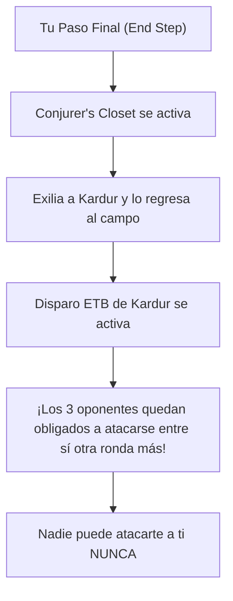

# Guía de Mejoras y Upgrades Futuros: Kardur, Doomscourge
### De Caos Forzado a Bloqueo Perpetuo de Combate y Drenaje Aristócrata (Power Level 8)

> **Mazo Base:** [`decks/kardur/kardur.txt`](file:///root/mtg/decks/kardur/kardur.txt)  
> **Guía Estratégica Base:** [`decks/kardur/kardur_guide.md`](file:///root/mtg/decks/kardur/kardur_guide.md)  
> **Comandante:** [Kardur, Doomscourge](file:///root/mtg/decks/kardur/kardur.txt#L2)  
> **Identidad de Color:** Rakdos (`{B, R}`)  
> **Presupuesto Estimado:** Escalonado en 3 fases modulares (desde 12 €).

---

## 1. Visión General: Los Cuellos de Botella de Kardur

Kardur tiene el efecto político y de disrupción más agresivo de la mesa: desvía los ataques de 3 oponentes entre ellos y te da inmunidad durante una ronda completa. Sin embargo, para dominar mesas de alto nivel necesita pulir tres aspectos:

1. **El "Bloqueo Perpetuo" (*The Flicker Lock*):** Si Kardur solo entra una vez, el efecto termina tras un turno. Si incorporas motores que lo re-disparen **todos los turnos de forma automática** (*Conjurer's Closet*, *Blade of Selves*), los rivales jamás podrán atacarte a ti en toda la partida.
2. **Drenaje de muerte general (no solo atacantes):** El disparo de Kardur solo drena cuando mueren criaturas *atacantes*. Añadiendo aristócratas clásicos (*Blood Artist*, *Zulaport Cutthroat*, *Mayhem Devil*), **cualquier criatura que muera** (bloqueadores, sacrificios o barridos) drena vidas a toda la mesa.
3. **El final en 1 vs 1:** Cuando dos oponentes mueren y solo queda uno, Kardur ya no puede forzar ataques a terceros. Necesitas finalizadores de daño directo y daño masivo (*Blasphemous Act*, *Brash Taunter*).



---

## 2. Hoja de Ruta de Adquisición por Fases

---

### FASE 1: Mejoras "Budget" de Alto Impacto (~12 € - 15 € en total)
*Motores de drenaje aristócrata y redundancia de rescate por menos de 2 € cada uno.*

| Carta a Incluir | Coste Maná | Tipo | Precio Aprox. | Rol Estratégico |
| :--- | :---: | :--- | :---: | :--- |
| **Blood Artist** | `{1}{B}` | Criatura — Vampiro | ~2.50 € | Cada vez que **cualquier criatura muere** (tuya o enemiga, atacante o bloqueadora), un jugador pierde 1 vida y tú ganas 1 vida. |
| **Zulaport Cutthroat** | `{1}{B}` | Criatura — Pícaro | ~1.50 € | Cada vez que muere una criatura tuya, cada oponente pierde 1 vida y tú ganas 1 vida. |
| **Mayhem Devil** | `{1}{B}{R}` | Criatura — Diablo | ~1.00 € | Cada vez que **cualquier jugador sacrifica un permanente** (criaturas, tesoros, *fetch lands*), inflige 1 daño a cualquier objetivo. |
| **Morbid Opportunist** | `{2}{B}` | Criatura — Humano | ~0.30 € | Si muere una criatura, robas una carta (se dispara en tu turno **y en cada turno rival**, robando hasta 4 cartas por ronda). |
| **Feign Death** | `{B}` | Instantáneo | ~0.30 € | Copia adicional de *Supernatural Stamina*: si Kardur muere, regresa al campo enderezado con un contador +1/+1 reactivando el goad. |
| **Undying Malice** | `{B}` | Instantáneo | ~0.30 € | Otra copia exacta por 1 maná para garantizar que Kardur nunca abandone el campo. |
| **Blasphemous Act** | `{8}{R}` | Conjuro | ~2.50 € | Cuesta habitualmente `{R}` en mesas pobladas y hace 13 daños a todas las criaturas. Con *Blood Artist* en mesa, liquida a todos de golpe. |
| **Disrupt Decorum** | `{2}{R}{R}` | Conjuro | ~1.50 € | Incita (*Goad*) a absolutamente todas las criaturas enemigas, sirviendo de respaldo total cuando Kardur no esté en mesa. |
| **Rakdos Signet** | `{2}` | Artefacto | ~0.50 € | Aceleración de coste 2 para bajar a Kardur un turno antes. |
| **Smoldering Marsh** | Tierra | Tierra Doble | ~0.80 € | Tierra dual con tipos de Pantano y Montaña; entra enderezada si tienes dos básicas. |

> **Resultado de la Fase 1:** Toda la mesa sangra constantemente con cada combate forzado y tienes 4 cartas de rescate para disparar a Kardur en bucle.

---

### FASE 2: Motores de Bloqueo Perpetuo y Equipos (~35 € - 45 € en total)
*Cierra por completo la posibilidad de que los oponentes puedan volver a atacarte.*

| Carta a Incluir | Coste Maná | Tipo | Precio Aprox. | Rol Estratégico |
| :--- | :---: | :--- | :---: | :--- |
| **Conjurer's Closet** | `{5}` | Artefacto | ~6.00 € | **El cerrojo supremo de Kardur.** Al inicio de tu paso final, parpadea (*flicker*) a Kardur gratis. ¡El disparo entra en cada turno tuyo, dejando a la mesa **permanentemente forzada a destruirse entre ellos sin poder atacarte jamás**! |
| **Blade of Selves** | `{2}` | Artefacto — Equipo | ~3.50 € | Otorga *Inculcar (Myriad)* a Kardur. Al atacar, creas copias de Kardur atacando a cada rival. La regla de leyendas las manda al cementerio, pero **sus disparos ETB entran y re-goadean la mesa** mientras drenan vidas. |
| **Brash Taunter** | `{4}{R}` | Criatura — Trasgo | ~1.50 € | Indestructible (1/1). Se pone delante de cualquier gigante enemigo y redirige todo el daño recibido a la cara del oponente. |
| **Malakir Rebirth // Malakir Mire** | `{B}` | Instantáneo // Tierra | ~4.50 € | Tierra que entra girada o rescate por 1 maná para reanimar a Kardur en el acto. |
| **Toxic Deluge** | `{2}{B}` | Conjuro | ~6.00 € | Limpieza de mesa barata por 3 manás para resetear el campo a bajo coste. |
| **Luxury Suite** | Tierra | Tierra Doble | ~8.00 € | La tierra dual perfecta de Commander para Rakdos: entra enderezada incondicionalmente en multijugador. |

> **Resultado de la Fase 2:** Con *Conjurer's Closet*, la partida entra en un bucle cerrado en el que tú no recibes daño y tus rivales no tienen más opción que autodestruirse.

---

### FASE 3: Upgrades de Lujo / Alta Gama (~50 €+)
*Para llevar a Kardur a mesas de máximo poder:*

* **Blood Crypt** (~12 €) y **Bloodstained Mire** (~13 €): Base de maná competitiva para jugar sin tapadas.
* **Jeska's Will** (~18 €): Rampa explosiva de 5-7 manás rojos y exilio de 3 cartas.
* **Vampiric Tutor** (~35 €): Tutor a velocidad de instantáneo por `{B}` para poner *Conjurer's Closet* o *Blasphemous Act* arriba del mazo.

---

## 3. Tabla de Sustituciones 1 a 1 (Qué entra y qué sale)

| Sale de la Lista Actual | Entra como Mejora | Motivo del Cambio |
| :--- | :--- | :--- |
| [Kathari Bomber](file:///root/mtg/decks/kardur/kardur.txt#L19) | **Blood Artist** | Cambias un pájaro prescindible por el mejor motor de drenaje de muertes del juego. |
| [Axgard Cavalry](file:///root/mtg/decks/kardur/kardur.txt#L5) | **Mayhem Devil** | Cambias dar prisa a una criatura por ametrallar a la mesa con cada sacrificio. |
| [Novice Dissector](file:///root/mtg/decks/kardur/kardur.txt#L21) | **Zulaport Cutthroat** | Sacrificar criaturas pagando maná reemplazado por drenaje automático pasivo. |
| [Immersturm Raider](file:///root/mtg/decks/kardur/kardur.txt#L17) | **Morbid Opportunist** | Cambias un 2/1 con descarte por un motor que puede robar 4 cartas por ronda. |
| [Spare Supplies](file:///root/mtg/decks/kardur/kardur.txt#L37) | **Conjurer's Closet** | Cambias un artefacto de robo menor por la pieza de bloqueo perpetuo de la mesa. |
| [Traveler's Amulet](file:///root/mtg/decks/kardur/kardur.txt#L38) | **Blade of Selves** | Sustituyes una búsqueda lenta de tierra por *Myriad* para re-disparar a Kardur en combate. |
| [Bitter Revelation](file:///root/mtg/decks/kardur/kardur.txt#L63) | **Blasphemous Act** | Cambias un conjuro de robo a velocidad lenta por el mejor wipe de coste 1 del color rojo. |
| [Skull Raid](file:///root/mtg/decks/kardur/kardur.txt#L70) | **Disrupt Decorum** | Reemplazas un descarte menor por un segundo turno garantizado de combate forzado. |
| [Base Camp](file:///root/mtg/decks/kardur/kardur.txt#L79) | **Luxury Suite** | Cambias una tierra que entra girada por la dual perfecta de Commander. |
| [Unknown Shores](file:///root/mtg/decks/kardur/kardur.txt#L91) | **Smoldering Marsh** | Cambias una tierra que te cobra maná por filtrar por una dual buscable. |

---

## 4. El Bloqueo Perpetuo de Combate: Conjurer's Closet + Kardur

```text
Condición: [Kardur, Doomscourge] en campo + [Conjurer's Closet] en campo.

1. Llegas a tu paso final (*End Step*):
   - El disparador de [Conjurer's Closet] se activa.
   - Haces objetivo a Kardur.
   - Kardur se exilia temporalmente y regresa inmediatamente al campo de batalla.

2. Se dispara la habilidad ETB de Kardur:
   - "Hasta tu próximo turno, las criaturas que controlan tus oponentes atacan cada combate si pueden y atacan a un jugador que no seas tú si pueden."

3. En los turnos de tus 3 oponentes:
   - Todas sus criaturas están obligadas a atacarse entre ellos.
   - Tienen prohibido atacarte a ti.
   - Cada criatura atacante que muera les drena 1 vida y te cura 1 vida a ti (o más si tienes a Blood Artist).

4. En tu siguiente turno:
   - Robas, juegas tus hechizos y llegas a tu paso final.
   - Conjurer's Closet vuelve a parpadear a Kardur.
   - El candado se reinicia: ¡La mesa NUNCA podrá atacarte en toda la partida!
```
