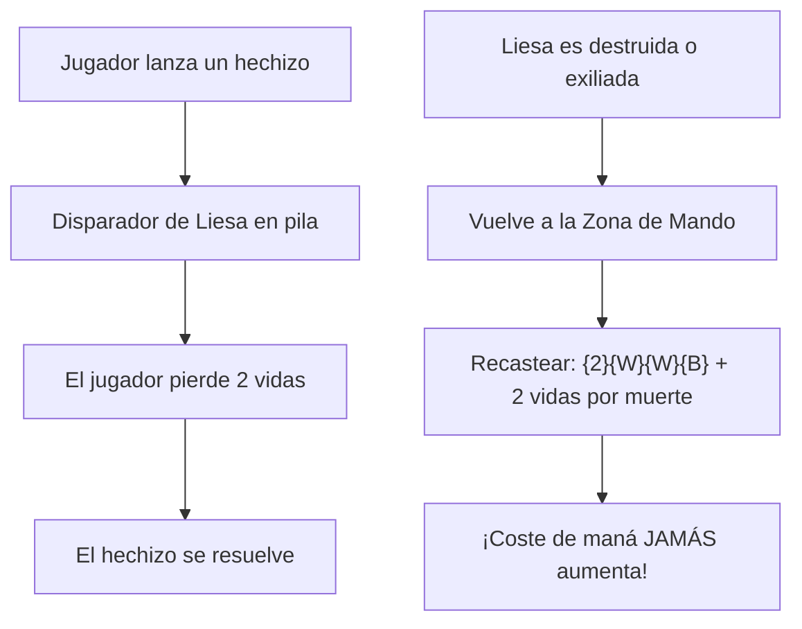
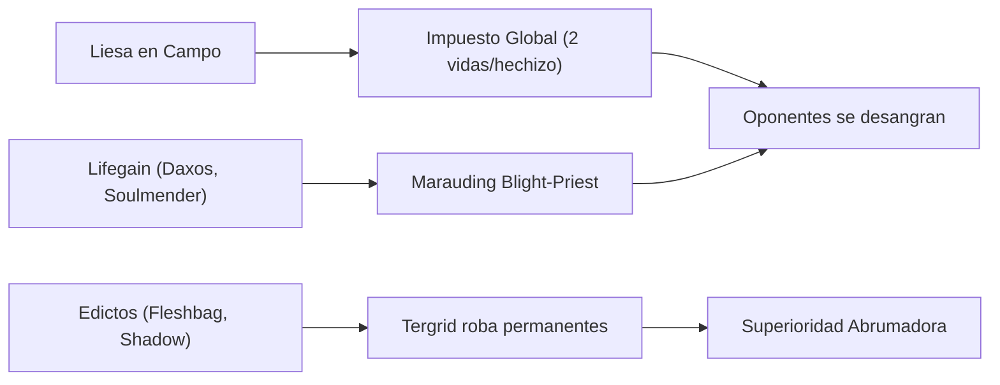

# Guía Estratégica: Liesa, Shroud of Dusk
### Control Impositivo, Drenaje de Vidas y Castigo Global (Orzhov Tax & Bleed)

> **Formato:** Commander / EDH (CR 903)  
> **Comandante:** [Liesa, Shroud of Dusk](file:///root/mtg/decks/liesa/liesa.txt#L2)  
> **Identidad de Color:** Orzhov (`{W, B}`)  
> **Total de Cartas:** 100 cartas exactas (Conforme a la normativa oficial CR 903.5)  
> **Archivo de Lista:** [`decks/liesa/liesa.txt`](file:///root/mtg/decks/liesa/liesa.txt)  
> **Compatibilidad Física:** 0 cartas en conflicto con [Adrix and Nev](file:///root/mtg/decks/adrix/adrix.txt) y [Anowon, the Ruin Thief](file:///root/mtg/decks/anowon/anowon.txt) (todas las cartas son físicamente independientes de la colección).

---

## 1. El Comandante: Mecánicas y Reglas Oficiales

| Característica | Detalle Técnico |
| :--- | :--- |
| **Coste de Maná** | `{2}{W}{W}{B}` (CMC: 5) |
| **Tipo de Carta** | Criatura Legendaria — Ángel (5/5) |
| **Palabras Clave** | Vuela (*Flying*), Vínculo vital (*Lifelink*) |
| **Regla de Impuesto Alternativo** | *"En lugar de pagar {2} por cada vez previa que hayas lanzado este hechizo desde la zona de mando este juego, pagas 2 vidas por cada vez previa."* |
| **Castigo Global por Hechizo** | *"Siempre que un jugador lance un hechizo, ese jugador pierde 2 vidas."* |



### Reglas Oficiales Clave (CR 903 & CR 118)

1. **Sustitución del Impuesto de Mando (CR 903.8 & CR 118.9):**  
   Normalmente, lanzar a tu comandante desde la zona de mando añade un coste adicional de `{2}` incoloros por cada lanzamiento previo. Liesa reemplaza este coste adicional de maná por **el pago de 2 vidas**.  
   *Consecuencia táctica:* Liesa cuesta **siempre exactamente 5 manás** `{2}{W}{W}{B}`. Si ha muerto 4 veces, no cuesta 13 manás como otros comandantes de coste 5: sigue costando 5 manás y 8 vidas. Como el mazo genera decenas de vidas pasivas, el impuesto de mando es virtualmente irrelevante.

2. **Pérdida de Vidas vs. Daño (CR 119.3 & CR 119.4):**  
   Liesa hace que el jugador **pierda 2 vidas** (*lose 2 life*), no inflige daño.  
   *Consecuencia:* No puede ser prevenido mediante efectos de prevención de daño ni genera disparadores de daño. Afecta directamente al total de vidas.

3. **Disparador en Pila antes de Resolución (CR 603.2):**  
   El disparador de pérdida de vidas va a la pila por encima del hechizo lanzado. Si un oponente lanza un hechizo estando a 2 vidas o menos, **muere antes de que su hechizo llegue a resolverse**.

4. **Sostenimiento Asimétrico (5/5 Vuela, Vínculo Vital):**  
   Liesa drena a todos, incluido a ti. Sin embargo, en cuanto ataca o bloquea, su cuerpo 5/5 con vínculo vital te recupera **5 vidas por turno** (compensando con creces los hechizos que juegues tú mientras la mesa se desangra).

---

## 2. Curva de Maná y Base de Tierras

El mazo presenta una curva media extraordinariamente controlada para Orzhov (**CMC promedio: 3.16**), evitando quedar estancado con costes altos y permitiendo operar con pocas tierras si fuera necesario.

```text
=================================================================
 MTG MANA CURVE & LAND BASE ANALYSIS
=================================================================
Total Cartas:           100 (1 Comandante, 63 Hechizos/Criaturas, 36 Tierras)
Coste Medio (CMC):      3.16
Tierras en Baraja:      36 tierras (33 convencionales + 3 MDFC)
Tierras Efectivas:      39 fuentes (incluyendo Kabira, Pelakka, Blackbloom)
Aceleradores / Rocas:   5 piezas de rampa fija (Sol Ring, Arcane Signet, etc.)
Distribución de Pips:   Negro (B): 39 pips (56.5%)  |  Blanco (W): 30 pips (43.5%)
Fuentes de Color:       20 Fuentes Blancas  |  21 Fuentes Negras
=================================================================
```

### Gráfico de Curva de Maná

```text
CMC 1: [7]  ███████ (Sol Ring, Path to Exile, Village Rites, Selfless Savior, Soulmender, Viscera Seer, Light of Hope)
CMC 2: [18] ██████████████████ (Arcane Signet, Daxos, Drannith, Fracture, Feed the Swarm, Hero's Blade, Keleth, etc.)
CMC 3: [20] ████████████████████ (Marauding Blight-Priest, Fleshbag Marauder, Banishing Light, Relic Vial, etc.)
CMC 4: [7]  ███████ (Thalia the Survivor, Mage Hunter, Dogged Pursuit, Extinction Event, Faith's Fetters, etc.)
CMC 5: [6]  ██████ (Liesa, Firja, Gray Merchant, Staunch Throneguard, Tergrid, Feast of Succession)
CMC 6: [3]  ███ (Blood on the Snow, Shepherd of the Cosmos, Radiant Serra Archangel)
CMC 7+: [3] ███ (Akroma Vision of Ixidor, Meteor Golem, In Garruk's Wake)
```

### Modelo de Frank Karsten y Fuentes de Color

Para garantizar lanzar de forma fiable hechizos con doble coste `{W}{W}` (como [Daxos, Blessed by the Sun](file:///root/mtg/decks/liesa/liesa.txt#L6), [Slaughter the Strong](file:///root/mtg/decks/liesa/liesa.txt#L75) y la propia [Liesa](file:///root/mtg/decks/liesa/liesa.txt#L2)) y doble coste `{B}{B}` (como [Gray Merchant of Asphodel](file:///root/mtg/decks/liesa/liesa.txt#L15), [Tergrid's Shadow](file:///root/mtg/decks/liesa/liesa.txt#L60) y [Blood on the Snow](file:///root/mtg/decks/liesa/liesa.txt#L64)), el modelo de Karsten exige un mínimo de **19 fuentes de cada color**.

El mazo cuenta con:
- **20 Fuentes de Maná Blanco** en tierras ([Command Tower](file:///root/mtg/decks/liesa/liesa.txt#L79), [Temple of Silence](file:///root/mtg/decks/liesa/liesa.txt#L92), [Scoured Barrens](file:///root/mtg/decks/liesa/liesa.txt#L87), [Snowfield Sinkhole](file:///root/mtg/decks/liesa/liesa.txt#L90), [Thriving Heath](file:///root/mtg/decks/liesa/liesa.txt#L94), [Kabira Takedown](file:///root/mtg/decks/liesa/liesa.txt#L81), 6 [Plains](file:///root/mtg/decks/liesa/liesa.txt#L85), 6 [Snow-Covered Plains](file:///root/mtg/decks/liesa/liesa.txt#L88), etc.).
- **21 Fuentes de Maná Negro** en tierras (los duales anteriores + [Pelakka Predation](file:///root/mtg/decks/liesa/liesa.txt#L84), [Blackbloom Rogue](file:///root/mtg/decks/liesa/liesa.txt#L78), [Great Hall of Starnheim](file:///root/mtg/decks/liesa/liesa.txt#L80), 5 [Swamp](file:///root/mtg/decks/liesa/liesa.txt#L89), 6 [Snow-Covered Swamp](file:///root/mtg/decks/liesa/liesa.txt#L89)).
- **Rampa y Buscadores Auxiliares:** [Sol Ring](file:///root/mtg/decks/liesa/liesa.txt#L42), [Arcane Signet](file:///root/mtg/decks/liesa/liesa.txt#L36), [Commander's Sphere](file:///root/mtg/decks/liesa/liesa.txt#L37), [Firemind Vessel](file:///root/mtg/decks/liesa/liesa.txt#L38), [Pilgrim's Eye](file:///root/mtg/decks/liesa/liesa.txt#L22), [Environmental Sciences](file:///root/mtg/decks/liesa/liesa.txt#L66), [Myriad Landscape](file:///root/mtg/decks/liesa/liesa.txt#L82) y [Terramorphic Expanse](file:///root/mtg/decks/liesa/liesa.txt#L93).

### La Sinergia Nevada: *Blood on the Snow* y Tierras Nevadas

El mazo incluye **13 permanentes nevados** (6 [Snow-Covered Plains](file:///root/mtg/decks/liesa/liesa.txt#L88), 6 [Snow-Covered Swamp](file:///root/mtg/decks/liesa/liesa.txt#L89) y 1 [Snowfield Sinkhole](file:///root/mtg/decks/liesa/liesa.txt#L90)).  
Al lanzar [Blood on the Snow](file:///root/mtg/decks/liesa/liesa.txt#L64) (`{4}{B}{B}`):
- Puedes destruir todas las criaturas o todos los planeswalkers.
- Gastando 5 manás de fuentes nevadas `{S}{S}{S}{S}{S}`, devuelves directamente al campo de batalla **a cualquier criatura de coste 5 o menos** de tu cementerio (a [Liesa](file:///root/mtg/decks/liesa/liesa.txt#L2), [Tergrid](file:///root/mtg/decks/liesa/liesa.txt#L30) o [Gray Merchant of Asphodel](file:///root/mtg/decks/liesa/liesa.txt#L15)) sobre una mesa completamente limpia.

---

## 3. Pilares Estratégicos del Mazo



### Pilar A: Impuesto de Mesa y Sangrado Pasivo (*Tax & Attrition*)
La estrategia principal consiste en estrangular los recursos de los oponentes castigando cada acción que realicen:
- **[Liesa, Shroud of Dusk](file:///root/mtg/decks/liesa/liesa.txt#L2):** 2 vidas por cada hechizo lanzado por cualquier jugador.
- **[Mage Hunter](file:///root/mtg/decks/liesa/liesa.txt#L18):** Cada vez que un oponente lance o copie un instantáneo o conjuro, pierde 1 vida adicional. Junto con Liesa, ¡un contrahechizo o removal les cuesta **3 vidas directas**!
- **[Thalia, the Survivor](file:///root/mtg/decks/liesa/liesa.txt#L31):** Hace que todos los hechizos que no sean de criatura de los oponentes cuesten `{1}` más de maná, ralentizando sus respuestas y artefactos.
- **[Drannith Magistrate](file:///root/mtg/decks/liesa/liesa.txt#L8):** El bloqueo definitivo en Commander. Impide a los oponentes lanzar a sus propios comandantes desde la zona de mando, y bloquea cascada, aventureros, exilio (*foretell*, *impulse draw*) y cartas del cementerio.
- **[Dogged Pursuit](file:///root/mtg/decks/liesa/liesa.txt#L47):** Drena pasivamente 1 vida a cada oponente al final de tu turno y te da 1 vida.

### Pilar B: Motor de Vidas y Drenaje Asimétrico (*Lifegain & Drain Engine*)
Para que el impuesto de Liesa solo perjudique a los rivales, el mazo genera un flujo constante de vidas que activa disparadores de castigo:
- **[Marauding Blight-Priest](file:///root/mtg/decks/liesa/liesa.txt#L19):** El motor letal del mazo. Cada vez que ganas vidas, **cada oponente pierde 1 vida**. Con Liesa golpeando en combate (5 vidas), los rivales pierden 1 vida extra. Con [Soulmender](file:///root/mtg/decks/liesa/liesa.txt#L28), [Daxos](file:///root/mtg/decks/liesa/liesa.txt#L6) o [Dogged Pursuit](file:///root/mtg/decks/liesa/liesa.txt#L47), drenas a toda la mesa cada ronda.
- **[Daxos, Blessed by the Sun](file:///root/mtg/decks/liesa/liesa.txt#L6) & [Kor Celebrant](file:///root/mtg/decks/liesa/liesa.txt#L17):** Te otorgan vida cada vez que cualquier criatura entra al campo bajo tu control (y cuando mueren en el caso de Daxos).
- **[Gray Merchant of Asphodel](file:///root/mtg/decks/liesa/liesa.txt#L15):** Con la gran cantidad de permanentes negros en mesa ([Tymaret](file:///root/mtg/decks/liesa/liesa.txt#L32), [Dogged Pursuit](file:///root/mtg/decks/liesa/liesa.txt#L47), [Tergrid](file:///root/mtg/decks/liesa/liesa.txt#L30), etc.), "Gary" entra drenando habitualmente de 6 a 12 vidas a cada oponente, dándote entre 18 y 36 vidas de golpe.
- **[Relic Vial](file:///root/mtg/decks/liesa/liesa.txt#L41):** Como el mazo incluye 9 Clérigos ([Blight-Priest](file:///root/mtg/decks/liesa/liesa.txt#L19), [Soulmender](file:///root/mtg/decks/liesa/liesa.txt#L28), [Kor Celebrant](file:///root/mtg/decks/liesa/liesa.txt#L17), [Nullpriest](file:///root/mtg/decks/liesa/liesa.txt#L21), [Firja](file:///root/mtg/decks/liesa/liesa.txt#L13), etc.), cada vez que una criatura tuya muere, cada oponente pierde 1 vida y tú ganas 1 vida.

### Pilar C: El Combo de Edictos y Hurto de Tergrid (*Tergrid Edicts*)
- **[Tergrid, God of Fright](file:///root/mtg/decks/liesa/liesa.txt#L30):** Su habilidad dice: *"Siempre que un oponente sacrifique un permanente que no sea ficha o descarte una carta de permanente, puedes poner esa carta de un cementerio en el campo de batalla bajo tu control."*
- Al combinar a Tergrid con:
  - **[Fleshbag Marauder](file:///root/mtg/decks/liesa/liesa.txt#L14) / [Demon's Disciple](file:///root/mtg/decks/liesa/liesa.txt#L7):** Cada jugador sacrifica una criatura. Si hay 3 oponentes, ¡robas las 3 mejores criaturas de la mesa!
  - **[Tergrid's Shadow](file:///root/mtg/decks/liesa/liesa.txt#L60):** A velocidad instantánea (o con *foretell* por 4 manás), cada jugador sacrifica **dos criaturas**. ¡Tergrid se queda con hasta 6 criaturas enemigas!
  - **[Elderfang Disciple](file:///root/mtg/decks/liesa/liesa.txt#L10) / [Go Blank](file:///root/mtg/decks/liesa/liesa.txt#L72):** Obliga a descartar cartas; cualquier permanente descartado va a tu lado de la mesa.

### Pilar D: Voltron y Ángeles Finalizadores (*Air Superiority*)
- **[Hero's Blade](file:///root/mtg/decks/liesa/liesa.txt#L40):** Se auto-equipa **gratis** a cualquier criatura legendaria al entrar. Al castear a Liesa, entra inmediatamente convertida en una **8/7 con Vuela y Vínculo Vital**. ¡Elimina a un rival de daño de comandante en tan solo 3 golpes y te cura 8 vidas por ataque!
- **[Akroma, Vision of Ixidor](file:///root/mtg/decks/liesa/liesa.txt#L5):** Al comienzo de cada combate (en tu turno y en el de los rivales), otorga +1/+1 por cada habilidad de palabra clave. Liesa tiene Vuela (+1/+1) y Vínculo vital (+1/+1), por lo que pasa a ser un **7/7** automáticamente en cada fase de combate.
- **[Rogue's Passage](file:///root/mtg/decks/liesa/liesa.txt#L86):** Permite hacer a Liesa inbloqueable para sentenciar a oponentes con daño de comandante letal.
- **[Radiant, Serra Archangel](file:///root/mtg/decks/liesa/liesa.txt#L23):** Ángel 6/4 que puede ganar protección contra cualquier color girando otro volador.
- **[Great Hall of Starnheim](file:///root/mtg/decks/liesa/liesa.txt#L80):** Tierra que puedes sacrificar a partida avanzada para crear un Ángel 4/4 con Vuela y Vigilancia.

---

## 4. Desglose Funcional de Cartas

| Categoría Funcional | Cantidad | Cartas Incluidas | Justificación Estratégica |
| :--- | :---: | :--- | :--- |
| **Comandante** | 1 | [Liesa, Shroud of Dusk](file:///root/mtg/decks/liesa/liesa.txt#L2) | Motor de drenaje global de 2 vidas/hechizo e impuesto alternativo por vidas. |
| **Impuestos y Control** | 4 | [Drannith Magistrate](file:///root/mtg/decks/liesa/liesa.txt#L8), [Mage Hunter](file:///root/mtg/decks/liesa/liesa.txt#L18), [Thalia, the Survivor](file:///root/mtg/decks/liesa/liesa.txt#L31), [Dogged Pursuit](file:///root/mtg/decks/liesa/liesa.txt#L47) | Cierran el juego a comandantes enemigos y castigan cada interacción rival. |
| **Drenaje y Vidas** | 8 | [Marauding Blight-Priest](file:///root/mtg/decks/liesa/liesa.txt#L19), [Gray Merchant of Asphodel](file:///root/mtg/decks/liesa/liesa.txt#L15), [Daxos](file:///root/mtg/decks/liesa/liesa.txt#L6), [Kor Celebrant](file:///root/mtg/decks/liesa/liesa.txt#L17), [Soulmender](file:///root/mtg/decks/liesa/liesa.txt#L28), [Nullpriest](file:///root/mtg/decks/liesa/liesa.txt#L21), [Screeching Soulbreaker](file:///root/mtg/decks/liesa/liesa.txt#L24), [Revitalize](file:///root/mtg/decks/liesa/liesa.txt#L59) | Convierten la ganancia de vidas en daño directo contra los 3 rivales simultáneamente. |
| **Edictos y Descarte** | 6 | [Tergrid, God of Fright](file:///root/mtg/decks/liesa/liesa.txt#L30), [Fleshbag Marauder](file:///root/mtg/decks/liesa/liesa.txt#L14), [Demon's Disciple](file:///root/mtg/decks/liesa/liesa.txt#L7), [Tergrid's Shadow](file:///root/mtg/decks/liesa/liesa.txt#L60), [Elderfang Disciple](file:///root/mtg/decks/liesa/liesa.txt#L10), [Elvish Doomsayer](file:///root/mtg/decks/liesa/liesa.txt#L11) | Sacrificio masivo que ignora indestructibilidad y permite a Tergrid robar el campo enemigo. |
| **Removal Dirigido** | 7 | [Path to Exile](file:///root/mtg/decks/liesa/liesa.txt#L55), [Fracture](file:///root/mtg/decks/liesa/liesa.txt#L53), [Feed the Swarm](file:///root/mtg/decks/liesa/liesa.txt#L69), [Banishing Light](file:///root/mtg/decks/liesa/liesa.txt#L45), [Poison the Cup](file:///root/mtg/decks/liesa/liesa.txt#L57), [Bake into a Pie](file:///root/mtg/decks/liesa/liesa.txt#L52), [Faith's Fetters](file:///root/mtg/decks/liesa/liesa.txt#L48) | Exilio incondicional y respuesta a cualquier amenaza (criaturas, artefactos, encantamientos o caminantes). |
| **Limpiezas de Mesa** | 5 | [Slaughter the Strong](file:///root/mtg/decks/liesa/liesa.txt#L75), [Extinction Event](file:///root/mtg/decks/liesa/liesa.txt#L67), [Blood on the Snow](file:///root/mtg/decks/liesa/liesa.txt#L64), [Feast of Succession](file:///root/mtg/decks/liesa/liesa.txt#L68), [In Garruk's Wake](file:///root/mtg/decks/liesa/liesa.txt#L73) | Wipes asimétricos que respetan a tus criaturas de baja fuerza o reaniman tras limpiar. |
| **Robo y Ventaja** | 8 | [Village Rites](file:///root/mtg/decks/liesa/liesa.txt#L61), [Plumb the Forbidden](file:///root/mtg/decks/liesa/liesa.txt#L56), [Funeral Rites](file:///root/mtg/decks/liesa/liesa.txt#L70), [Cast Away Doubt](file:///root/mtg/decks/liesa/liesa.txt#L65), [Relic Vial](file:///root/mtg/decks/liesa/liesa.txt#L41), [Staunch Throneguard](file:///root/mtg/decks/liesa/liesa.txt#L29), [Egon, God of Death](file:///root/mtg/decks/liesa/liesa.txt#L9), [Firja](file:///root/mtg/decks/liesa/liesa.txt#L13) | Flujo constante de cartas sacrificando fichas o reutilizando recursos del cementerio. |
| **Protección y Soporte** | 5 | [Selfless Savior](file:///root/mtg/decks/liesa/liesa.txt#L25), [Benevolent Blessing](file:///root/mtg/decks/liesa/liesa.txt#L46), [Hero's Blade](file:///root/mtg/decks/liesa/liesa.txt#L40), [Open the Armory](file:///root/mtg/decks/liesa/liesa.txt#L74), [Light of Hope](file:///root/mtg/decks/liesa/liesa.txt#L54) | Escudos de indestructibilidad y protección contra color para mantener viva a Liesa. |
| **Rematadores Aéreos** | 4 | [Akroma, Vision of Ixidor](file:///root/mtg/decks/liesa/liesa.txt#L5), [Radiant, Serra Archangel](file:///root/mtg/decks/liesa/liesa.txt#L23), [Shepherd of the Cosmos](file:///root/mtg/decks/liesa/liesa.txt#L26), [Rally of Wings](file:///root/mtg/decks/liesa/liesa.txt#L58) | Poder ofensivo en el aire para cerrar partidas en turnos tardíos. |
| **Rampa de Maná** | 7 | [Sol Ring](file:///root/mtg/decks/liesa/liesa.txt#L42), [Arcane Signet](file:///root/mtg/decks/liesa/liesa.txt#L36), [Commander's Sphere](file:///root/mtg/decks/liesa/liesa.txt#L37), [Goldvein Pick](file:///root/mtg/decks/liesa/liesa.txt#L39), [Firemind Vessel](file:///root/mtg/decks/liesa/liesa.txt#L38), [Pilgrim's Eye](file:///root/mtg/decks/liesa/liesa.txt#L22), [Environmental Sciences](file:///root/mtg/decks/liesa/liesa.txt#L66) | Aceleración para garantizar bajar a Liesa en el turno 4 o 5 sin contratiempos. |
| **Tierras (convencionales)** | 33 | 6 [Snow Plains](file:///root/mtg/decks/liesa/liesa.txt#L87), 6 [Snow Swamp](file:///root/mtg/decks/liesa/liesa.txt#L88), 6 [Plains](file:///root/mtg/decks/liesa/liesa.txt#L85), 5 [Swamp](file:///root/mtg/decks/liesa/liesa.txt#L89), duales Orzhov y utilidades | Base sólida de maná nevado y duales con ajuste según el modelo de Karsten. |
| **Tierras MDFC** | 3 | [Kabira Takedown](file:///root/mtg/decks/liesa/liesa.txt#L81), [Pelakka Predation](file:///root/mtg/decks/liesa/liesa.txt#L84), [Blackbloom Rogue](file:///root/mtg/decks/liesa/liesa.txt#L78) | Flexibilidad absoluta: tierras cuando hacen falta manás, o hechizos en el *mid-game*. |

---

## 5. Plan de Partida Turno a Turno

### Turnos 1 - 2: Rampa Temprana y Preparación
- Baja tierras enderezadas o duales con *scry* ([Temple of Silence](file:///root/mtg/decks/liesa/liesa.txt#L92)).
- Despliega aceleradores: [Sol Ring](file:///root/mtg/decks/liesa/liesa.txt#L42), [Arcane Signet](file:///root/mtg/decks/liesa/liesa.txt#L36) o [Goldvein Pick](file:///root/mtg/decks/liesa/liesa.txt#L39).
- Coloca en mesa protecciones tempranas como [Selfless Savior](file:///root/mtg/decks/liesa/liesa.txt#L25) o [Hero's Blade](file:///root/mtg/decks/liesa/liesa.txt#L40). Si juegas contra comandantes agresivos, un [Drannith Magistrate](file:///root/mtg/decks/liesa/liesa.txt#L8) de turno 2 arruinará la apertura de los tres rivales.

### Turnos 3 - 4: Establecimiento del Motor de Vidas o Edictos
- Baja piezas de desgaste: [Marauding Blight-Priest](file:///root/mtg/decks/liesa/liesa.txt#L19), [Daxos](file:///root/mtg/decks/liesa/liesa.txt#L6), [Relic Vial](file:///root/mtg/decks/liesa/liesa.txt#L41) o [Thalia, the Survivor](file:///root/mtg/decks/liesa/liesa.txt#L31).
- Si la mesa enemiga empieza a acumular amenazas problemáticas, utiliza [Fleshbag Marauder](file:///root/mtg/decks/liesa/liesa.txt#L14) o pon en *foretell* a [Tergrid's Shadow](file:///root/mtg/decks/liesa/liesa.txt#L60).
- Prepara el maná nevado para los turnos venideros.

### Turnos 5 - 6: Despliegue de Liesa y Cierre de Mesa
- Lanza a [Liesa, Shroud of Dusk](file:///root/mtg/decks/liesa/liesa.txt#L2). Si [Hero's Blade](file:///root/mtg/decks/liesa/liesa.txt#L40) está en mesa, se equipa automáticamente convirtiendo a Liesa en un **8/7 Vuela Vínculo Vital**.
- Desde ese instante, cada conjuro, instantáneo o criatura enemiga les cuesta 2 vidas. Los mazos de robo masivo o cantrips quedan incapacitados.
- Ataca con Liesa hacia el jugador con menos defensa aérea para ganar 5 u 8 vidas por turno y activar [Marauding Blight-Priest](file:///root/mtg/decks/liesa/liesa.txt#L19).

### Turno 7 en adelante: El Golpe de Gracia
- Si los oponentes intentaron estabilizarse con criaturas, limpia la mesa con [Slaughter the Strong](file:///root/mtg/decks/liesa/liesa.txt#L75) (que respeta a tus criaturas de apoyo) o con [Blood on the Snow](file:///root/mtg/decks/liesa/liesa.txt#L64) para arrasar todo y reanimar a Liesa o Tergrid.
- Lanza a [Gray Merchant of Asphodel](file:///root/mtg/decks/liesa/liesa.txt#L15) para rematar las últimas 8-10 vidas de los rivales que ya estaban desangrados por el impuesto.
- O bien despliega a [Akroma, Vision of Ixidor](file:///root/mtg/decks/liesa/liesa.txt#L5) o [In Garruk's Wake](file:///root/mtg/decks/liesa/liesa.txt#L73) para un asalto aéreo definitivo e imparable.

---

## 6. Sinergias Avanzadas y Reglas Clave

1. **La "Inmortalidad" de Liesa en Mando:**  
   Cuando un oponente gasta un removal de 3 manás para destruir a Liesa, él ha perdido 2 vidas por castear el removal. En tu siguiente turno, recastear a Liesa cuesta exactamente los mismos 5 manás `{2}{W}{W}{B}` y tú pagas 2 vidas. Has cambiado 2 vidas por obligarle a gastar una carta clave, y en tu fase de combate recuperas 5 vidas.

2. **Edictos Simultáneos y Tergrid:**  
   Al resolver [Fleshbag Marauder](file:///root/mtg/decks/liesa/liesa.txt#L14) con [Tergrid](file:///root/mtg/decks/liesa/liesa.txt#L30) en mesa, todos los oponentes eligen y sacrifican simultáneamente en orden APNAP (*Active Player, Non-Active Player*). Cada carta que toque el cementerio dispara a Tergrid, colocándose todas bajo tu control.

3. **Slaughter the Strong como Limpieza Asimétrica:**  
   [Slaughter the Strong](file:///root/mtg/decks/liesa/liesa.txt#L75) hace que cada jugador conserve criaturas cuya fuerza total sea 4 o menos. Tus criaturas utilitarias ([Drannith](file:///root/mtg/decks/liesa/liesa.txt#L8) es 1/3, [Daxos](file:///root/mtg/decks/liesa/liesa.txt#L6) es 2/X, [Blight-Priest](file:///root/mtg/decks/liesa/liesa.txt#L19) es 3/2, [Soulmender](file:///root/mtg/decks/liesa/liesa.txt#L28) es 1/1) sobreviven, mientras los dragones, titanes y comandantes gigantes enemigos son destruidos sin posibilidad de regeneración.

4. **El Freno Definitivo contra Mazos Spellslinger / Storm:**  
   Contra mazos que buscan jugar 5 o 6 hechizos en un turno para combar, la presencia de Liesa combinada con [Mage Hunter](file:///root/mtg/decks/liesa/liesa.txt#L18) significa que cada hechizo les cuesta 3 vidas directas. Intentar resolver su combo les provocaría la muerte por pérdida de vidas antes de que puedan completar la secuencia.
