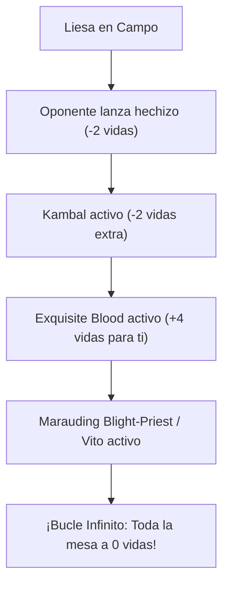

# Guía de Mejoras y Upgrades Futuros: Liesa, Shroud of Dusk
### De Nivel Casual/Equilibrado a Nivel Optimizado (Power Level 8)

> **Mazo Base:** [`decks/liesa/liesa.txt`](file:///root/mtg/decks/liesa/liesa.txt)  
> **Guía Estratégica Base:** [`decks/liesa/liesa_guide.md`](file:///root/mtg/decks/liesa/liesa_guide.md)  
> **Comandante:** [Liesa, Shroud of Dusk](file:///root/mtg/decks/liesa/liesa.txt#L2)  
> **Presupuesto Estimado Total:** ~80 € - 100 € (adquirible en fases modulares desde 10 €).

---

## 1. Visión General: Los Tres Cuellos de Botella de Liesa

El mazo actual construido con tu colección es muy consistente y autosuficiente. Sin embargo, para dar un salto cuantitativo de nivel, debe solucionar tres limitaciones naturales:

1. **La simetría del impuesto:** Liesa te cobra 2 vidas por hechizo a ti también. La solución es incorporar **ganancia pasiva de vidas en turno rival** (*Soul Sisters*) para que lanzar tus hechizos te resulte gratis.
2. **La velocidad del Comandante:** Bajar a Liesa en turno 5 es decente, pero bajarla en **turno 3 o 4** cambia drásticamente la partida antes de que los rivales desarrollen su rampa.
3. **El cierre de partida:** Añadir una condición de victoria de combo instantáneo (*Exquisite Blood*) o amplificadores de drenaje (*Vito*, *Kambal*) para evitar que los rivales puedan estabilizarse.



---

## 2. Hoja de Ruta de Adquisición por Fases (Presupuesto Escalonado)

Para que puedas estudiarlo con calma sin desembolsar 100 € de golpe, la mejora está dividida en **3 fases independientes**:

---

### FASE 1: Mejoras "Budget" de Alto Impacto (~10 € - 15 € en total)
*Son cartas extremadamente baratas (muchas de 0.50 € a 2 €) que disparan el rendimiento del mazo desde el primer día.*

| Carta a Incluir | Coste Maná | Tipo | Precio Aprox. | Rol Estratégico |
| :--- | :---: | :--- | :---: | :--- |
| **Swords to Plowshares** | `{W}` | Instantáneo | ~1.50 € | El mejor removal de criaturas de la historia de Magic: exilio incondicional por 1 maná. |
| **Soul Warden** | `{W}` | Criatura (1/1) | ~1.50 € | Ganas 1 vida cada vez que cualquier criatura entra al campo bajo cualquier jugador. |
| **Soul's Attendant** | `{W}` | Criatura (1/1) | ~1.50 € | Copia exacta funcional de Soul Warden. Te genera decenas de vidas pasivas gratis. |
| **Authority of the Consuls** | `{W}` | Encantamiento | ~2.50 € | Las criaturas enemigas entran giradas (frena atacantes rápidos) y ganas 1 vida por cada una. |
| **Kambal, Consul of Allocation** | `{1}{W}{B}` | Criatura (2/3) | ~1.80 € | Los no-criatura enemigos les cuestan 2 vidas y te curan 2. Con Liesa son **4 vidas de castigo**. |
| **Blind Obedience** | `{1}{W}` | Encantamiento | ~2.00 € | Artefactos y criaturas rivales entran girados. Añade la mecánica de *Extorsionar*. |
| **Talisman of Hierarchy** | `{2}` | Artefacto | ~0.80 € | Roca de maná rápida de turno 2 para bajar a Liesa en turno 3 o 4. |
| **Orzhov Signet** | `{2}` | Artefacto | ~0.50 € | Aceleración eficiente de 2 manás para fijar `{W}{B}`. |
| **Caves of Koilos** | Tierra | Tierra Doble | ~0.50 € | Tierra que da incoloro gratis o maná de color por 1 vida (enderezada siempre). |

> **Resultado de la Fase 1:** Por apenas 12-15 €, el mazo gana una velocidad tremenda, duplica el castigo de mesa y anula por completo la pérdida de vidas propia.

---

### FASE 2: Los Rematadores y Motores de Victoria (~35 € - 45 € en total)
*Aquí entran las cartas definitorias que otorgan combos de victoria inmediata y protección total.*

| Carta a Incluir | Coste Maná | Tipo | Precio Aprox. | Rol Estratégico |
| :--- | :---: | :--- | :---: | :--- |
| **Exquisite Blood** *(Sangre exquisita)* | `{4}{B}` | Encantamiento | ~18.00 € | **La pieza reina.** Cada vez que un rival pierde vida, tú la ganas. Con Liesa te cura con cada hechizo rival. Con [Blight-Priest](file:///root/mtg/decks/liesa/liesa.txt#L19) o *Vito*, es **victoria infinita inmediata**. |
| **Vito, Thorn of the Dusk Rose** | `{2}{B}` | Criatura (1/3) | ~4.00 € | Cada vez que ganas vidas, un rival pierde esa cantidad. Convierte el ataque de Liesa en 10 daños. |
| **Toxic Deluge** | `{2}{B}` | Conjuro | ~6.00 € | Limpieza de mesa por 3 manás que ignora *Indestructible* pagando vidas. |
| **Lightning Greaves** | `{2}` | Artefacto — Equipo | ~4.50 € | Da *Prisa* y *Velo* gratis a Liesa para golpear el mismo turno que entra y protegerla de removal. |
| **Vault of Champions** | Tierra | Tierra Doble | ~6.50 € | La tierra dual perfecta para Commander: entra enderezada incondicionalmente en multijugador. |
| **Godless Shrine** | Tierra | Tierra Doble | ~9.00 € | *Shock land* Orzhov: entra enderezada pagando 2 vidas. Buscable con efectos de pantano/llanura. |

> **Resultado de la Fase 2:** El mazo adquiere una condición de victoria contundente e ineludible, además de contar con la mejor limpieza de mesa negra del juego.

---

### FASE 3: Upgrades de Lujo / Nivel Competitivo Alto (~50 €+)
*Cartas de alta gama para cuando quieras exprimir el 100% absoluto del potencial del arquetipo.*

* **Smothering Tithe** (~18 €): Rampa incontrolable en blanco; genera entre 3 y 6 tesoros en cada ronda de mesa.
* **Esper Sentinel** (~28 €): Motor de robo por 1 maná que castiga a los rivales por no pagar maná extra.
* **Teferi's Protection** (~26 €): El mejor hechizo de salvación de Magic; te hace inmune a perder el juego o a ser barrido de la mesa.
* **Demonic Tutor** (~32 €) o **Vampiric Tutor** (~35 €): Buscan en tu biblioteca la carta exacta que te dé la victoria o la respuesta que necesitas.

---

## 3. Tabla de Sustituciones Directas (Qué entra y qué sale)

Cuando decidas adquirir cartas de estas fases, esta es la tabla exacta de cambios 1 a 1 para mantener el equilibrio de curva y roles:

| Sale de la Lista Actual | Entra como Mejora | Motivo del Cambio |
| :--- | :--- | :--- |
| [Cast Away Doubt](file:///root/mtg/decks/liesa/liesa.txt#L65) | **Kambal, Consul of Allocation** | Cambias un robo mediocre de 3 manás por un comandante secundario letal. |
| [Faith's Fetters](file:///root/mtg/decks/liesa/liesa.txt#L48) | **Swords to Plowshares** | Cambias un removal lento de coste 4 por el mejor exilio incondicional de coste 1. |
| [Filigree Familiar](file:///root/mtg/decks/liesa/liesa.txt#L12) | **Soul Warden** | Pagas 1 maná en vez de 3 y obtienes decenas de vidas pasivas en vez de solo 2. |
| [Screeching Soulbreaker](file:///root/mtg/decks/liesa/liesa.txt#L24) | **Soul's Attendant** | Redundancia de ganancia de vidas para neutralizar el impuesto de Liesa. |
| [Pilgrim's Eye](file:///root/mtg/decks/liesa/liesa.txt#L22) | **Talisman of Hierarchy** | La roca de coste 2 acelera a Liesa a turno 3; el pájaro de coste 3 llega tarde. |
| [Firemind Vessel](file:///root/mtg/decks/liesa/liesa.txt#L38) | **Orzhov Signet** | Bajar el coste de la rampa de coste 4 a coste 2 agiliza toda la mano inicial. |
| [In Garruk's Wake](file:///root/mtg/decks/liesa/liesa.txt#L73) | **Toxic Deluge** | 9 manás suele ser una carta muerta en mano; Deluge limpia la mesa por 3 manás. |
| [Dogged Pursuit](file:///root/mtg/decks/liesa/liesa.txt#L47) | **Exquisite Blood** | Sustituir un drenaje pasivo de 1 vida por el combo infinito de victoria. |
| [Soulmender](file:///root/mtg/decks/liesa/liesa.txt#L28) | **Authority of the Consuls** | Frenar atacantes rivales y ganar vida por cada criatura enemiga supera a girar un 1/1. |
| [Light of Hope](file:///root/mtg/decks/liesa/liesa.txt#L54) | **Vito, Thorn of the Dusk Rose** | Añade una amenaza masiva que duplica el daño de cada ataque de Liesa. |
| [Snowfield Sinkhole](file:///root/mtg/decks/liesa/liesa.txt#L90) | **Caves of Koilos** | Elimina una tierra que entra girada por una que entra enderezada de inmediato. |
| [Scoured Barrens](file:///root/mtg/decks/liesa/liesa.txt#L87) | **Vault of Champions** | Tierra dual incondicionalmente enderezada para jugar en curva perfecta. |

---

## 4. El Combo Infinito Explicado: Exquisite Blood + Blight-Priest / Vito

Si decides dar el paso a la Fase 2, desbloqueas una de las combinaciones más famosas y limpias de Magic:

```text
Condición en mesa: [Exquisite Blood] + [Marauding Blight-Priest] (o [Vito])

1. Ocurre cualquier evento que altere la vida:
   - Atacas con Liesa (ganas vida por vínculo vital).
   - O bien un oponente lanza un hechizo (pierde 2 vidas por Liesa).
   - O un oponente recibe 1 punto de daño de combate.

2. Se inicia el bucle:
   a) Un oponente pierde vida -> Exquisite Blood se dispara y te da esa misma cantidad de vida.
   b) Al ganar vida -> Marauding Blight-Priest se dispara y hace que CADA oponente pierda 1 vida.
   c) Los oponentes pierden vida -> Exquisite Blood se dispara de nuevo.

3. Resultado:
   El ciclo se repite de manera infinita hasta que todos los oponentes llegan a 0 vidas.
```

---

## 5. Conclusión y Recomendación

No hay ninguna prisa por gastar dinero de golpe. El mazo que tienes actualmente en [`decks/liesa/liesa.txt`](file:///root/mtg/decks/liesa/liesa.txt) es plenamente funcional y competitivo en mesas casuales.

Si en el futuro te apetece darle un empujón:
1. Empieza únicamente por la **Fase 1 (~12 €)**: con solo *Swords to Plowshares*, *Kambal*, *Soul Warden* y las dos rocas de 2 manás notarás que el mazo vuela.
2. Si más adelante quieres llevarlo a torneos de tienda o mesas de alta potencia, incorpora *Exquisite Blood* y *Toxic Deluge*.
