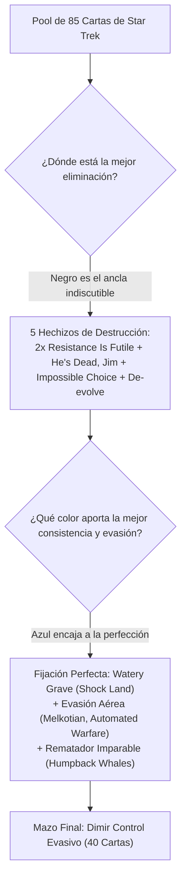

# Guía de Construcción y Estrategia: Torneo de Presentación Star Trek (`TRK`)

**Formato**: Limitado (Mazo Sellado / Sealed Deck - 40 cartas, según Magic Comprehensive Rules CR 100.2b)  
**Colores**: Dimir (`{U}{B}`: Azul / Negro)  
**Arquetipo**: Control Evasivo, Tempo de Rebote y Sinergia de Dilemas  
**Estructura**: 15 Criaturas, 8 Hechizos, 17 Tierras (Curva Media: **3.26**)  
**Pool de Cartas**: **100% de las cartas que abriste en tu caja de presentación de Star Trek** ([`ManaBox_Collection.csv`](file:///root/mtg/ManaBox_Collection.csv))

---

## 1. ¿Por qué Dimir (`{U}{B}`) era la Mejor Elección de tu Pool?

En el formato de Mazo Sellado (Sealed Deck), los tres factores que deciden el 90% de las victorias son: **Eliminación (Removal)**, **Evasión** y **Consistencia de Maná**.

Al analizar las 85 cartas que abriste en tus 6 sobres de presentación, **la combinación Azul / Negra es objetivamente superior** a cualquier otra opción:



### Análisis por Colores: Por qué descartar los otros
* **Negro (El Ancla del Mazo - 16 cartas)**: Abrir **dos copias de [`Resistance Is Futile`](file:///root/mtg/decks/presentacion/star_trek/star_trek.txt#L29)** en un mismo sellado es una bendición. Sumado a [`He's Dead, Jim`](file:///root/mtg/decks/presentacion/star_trek/star_trek.txt#L23) e [`Impossible Choice`](file:///root/mtg/decks/presentacion/star_trek/star_trek.txt#L24), tienes el mejor arsenal de eliminación del torneo.
* **Azul (La Pareja Perfecta - 13 cartas)**: Te aporta la carta bicolor legendaria del arquetipo ([`Lore, Positronic Provocateur`](file:///root/mtg/decks/presentacion/star_trek/star_trek.txt#L11)), la tierra doble desgirada ([`Watery Grave`](file:///root/mtg/decks/presentacion/star_trek/star_trek.txt#L38)), rebote masivo con retorno ([`Energize`](file:///root/mtg/decks/presentacion/star_trek/star_trek.txt#L28) e [`Interstellar Effigy`](file:///root/mtg/decks/presentacion/star_trek/star_trek.txt#L10)) y un volador 5/6 intocable ([`Humpback Whales`](file:///root/mtg/decks/presentacion/star_trek/star_trek.txt#L9)).
* **Por qué NO Rojo**: Aunque abriste a [`Pah-Wraith`](file:///root/mtg/decks/presentacion/star_trek/star_trek.txt#L71), cuesta `{5}{R}{R}` (dos manás rojos específicos) y [`Dominion Infiltration`](file:///root/mtg/decks/presentacion/star_trek/star_trek.txt#L56) cuesta `{X}{R}{R}{R}` (triple rojo). Forzar rojo como color secundario o salpique te habría condenado a atascos de maná frecuentes.
* **Por qué NO Verde**: Verde tenía buenos cuerpos, pero casi cero eliminación (solo un conjuro de morder) y carecía de formas de interactuar con voladores rivales.
* **Por qué NO Blanco**: Cartas como [`Peace in Our Time`](file:///root/mtg/decks/presentacion/star_trek/star_trek.txt#L73) son terribles en limitado (le dan cartas gratis al oponente) y el resto de criaturas blancas no tenían la agresividad necesaria.

---

## 2. Los Grandes Motores del Mazo

### A. La Fábrica de Dilemas
En Star Trek, varias cartas tienen efectos modales ("Elige uno"):
* [`Melkotian Adjudicator`](file:///root/mtg/decks/presentacion/star_trek/star_trek.txt#L12) es un 2/1 con Volar y Vigilancia que **pone un contador +1/+1 cada vez que te enfrentas a un dilema**.
* [`Obsidian Order Operative`](file:///root/mtg/decks/presentacion/star_trek/star_trek.txt#L13) drena 1 vida a cada oponente y te cura 1 vida cada vez que eliges modos.
* **¿Qué activa esto?**: [`Resistance Is Futile`](file:///root/mtg/decks/presentacion/star_trek/star_trek.txt#L29) (modal), [`Consider the Prime Directive`](file:///root/mtg/decks/presentacion/star_trek/star_trek.txt#L22) (modal), [`Impossible Choice`](file:///root/mtg/decks/presentacion/star_trek/star_trek.txt#L24) (modal) y [`Lore`](file:///root/mtg/decks/presentacion/star_trek/star_trek.txt#L11) (modal). ¡Cada vez que lanzas una respuesta eliminas una amenaza rival y haces crecer a tus criaturas voladoras!

### B. El Circuito de Reciclaje de Artefactos
* [`Resistance Is Futile`](file:///root/mtg/decks/presentacion/star_trek/star_trek.txt#L29) tiene un segundo modo devastador: *"Regresa una carta de artefacto criatura de coste 3 o menos de tu cementerio al campo de batalla"*.
* Te permite reanimar gratis a [`Lore`](file:///root/mtg/decks/presentacion/star_trek/star_trek.txt#L11) (para dar inbloqueable otra vez), a [`Automated Warfare System`](file:///root/mtg/decks/presentacion/star_trek/star_trek.txt#L2) (tu volador de robo) o a tu [`Assault Drone`](file:///root/mtg/decks/presentacion/star_trek/star_trek.txt#L3).

### C. La Fortaleza Imbatible de Fin de Partida
* [`Humpback Whales`](file:///root/mtg/decks/presentacion/star_trek/star_trek.txt#L9) (5/6 Vigilancia, Protección {2}): En limitado de 40 cartas, una criatura 5/6 con vigilancia domina completamente el combate, y el coste de protección de 2 manás adicionales impide que los oponentes la maten con facilidad.
* [`Rogue Artificial Intelligence`](file:///root/mtg/decks/presentacion/star_trek/star_trek.txt#L14) (5/4): Si no tienes tierras en los primeros turnos, la ciclas por `{2}` para buscar un Pantano básico. Si la bajas en turno 6, te cura 3 vidas o hace Vigilar 2 para encontrar el remate.

---

## 3. Curva de Maná y Base de Tierras

```text
CMC 1: █ (1)
CMC 2: ███████ (7)
CMC 3: ███████ (7)
CMC 4: ███ (3)
CMC 5: ███ (3)
CMC 6: ██ (2)
```

### Base de Tierras (17 Tierras):
* 1 [`Watery Grave`](file:///root/mtg/decks/presentacion/star_trek/star_trek.txt#L38) (Shock Land: entra desgirada por 2 vidas).
* 1 [`The Unicomplex`](file:///root/mtg/decks/presentacion/star_trek/star_trek.txt#L37) (Tierra negra que entra desgirada si controlas 2 o más tierras y permite recuperar una criatura o hacer Vigilar 1).
* 8 Pantanos básicos (`Swamp`).
* 7 Islas básicas (`Island`).

**Fuentes**: 10 fuentes de Maná Negro y 8 fuentes de Maná Azul. Equilibrio perfecto para asegurar tus hechizos de coste 2 desde los primeros compases.

---

## 4. Guía de Banquilleo (Sideboard) Durante el Torneo

Entre partidas de cada ronda del torneo, puedes modificar tu mazo con las 55 cartas restantes de tu banquillo ([`SIDEBOARD`](file:///root/mtg/decks/presentacion/star_trek/star_trek.txt#L40)):

* **Contra mazos muy lentos o cargados de bichos gigantes**:
  * **Entra**: [`Rules of Acquisition`](file:///root/mtg/decks/presentacion/star_trek/star_trek.txt#L80) (robar su mejor criatura o robar 3 cartas) y [`Guidance Failure`](file:///root/mtg/decks/presentacion/star_trek/star_trek.txt#L64) (contrahechizo duro).
  * **Sale**: [`De-evolve`](file:///root/mtg/decks/presentacion/star_trek/star_trek.txt#L33) o [`Fugitive Listener`](file:///root/mtg/decks/presentacion/star_trek/star_trek.txt#L7).
* **Contra mazos ultra-rápidos y agresivos**:
  * **Entra**: [`A Good Day to Die`](file:///root/mtg/decks/presentacion/star_trek/star_trek.txt#L42) (truco de combate de 1 maná que reemplaza carta al morir).
  * **Sale**: [`Hoshi Sato, Exolinguist`](file:///root/mtg/decks/presentacion/star_trek/star_trek.txt#L8).
* **Contra mazos plagados de artefactos**:
  * **Entra**: [`Starfleet Spanner Jockey`](file:///root/mtg/decks/presentacion/star_trek/star_trek.txt#L85) (muro 1/3) o [`Warp Core`](file:///root/mtg/decks/presentacion/star_trek/star_trek.txt#L95).
